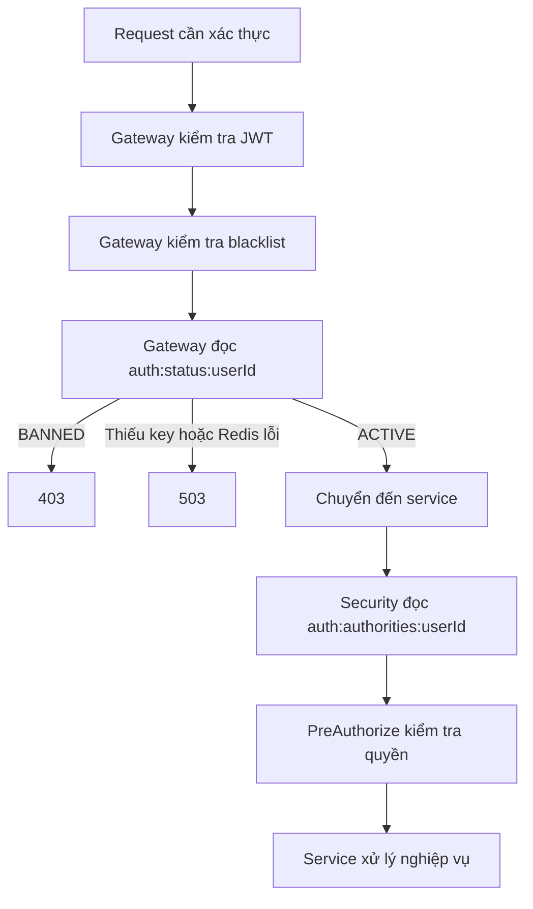

# Kế hoạch refactor authentication, authorization và user status

- Ngày lập: 2026-10-15.
- Trạng thái: Đã triển khai và kiểm chứng ngày 2026-10-15.
- Mục tiêu: JWT xác nhận danh tính, Redis cung cấp authorities và user status; loại bỏ kiểm tra account active thủ công trong các service nghiệp vụ.

## 1. Hành vi đích của hệ thống

Luồng request cần xác thực sau refactor:



### Phân công trách nhiệm

| Thành phần | Trách nhiệm |
|---|---|
| User-service | Sở hữu role, permission, user status; ghi dữ liệu xác thực vào Redis |
| API Gateway | Xác thực JWT, kiểm tra blacklist và user status |
| Security của từng service | Đọc authorities từ Redis, thực thi phân quyền |
| Service nghiệp vụ | Xử lý nghiệp vụ và quyền gắn với tài nguyên |

### Quy ước lỗi

| Trường hợp | HTTP |
|---|---:|
| Thiếu JWT bắt buộc, JWT không hợp lệ, hết hạn hoặc bị thu hồi | `401` |
| Account bị ban | `403` |
| Không có quyền thực hiện hành động | `403` |
| Redis lỗi, timeout, thiếu key hoặc dữ liệu xác thực hỏng | `503` |

Các lỗi validation, tài nguyên không tồn tại và lỗi nghiệp vụ khác tiếp tục theo contract tương ứng.

## 2. Phạm vi module cần thay đổi

| Module | Thay đổi chính |
|---|---|
| `user-service` | Refactor cấp token, ghi Redis, lấy authorities từ Redis, xóa kiểm tra active thủ công |
| `api-gateway` | Thêm kiểm tra user status sau xác thực JWT/blacklist |
| `channel-service`, `payment-service`, `notification-service` | Thay converter đọc `scope` bằng converter đọc authorities từ Redis; bổ sung/chuẩn hóa Redis dependency, cấu hình kết nối và xử lý lỗi security |
| `web-app` | Điều chỉnh cách xử lý lỗi `503` trong kiểm tra phiên đăng nhập |
| `stream-service`, `vod-service`, `chat-service`, `mobile-app` | Hiện chưa có luồng phân quyền tương ứng để refactor; ghi nhận contract cho phần triển khai sau |

Ba service channel, payment và notification áp dụng cùng cơ chế đọc authorities và xử lý lỗi. Khác biệt triển khai chỉ nằm ở dependency/config hiện có: channel-service và payment-service cần bổ sung Redis dependency; notification-service đã có dependency nhưng cần chuẩn hóa cấu hình kết nối auth Redis. Chi tiết tại mục 7.

Repo hiện chưa có API ban/unban hoặc quản lý role/permission. Luồng thay đổi role đang có là become-streamer. Tạo cơ chế đồng bộ dùng chung để các API đó tích hợp sau này.

Phạm vi lần này chỉ xử lý authorities và `users.status`. Quyền moderator theo channel, ban chat, ban view, trạng thái streamer bị suspend và kết nối WebSocket đang mở thuộc nghiệp vụ riêng.

## 3. Chuẩn hóa dữ liệu Redis

Giữ đúng hai key nghiệp vụ đã thống nhất:

```text
auth:authorities:{userId}
→ ["ROLE_USER", "ROLE_STREAMER", "CHANNEL_UPDATE"]

auth:status:{userId}
→ ACTIVE hoặc BANNED
```

### Định dạng và quyền truy cập

- Authorities lưu bằng Redis String chứa JSON array.
- Role có prefix `ROLE_`; permission giữ nguyên tên hiện tại.
- Loại bỏ authorities trùng nhau, sắp xếp ổn định để dễ kiểm tra.
- `[]` là dữ liệu hợp lệ: user đã xác thực nhưng không có authorities.
- Key không tồn tại, JSON sai định dạng hoặc status không hợp lệ → `503`.
- Các consumer chỉ đọc; user-service quản lý việc ghi.
- Request thông thường không gọi user-service khi Redis thiếu key.
- Không cache authorities/status trong bộ nhớ service để quyền mới có hiệu lực từ request tiếp theo.

### TTL và vòng đời

```text
TTL auth state = TTL refresh token + khoảng đệm cấu hình được
```

Ví dụ khoảng đệm mặc định có thể là 60 giây.

Mỗi lần phát hành cặp token:

- Cập nhật cả authorities và status.
- Gia hạn TTL cho cả hai key.
- Ghi hai key trong một thao tác Redis có tính nguyên tử.
- Các thao tác đổi quyền/status không được vô tình làm mất TTL hoặc rút ngắn thời gian sống đang có.
- Logout chỉ thu hồi token tương ứng, không xóa hai key dùng chung giữa các thiết bị.

Redis hỗ trợ thực thi script nguyên tử để phối hợp cập nhật các key. Tham khảo [Scripting with Lua](https://redis.io/docs/latest/develop/programmability/eval-intro/).

## 4. Refactor phần cấp token trong user-service

Phần hiện tại nằm tại [AuthServiceImpl.java](../../user-service/src/main/java/com/reallive/userservice/auth/service/impl/AuthServiceImpl.java).

### Tách trách nhiệm

| Thành phần dự kiến | Trách nhiệm |
|---|---|
| `auth.service.AuthTokenService` | Điều phối phát hành cặp token và chuẩn bị auth state |
| `auth.util.UserAuthoritiesMapper` | Chuyển role/permission thành danh sách authorities |
| `auth.adapter.redis.AuthStateStore` | Contract ghi/cập nhật auth state |
| `auth.adapter.redis.RedisAuthStateStore` | Redis commands, serialization, TTL và thao tác nguyên tử |
| `common.security.TokenIssuancePolicy` | Điều kiện tài khoản được phép nhận access/refresh token |

### Các bước thay đổi

1. Xóa claim `scope` khỏi cả access token và refresh token.
2. Giữ `sub`, `iss`, `iat`, `exp`, `jti`, `type` và thuật toán ký hiện tại.
3. Thay `buildScope()` bằng mapper tạo danh sách authorities.
4. Gom mọi đường phát hành token vào cùng một luồng:
   - Login.
   - Register đang tự đăng nhập.
   - Refresh.
   - Change password đang phát hành token mới.
5. Mỗi lần phát hành cặp token chỉ đồng bộ auth state một lần.
6. Chỉ trả token/cookie thành công sau khi auth state đã được đồng bộ.

### Điều kiện cấp token cho tài khoản

- Xóa các kiểm tra `isActive()`/`validateActive()` đang rải trong `AuthServiceImpl`.
- Gom điều kiện không cấp access/refresh token cho account bị ban vào `TokenIssuancePolicy`.
- Login sai credentials vẫn xử lý lỗi xác thực; credentials đúng nhưng account bị ban → `403`.
- Refresh của account bị ban → `403`.

Điều này cần thiết vì login/refresh là `permitAll` và không qua bước kiểm tra account status của gateway.

Các API public như forgot-password, verify-reset-otp và reset-password được bỏ kiểm tra active thủ công theo phạm vi đã thống nhất. Chúng vẫn kiểm tra user tồn tại, OTP/reset token và các điều kiện riêng của luồng đặt lại mật khẩu.

## 5. Đồng bộ Redis khi đổi quyền/status và xử lý transaction

Áp dụng trước cho [StreamerRegistrationServiceImpl.java](../../user-service/src/main/java/com/reallive/userservice/streamer/service/impl/StreamerRegistrationServiceImpl.java).

Luồng become-streamer:

```text
Kiểm tra điều kiện nghiệp vụ
→ Cập nhật user role và streamer
→ Hoàn thành transaction database
→ Đồng bộ authorities vào Redis
→ Trả thành công
```

### Yêu cầu transaction

- Không cập nhật Redis trước khi database commit.
- Nếu transaction rollback, Redis không nhận quyền mới.
- API trả thành công thì request tiếp theo phải đọc được authorities mới.
- Đọc đủ `roles.permissions` trong transaction; không dùng lazy entity đã đóng session.
- Luồng gọi channel-service hiện tại tiếp tục nằm trong quy trình đăng ký streamer.

Spring hỗ trợ gắn xử lý vào giai đoạn sau commit; cần dùng đúng transaction boundary khi đọc lại dữ liệu. Tham khảo [Transaction-bound Events](https://docs.spring.io/spring-framework/reference/data-access/transaction/event.html).

### Đồng bộ thất bại và cập nhật đồng thời

Bổ sung:

- Một revision nội bộ cho auth state của user.
- Metadata revision phía Redis, tách khỏi hai value nghiệp vụ đã chốt.
- Ghi có điều kiện để snapshot cũ không ghi đè quyền/status mới.
- Một bảng tác vụ đồng bộ trong user-service, ghi cùng transaction thay đổi quyền/status.
- Sau commit, thử đồng bộ ngay; tác vụ còn lại được worker retry theo dữ liệu mới nhất.

Revision này phục vụ đồng bộ dữ liệu, không đưa vào JWT.

Nếu database đã commit nhưng ghi Redis thất bại, API trả `503`; database đã thay đổi và tác vụ đồng bộ còn chờ xử lý. Worker chỉ sửa auth state, không chạy lại toàn bộ become-streamer.

### Tích hợp các thao tác thay đổi auth state

Các API ban/unban và quản lý role sau này phải sử dụng cùng cơ chế này:

| Thao tác | Auth state cần cập nhật |
|---|---|
| Gán/gỡ role cho user | Authorities |
| Thêm/gỡ permission của role | Authorities của các user bị ảnh hưởng |
| Ban/unban account | Status |
| Phát hành cặp token | Authorities và status |

## 6. Thêm kiểm tra status tại API Gateway

Các file chính:

- [AuthenticationGlobalFilter.java](../../api-gateway/src/main/java/com/reallive/apigateway/filter/AuthenticationGlobalFilter.java).
- [CookieAuthenticationService.java](../../api-gateway/src/main/java/com/reallive/apigateway/security/CookieAuthenticationService.java).
- [JwtClaimsValidator.java](../../api-gateway/src/main/java/com/reallive/apigateway/security/JwtClaimsValidator.java).

### Thứ tự xử lý

1. Bỏ logic liên quan đến `scope` trong validator.
2. Giữ kiểm tra chữ ký, issuer, thời hạn, subject, token type, `jti` và blacklist.
3. Sau khi xác thực cookie và đối chiếu subject, lấy userId của request.
4. Với endpoint cần xác thực, đọc `auth:status:{userId}` đúng một lần.
5. `ACTIVE` → forward.
6. `BANNED` → `403`.
7. Redis lỗi, timeout hoặc thiếu status → `503`.

Thêm Redis adapter dùng `ReactiveStringRedisTemplate`; không thực hiện blocking Redis I/O trên luồng WebFlux.

### Response và endpoint policy

- Tái sử dụng response envelope hiện tại.
- `403` do account ban và `503` không bị chuyển thành `401`.
- Không xóa cookie còn hợp lệ khi gặp `503`.
- Request bị chặn không tới backend.
- Endpoint `permitAll` bỏ qua bước đọc status.

Việc kiểm tra JWT gửi kèm ở public endpoint đang có được giữ theo contract hiện tại; không bổ sung đọc status cho các endpoint này.

`GET /channel/api/channels` hiện được gateway đánh dấu public nhưng controller yêu cầu `isAuthenticated()` và dùng userId. Chuẩn hóa endpoint này thành authenticated theo hành vi backend hiện có, để nó đi qua kiểm tra status.

## 7. Chuyển authorities sang Redis tại từng service

Thực hiện đồng nhất trên:

- User-service.
- Channel-service.
- Payment-service.
- Notification-service.

Mỗi service có các thành phần cục bộ theo quy ước package:

```text
common/
├── adapter/redis/
│   └── RedisAuthoritiesReader
└── security/
    ├── RedisJwtGrantedAuthoritiesConverter
    ├── RedisJwtAuthenticationConverter
    └── AuthStateFailureFilter
```

Kết nối và timeout dùng cấu hình `spring.data.redis.*` cùng Redis auto-configuration của Spring Boot trong từng service.

### Các bước thay đổi

1. Thay `JwtGrantedAuthoritiesConverter` đọc `scope` bằng converter riêng.
2. Lấy userId từ `Jwt.getSubject()`.
3. Đọc authorities từ Redis.
4. Chuyển thành `SimpleGrantedAuthority`.
5. Gắn vào `JwtAuthenticationToken`.
6. Giữ principal là `Jwt` để các controller đang dùng `@AuthenticationPrincipal Jwt` tiếp tục hoạt động.
7. Giữ cách dùng `hasRole()` và `hasAuthority()` hiện tại.
8. Cấu hình xử lý request theo kiểu stateless để authorities được tải lại mỗi request.

Spring Security hỗ trợ tùy biến converter phục vụ bước tạo authorities. Tham khảo [OAuth 2.0 Resource Server JWT](https://docs.spring.io/spring-security/reference/servlet/oauth2/resource-server/jwt.html).

### Xử lý lỗi trong security chain

- Redis adapter dùng `AppException(ErrorCode)` theo convention repo.
- Security infrastructure chuyển lỗi dependency thành response `503`.
- Không bọc Redis failure thành lỗi JWT.
- Điều chỉnh `JwtAuthenticationEntryPoint` hoặc điểm xử lý lỗi phù hợp trong security chain.
- Không chỉ dựa vào `GlobalExceptionHandler`, vì lỗi converter có thể xảy ra trước controller.

Với public/internal endpoint không cần user authentication, resolver/security chain phải tránh tải authorities không cần thiết. Đặc biệt login/refresh phải vào được luồng tạo lại cache khi auth state đang thiếu.

Bổ sung Redis dependency cho channel-service và payment-service. Notification-service đã có dependency nhưng cần cấu hình kết nối auth Redis thống nhất.

## 8. Xóa toàn bộ kiểm tra user active thủ công

Có 12 vị trí trực tiếp hiện tại: 11 lời gọi `UserValidator.validateActive()` và một kiểm tra `isActive()` trong login.

### Danh sách xử lý

| File | Phần cần bỏ hoặc refactor |
|---|---|
| `AuthServiceImpl` | Bỏ kiểm tra active trong login, refresh, change-password, forgot-password, verify-reset-otp và reset-password; điều kiện cấp token chuyển về thành phần tập trung |
| `ProfileServiceImpl` | Bỏ kiểm tra active trong get/update profile |
| `CategoryPreferenceServiceImpl` | Bỏ active check trong `validateActiveUser()` |
| `EmailVerificationServiceImpl` | Bỏ active check trong `getEligibleUser()` |
| `StreamerRegistrationServiceImpl` | Bỏ active check trong `validateEligibility()` |
| `StreamerServiceImpl` | Bỏ account active check trong `getActiveStreamerIdByUserId()` |
| `UserValidator` | Xóa `validateActive()` và dọn import |
| `UserEntity` | Xóa `isActive()` nếu không còn caller |

Sau khi bỏ validator, tiếp tục dọn:

- Biến local chỉ dùng cho active check.
- Dependency repository chỉ phục vụ kiểm tra account status.
- Helper có tên chứa “active user” nhưng chỉ còn kiểm tra user tồn tại.
- Javadoc mô tả lỗi `USER_NOT_ACTIVE` ở các service nghiệp vụ đã bỏ kiểm tra.
- Test đang yêu cầu business service tự chặn account bị ban.

### Các kiểm tra nghiệp vụ tiếp tục áp dụng

- User/tài nguyên có tồn tại.
- Email đã xác thực.
- Streamer đã đăng ký hay chưa.
- `streamers.status`.
- Channel/category status.
- Quyền sở hữu tài nguyên.
- OTP và password validation.

`ActiveStreamerResolver` vẫn cần cho việc lấy streamerId và kiểm tra trạng thái streamer. Lời gọi này đang giải quyết thêm dữ liệu nghiệp vụ, nên việc chuyển `users.status` lên gateway chưa thay thế toàn bộ chức năng đó.

## 9. Cấu hình, client và tài liệu

### Cấu hình

- Đồng nhất Redis host, port, database, credentials và timeout giữa các service đọc auth state.
- Thêm cấu hình khoảng đệm TTL.
- Cấu hình retry cho tác vụ đồng bộ.
- Cập nhật cấu hình test để test thông thường không cần Redis đang chạy.
- Giữ credentials dưới dạng biến môi trường.

### Client

- [API client hiện tại](../../web-app/src/api/client.ts) chỉ refresh khi `401`, phù hợp với contract mới.
- Sửa `checkAuth()` trong [auth.store.ts](../../web-app/src/stores/auth.store.ts): hiện mọi lỗi đều chuyển sang trạng thái chưa đăng nhập; cần phân biệt `503` để không coi sự cố Redis là phiên đăng nhập hết hạn.
- Việc cập nhật UI sau become-streamer có thể dùng response hiện tại; không cần refresh token để backend nhận quyền mới.

### Tài liệu và convention

- Cập nhật API Gateway README.
- Ghi schema Redis, TTL, quyền ghi/đọc và bảng mã lỗi.
- Cập nhật mô tả authentication/authorization trong tài liệu kiến trúc.
- Cập nhật data model cho revision và bảng đồng bộ nếu bổ sung.
- Viết English Javadoc cho mọi phương thức trong service interface được tạo/sửa.

Các backend hiện tin gateway đã xác thực JWT. Bước triển khai phải bảo đảm backend chỉ nhận request từ các caller được tin cậy trước khi bỏ các account guard ở nghiệp vụ.

## 10. Kế hoạch kiểm thử khi triển khai

Các kiểm thử đã được thực hiện. Xem [kết quả kiểm chứng](../testing/Auth%20State%20Refactor%20Tests.md) cho 1.496 test Java, kiểm tra web và luồng HTTP thật qua các ứng dụng đã đóng gói.

### Các trường hợp cần kiểm tra

| Nhóm | Trường hợp cần kiểm tra |
|---|---|
| JWT | Token mới không chứa `scope`; các claim/chữ ký bắt buộc vẫn đúng |
| Cấp token | Login, register, refresh, change-password đều ghi hai key và TTL |
| Account ban | Không cấp access/refresh token; protected request bị chặn tại gateway |
| Authorities | Role/permission từ Redis được dùng dù JWT cũ chứa `scope` khác |
| Đổi quyền | Become-streamer thành công, dùng chính access token cũ gọi API yêu cầu quyền mới |
| Gỡ quyền | Token còn hạn nhưng request tiếp theo bị `403` |
| TTL | Refresh gần hết hạn gia hạn cả hai key; cập nhật quyền không làm mất TTL |
| Redis failure | Gateway và security converter trả `503`, không chạy nghiệp vụ |
| Dữ liệu thiếu/hỏng | Thiếu key, JSON hỏng, status lạ trả `503`; authorities `[]` được xử lý hợp lệ |
| Transaction | Rollback không cấp quyền mới trong Redis |
| Đồng thời | Login/refresh không ghi đè role/status mới bằng snapshot cũ |
| Refresh replay | Một refresh token không được dùng thành công nhiều lần |
| Đồng bộ thất bại | Database đã commit, Redis lỗi → `503`, tác vụ retry khôi phục đúng |
| Public/internal | Không bị tải authorities/status ngoài chính sách endpoint |
| Nhiều thiết bị | Logout một thiết bị không xóa authorities/status của thiết bị khác |
| Cleanup | Không còn account active check trong business service |

Riêng refresh cần kiểm tra việc phối hợp consume refresh token và ghi auth state: tránh phát sinh trường hợp chỉ vì lỗi ghi cache mà refresh token cũ đã bị tiêu thụ nhưng client không nhận được cặp token mới.

### Cập nhật các test sẵn có

- `AuthServiceImplTest`, `AuthControllerTest`.
- `SecurityConfigTest`, `SecurityFilterChainTest` của các service.
- `GatewayAuthenticationTest`, Redis integration test của gateway.
- Test profile, category preferences, email verification và streamer.
- `UserValidatorTest`.
- Test converter, auth state store và cơ chế đồng bộ mới.

Khi triển khai, chạy `./mvnw clean verify` trong từng module Java bị ảnh hưởng; kiểm thử với Redis thật dùng instance/database riêng.

## 11. Thứ tự triển khai để token đang dùng không bị gián đoạn

Không bỏ `scope` ngay ở bước đầu vì các service cũ vẫn đang đọc claim đó.

### Thứ tự thực hiện

1. Tạo contract, cấu hình và cơ chế ghi auth state.
2. Bổ sung ghi Redis vào mọi luồng phát hành token, tạm thời token vẫn còn `scope`.
3. Bổ sung đồng bộ sau become-streamer và cơ chế retry/version.
4. Nạp auth state cho user hiện có theo batch, dùng dữ liệu database; không phát token mới và không xóa blacklist.
5. Chuyển security của bốn service sang đọc Redis.
6. Bật kiểm tra status tại gateway, hoàn tất phân loại public/protected.
7. Xóa các kiểm tra active thủ công, cập nhật Javadoc và test tương ứng.
8. Bỏ claim `scope` và `buildScope()` khỏi luồng phát hành token.
9. Kiểm tra xuyên suốt qua gateway, đặc biệt become-streamer với token cũ, account ban và Redis failure.
10. Hoàn thiện tài liệu và phương án rollback.

Token cũ có `scope` vẫn có thể tiếp tục dùng: các service mới bỏ qua claim đó và lấy authorities từ Redis. Sau khi bắt đầu phát hành token không có `scope`, bản rollback phải là phiên bản đã hỗ trợ đọc Redis.

### Tiêu chí hoàn thành

- Quyền mới được áp dụng từ request tiếp theo sau API thành công.
- Account bị ban bị chặn tại gateway.
- Không còn kiểm tra account active thủ công trong các service nghiệp vụ.

## 12. Kết quả triển khai

- Hoàn tất refactor JWT, Redis authorities/status, đồng bộ sau commit và durable retry.
- Hoàn tất xóa account-active checks khỏi business services; điều kiện cấp token tập trung tại `TokenIssuancePolicy`.
- Bổ sung migration V8, backfill theo batch và mặc định bind backend development vào loopback.
- Cả năm module Java qua `clean verify`, gồm các integration test Redis thật; web qua build/lint và kiểm tra session khi 503.
- Kiểm thử HTTP qua Gateway → User/Channel trên PostgreSQL/Redis tạm đã xác nhận đổi quyền, ban/unban, timeout Redis và refresh.
- Các API quản lý role/ban/unban chưa tồn tại được tích hợp sau bằng các synchronization hook đã triển khai; moderation theo channel và các module scaffold tiếp tục theo phạm vi ban đầu.

Chi tiết và cách chạy lại: [Auth State Refactor Tests](../testing/Auth%20State%20Refactor%20Tests.md).
