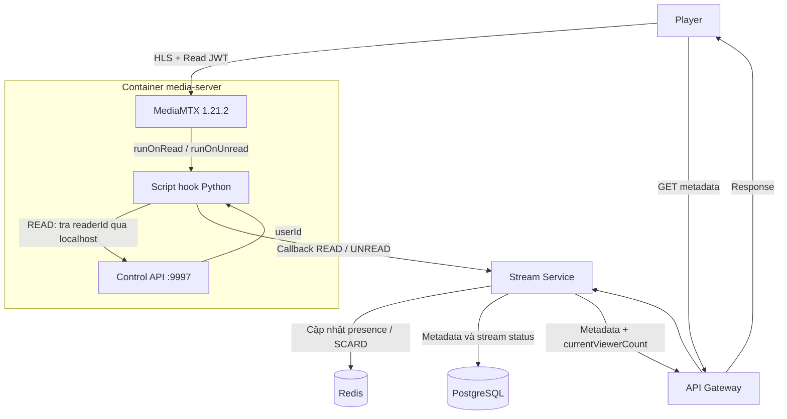
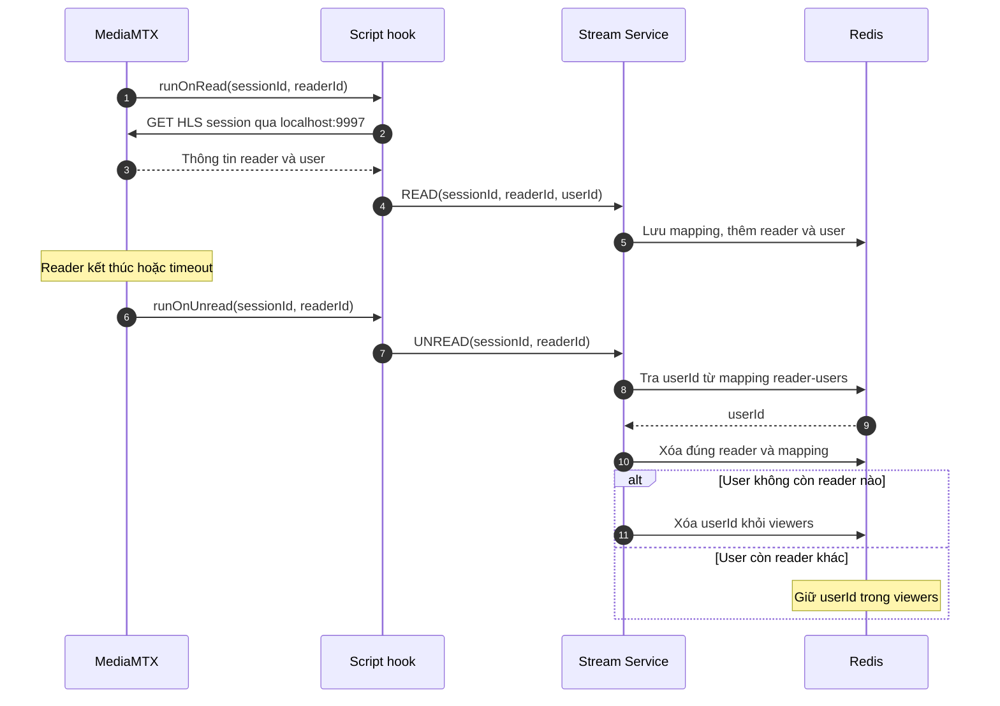

# Livestream CCU — Kiến trúc và workflow

## 1. Mô tả

Đếm số tài khoản đang xem đồng thời trên từng stream session. Mỗi cặp `(sessionId, userId)` chỉ đóng góp **1 CCU**, kể cả khi người dùng F5, mở nhiều tab hoặc nhiều thiết bị.

- `userId`: UUID tài khoản, nằm trong claim `sub` của Read JWT.
- `readerId`: UUID phiên xem HLS do MediaMTX tạo. Một user có thể có nhiều reader.
- Chỉ tính các phiên xem của tài khoản; loại chủ stream theo `ownerUserId` và phiên kỹ thuật như Media Worker chụp thumbnail.

Contract API và cấu hình vận hành nằm tại [CCU contract](../contracts/ccu/README.md).

Thiết kế dùng MediaMTX 1.21.2 nguyên bản, bổ sung script hook trong container `media-server`. Xem thêm [kiến trúc streaming](Streaming%20Architecture%20and%20Flow.md).

## 2. Các thành phần

| Thành phần | Vai trò |
|---|---|
| Player | Gửi Read JWT tới MediaMTX để xem HLS; lấy metadata để hiển thị CCU |
| API Gateway | Chuyển tiếp API của client tới Stream Service |
| MediaMTX | Xác thực Read JWT, quản lý reader/user và phát sinh `runOnRead`, `runOnUnread` |
| Script hook Python | Chạy trong container MediaMTX; tra user qua Control API rồi callback về Stream Service |
| Stream Service | Quản lý presence, cập nhật Redis và trả CCU trong metadata |
| Redis | Lưu tập user, các reader của từng user và mapping reader → user |
| PostgreSQL | Lưu metadata và trạng thái stream session |

Stream Service sở hữu nghiệp vụ CCU và là thành phần duy nhất ghi dữ liệu presence vào Redis.

## 3. Workflow và kiến trúc

### 3.1. Cấu trúc Redis

| Key | Kiểu | Nội dung |
|---|---|---|
| `stream:{sessionId}:viewers` | Set | Các `userId` đang còn reader hoạt động |
| `stream:{sessionId}:user:<userId>:readers` | Set | Các `readerId` của user trong stream đó |
| `stream:{sessionId}:reader-users` | Hash | Mapping `readerId → userId` để xử lý sự kiện rời đi |

Ví dụ ID rút gọn:

```text
stream:{s123}:viewers             → {userA, userB}
stream:{s123}:user:userA:readers   → {reader1, reader2}
stream:{s123}:user:userB:readers   → {reader3}
stream:{s123}:reader-users        → {reader1: userA, reader2: userA, reader3: userB}

CCU = SCARD stream:{s123}:viewers = 2
```

`viewers` giúp chống cộng trùng user. `readers` giúp xác định lúc user không còn phiên xem nào. Mapping giúp tìm user khi hook chỉ cung cấp reader ID. Không cần một key counter riêng bằng `INCR/DECR`.

### 3.2. Người dùng vào xem — `runOnRead`

1. Player gửi Read JWT có `sub = userId`; MediaMTX xác thực và tạo reader gắn với user đó.
2. `runOnRead` khởi chạy script với `MTX_PATH`, `MTX_READER_ID`.
3. Script gọi Control API trong cùng container:

   ```http
   GET http://127.0.0.1:9997/v3/hls/sessions/get/{readerId}
   ```

4. Script lấy trường `user`, rồi callback về Stream Service với `{ eventType: READ, sessionId, readerId, userId }`.
5. Stream Service lưu mapping, thêm reader vào Set của user và thêm user vào `viewers`. User đã tồn tại trong Set thì CCU không tăng thêm.

Hai hook không cung cấp trực tiếp user đã xác thực, nên bước tra cứu nằm trong script. Script dùng **Control API JWT có quyền `api`** cho request này và credential nội bộ khi callback; không dùng Read JWT của player để gọi Control API. [Dữ liệu hook](https://github.com/bluenviron/mediamtx/blob/v1.21.2/internal/hooks/on_read.go#L25-L59), [Control API](https://github.com/bluenviron/mediamtx/blob/v1.21.2/api/openapi.yaml#L3248).

### 3.3. Người dùng rời đi — `runOnUnread`

1. Reader kết thúc hoặc timeout, MediaMTX khởi chạy script `runOnUnread`.
2. Script callback `{ eventType: UNREAD, sessionId, readerId }` về Stream Service.
3. Stream Service tra mapping Redis để lấy `userId`, rồi xóa đúng reader khỏi Set của user.
4. **Chỉ khi user không còn reader nào**, mới xóa user khỏi `viewers`. Sau đó xóa mapping của reader vừa kết thúc.

Ví dụ: userA F5 tạo reader2 trong khi reader1 cũ đang chờ timeout. Khi reader1 kết thúc, userA vẫn được giữ trong `viewers` vì còn reader2. CCU chỉ giảm khi reader cuối cùng kết thúc.

Không tra Control API ở bước UNREAD vì phiên có thể đã bị MediaMTX xóa.

### 3.4. Client lấy CCU

Khi nhận `GET /stream/api/streams/{sessionId}`, Stream Service đọc metadata từ PostgreSQL, đọc số phần tử của `viewers` bằng `SCARD` và trả thêm `currentViewerCount` trong response. Khi CCU chưa sẵn sàng hoặc lỗi presence, field là `null` và UI hiển thị `—`; `READY/ENDED` trả `0`.

Endpoint danh sách `GET /stream/api/streams` cũng trả `currentViewerCount` trong từng phần tử `result.content[]` của trang hiện tại. Service dùng lại logic presence sau khi kết thúc transaction đọc danh sách; lỗi CCU trả `null` cho stream tương ứng và không làm hỏng danh sách. Đọc danh sách không thêm viewer hoặc gọi MediaMTX.

Frontend cập nhật số đếm qua polling metadata hiện có, khoảng 3 giây khi tab hiển thị. `/details` lấy thông tin channel/category; `/playback-access` cấp URL và Read JWT. Các API này không thêm user vào Redis.

### 3.5. Nguyên tắc vận hành

- Các cập nhật presence của một sự kiện cần atomic để tránh READ/UNREAD đồng thời làm xóa nhầm user.
- Cần xử lý callback trùng, đến sai thứ tự hoặc bị mất; ghi nhận reader đã đóng để chặn READ trễ và đối soát presence với MediaMTX khi cần phục hồi.
- Khi stream ENDED, trả CCU bằng 0, dọn presence và chặn sự kiện cũ thêm lại viewer.
- CCU phản ánh các phiên HLS được ghi nhận còn hoạt động. Với MediaMTX 1.21.2, thường mất khoảng **30–40 giây sau request HLS cuối** để phát hiện inactivity, rồi mới cộng thêm độ trễ callback/polling. [Logic timeout](https://github.com/bluenviron/mediamtx/blob/v1.21.2/internal/servers/hls/session.go#L189-L230).

## 4. Diagram

### 4.1. Kiến trúc tổng thể


<details>
<summary>Mã nguồn Mermaid</summary>



</details>

### 4.2. Luồng vào và rời phiên xem


<details>
<summary>Mã nguồn Mermaid</summary>



</details>

Các bước ghi Redis trong diagram được gộp thành cập nhật atomic theo từng sự kiện; diagram thể hiện luồng nghiệp vụ bình thường.
