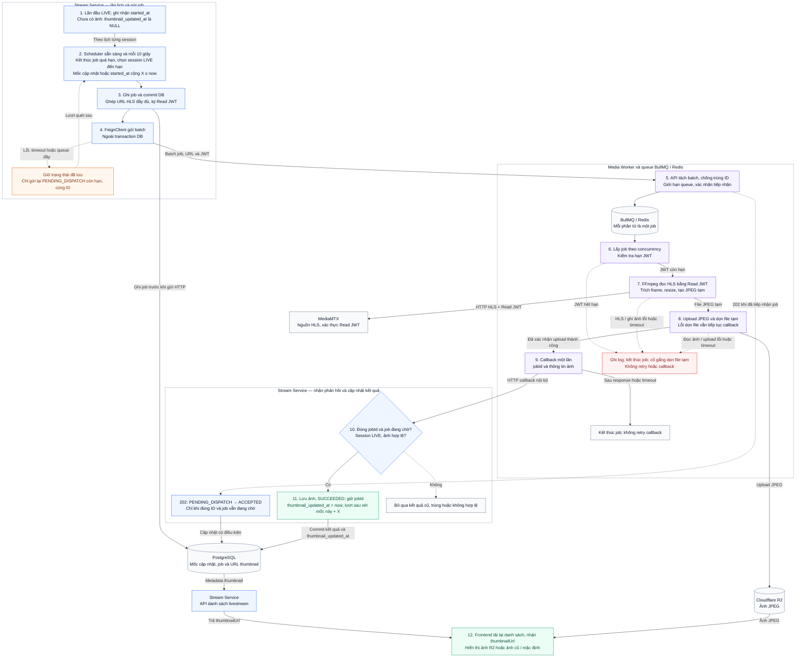

# Livestream Thumbnail — Kiến trúc và workflow

## 1. Mô tả

Tự động tạo và cập nhật thumbnail cho các phiên livestream đang LIVE bằng hình ảnh trích từ luồng video. Thumbnail được hiển thị trên danh sách livestream để người xem nhận biết nội dung của phiên.

## 2. Các thành phần

| Thành phần | Vai trò |
|---|---|
| OBS | Phát video/audio tới MediaMTX |
| Stream Service | Quản lý lịch chụp, query session đến hạn, tạo jobId, ghép URL HLS đầy đủ, ký Read JWT, gửi batch và nhận callback cập nhật DB |
| PostgreSQL | Lưu stream session, URL thumbnail, thời điểm cập nhật thành công thumbnail_updated_at và thông tin điều phối công việc |
| Media Worker API | Ứng dụng Node.js + TypeScript + NestJS nhận batch qua HTTP và thêm từng công việc vào queue |
| BullMQ / Redis | Lưu công việc đang chờ, quản lý trạng thái và hỗ trợ retry, chống nhận trùng |
| Media Worker processor | Lấy job từ queue, chạy FFmpeg, upload ảnh lên R2, gửi callback và dọn file tạm |
| FFmpeg | Đọc HLS từ MediaMTX, giải mã video, trích frame, resize và ghi ảnh JPEG |
| MediaMTX trong media-server | Nhận luồng từ OBS, xác thực Read JWT và cung cấp playlist/segment cho FFmpeg và player |
| Cloudflare R2 | Lưu ảnh thumbnail để frontend tải qua URL |
| Frontend | Nhận thumbnailUrl từ API và hiển thị trên card livestream |

Media Worker API và processor là hai vai trò của cùng ứng dụng, chạy trong môi trường riêng với Stream Service. Stream Service gọi worker bằng FeignClient; ứng dụng Node.js dùng `spawn()` để khởi chạy chương trình FFmpeg. FFmpeg không cung cấp HTTP endpoint riêng.

## 3. Workflow từ đầu đến cuối

<table width="100%" style="width: 100%; table-layout: fixed;">
  <thead>
    <tr>
      <th width="6%">Bước</th>
      <th width="34%">Công việc</th>
      <th width="60%">Mô tả</th>
    </tr>
  </thead>
  <tbody>
    <tr>
      <td>1</td>
      <td>Ghi nhận mốc LIVE đầu tiên</td>
      <td>Stream Service giữ <code>started_at</code> của lần đầu LIVE. Khi chưa có ảnh, <code>thumbnail_updated_at</code> là NULL và lượt đầu đến hạn sau <code>started_at + X</code>; reconnect không reset các mốc này.</td>
    </tr>
    <tr>
      <td>2</td>
      <td>Quét lịch và chọn các job cần gửi</td>
      <td>Kết thúc job đang chờ quá hạn trước, rồi chỉ xét session <code>LIVE</code>: gửi lại job <code>PENDING_DISPATCH</code> còn hạn, hoặc tạo lượt mới khi không còn job đang chờ và <code>thumbnail_updated_at + X &lt;= now</code>. Nếu chưa từng cập nhật ảnh thì dùng <code>started_at + X &lt;= now</code>.</td>
    </tr>
    <tr>
      <td>3</td>
      <td>Chuẩn bị và lưu thông tin job</td>
      <td>Với lượt mới, lưu <code>thumbnail_job_id</code>, trạng thái <code>PENDING_DISPATCH</code> và hạn chờ trong transaction ngắn. Sau commit, ghép <code>playbackUrl</code> đầy đủ và ký Read JWT cho từng session; lượt gửi lại giữ nguyên <code>jobId</code>.</td>
    </tr>
    <tr>
      <td>4</td>
      <td>Gửi batch sang Media Worker</td>
      <td>Stream Service dùng FeignClient gửi batch gồm <code>jobId</code>, <code>sessionId</code>, <code>playbackUrl</code>, Read JWT và <code>readExpiresAt</code>. Lỗi kết nối hoặc timeout thì giữ <code>PENDING_DISPATCH</code> để gửi lại cùng ID ở lượt quét sau.</td>
    </tr>
    <tr>
      <td>5</td>
      <td>Tiếp nhận, xếp hàng và xác nhận job</td>
      <td>Worker API tách batch thành từng job BullMQ, chống trùng theo <code>jobId</code> và chỉ nhận job mới khi queue còn chỗ. Sau xác nhận tiếp nhận <code>202</code>, Stream Service chỉ chuyển đúng job còn <code>PENDING_DISPATCH</code> sang <code>ACCEPTED</code>.</td>
    </tr>
    <tr>
      <td>6</td>
      <td>Lấy job và kiểm tra hạn JWT</td>
      <td>Processor lấy job theo giới hạn số job chạy đồng thời và kiểm tra <code>readExpiresAt</code>. JWT hết hạn thì ghi log và kết thúc job tại Worker, không chạy FFmpeg, không retry hay callback.</td>
    </tr>
    <tr>
      <td>7</td>
      <td>Trích frame bằng FFmpeg</td>
      <td>Worker truyền URL và JWT cho FFmpeg đọc HLS, trích một frame, resize và xuất JPEG vào file tạm. Nếu đọc luồng, ghi ảnh thất bại hoặc quá timeout thì kết thúc job, không retry hay callback.</td>
    </tr>
    <tr>
      <td>8</td>
      <td>Upload JPEG và dọn file tạm</td>
      <td>Worker kiểm tra JPEG rồi upload lên R2. Khi xác nhận ảnh đã lưu thành công, dọn file tạm; lỗi dọn file được ghi log để xử lý lại sau và vẫn tiếp tục callback. Upload thất bại thì kết thúc job, không retry hay callback.</td>
    </tr>
    <tr>
      <td>9</td>
      <td>Gửi callback kết quả một lần</td>
      <td>Worker gửi <code>jobId</code> và thông tin ảnh về API nội bộ của Stream Service một lần sau khi xác nhận upload thành công. Chờ response hoặc timeout, ghi log rồi kết thúc job; không retry callback.</td>
    </tr>
    <tr>
      <td>10</td>
      <td>Kiểm tra và cập nhật thumbnail</td>
      <td>Backend kiểm tra <code>jobId</code> khớp, job còn <code>PENDING_DISPATCH</code> hoặc <code>ACCEPTED</code>, session vẫn <code>LIVE</code> và ảnh hợp lệ trước khi lưu URL. Bỏ qua kết quả trùng, cũ hoặc không đủ điều kiện.</td>
    </tr>
    <tr>
      <td>11</td>
      <td>Hoàn tất job và ghi nhận mốc cập nhật</td>
      <td>Trong cùng transaction cập nhật ảnh, chuyển job sang <code>SUCCEEDED</code>, giữ <code>thumbnail_job_id</code> và đặt <code>thumbnail_updated_at = now</code> theo đồng hồ backend. Lượt mới đến hạn sau mốc này cộng <code>X</code>; <code>RECONNECTING</code> tạm ngừng và <code>ENDED</code> dừng giao việc.</td>
    </tr>
    <tr>
      <td>12</td>
      <td>Hiển thị thumbnail trên frontend</td>
      <td>Frontend nhận <code>thumbnailUrl</code> khi tải lại danh sách livestream và hiển thị ảnh từ R2. Khi chưa có ảnh, dùng ảnh mặc định; trong lúc chờ cập nhật thì giữ ảnh hiện tại.</td>
    </tr>
  </tbody>
</table>

## 4. Các trường hợp lỗi và cách xử lý

| # | Trường hợp lỗi | Cách xử lý |
|---|---|---|
| 1 | Stream Service restart sau khi ghi nhận job nhưng trước khi gửi sang worker | Scheduler chạy ngay khi ứng dụng sẵn sàng, sau đó tiếp tục mỗi 10 giây. Đọc lại các job `PENDING_DISPATCH` còn hạn trong DB và gửi tiếp bằng cùng `jobId`. |
| 2 | Worker API ngừng hoạt động hoặc kết nối HTTP thất bại | Bắt lỗi, giữ `PENDING_DISPATCH`; lượt scheduler sau gửi lại cùng `jobId`. Riêng `connectTimeout` không cần mở transaction mới để đổi trạng thái thành `FAILED`. |
| 3 | Worker đã nhận job nhưng response HTTP bị mất hoặc timeout | Khi `readTimeout`, giữ `PENDING_DISPATCH` và gửi lại cùng `jobId` ở lượt scheduler sau. Worker chống thêm trùng theo ID. Nếu callback hợp lệ đã kết thúc job trước khi gửi lại thì không gửi lại job đó. |
| 4 | Redis mất kết nối khi tiếp nhận batch, có thể chỉ thêm được một phần | Gửi lại các công việc chưa được xác nhận bằng cùng `jobId`. Worker chỉ thêm job chưa tồn tại; những job đã tiếp nhận không được tạo lại. Chỉ ghi nhận `ACCEPTED` cho các job đã được xác nhận tiếp nhận. |
| 5 | Stream Service tạm ngừng hoạt động hoặc kết nối callback thất bại | Worker ghi log rồi kết thúc lượt xử lý, chấp nhận mất một lượt cập nhật ảnh. Scheduler hiện tại kết thúc job đang chờ khi quá hạn, cho phép tạo lượt chụp mới nếu session vẫn LIVE và đủ điều kiện. |
| 6 | Backend đã áp dụng kết quả nhưng response callback bị mất | Backend giữ nguyên ảnh mới và trạng thái `SUCCEEDED`. Worker ghi log chưa nhận được xác nhận rồi kết thúc lượt xử lý, không retry callback hay chạy lại FFmpeg và upload ảnh. |
| 7 | JWT hết hạn trong lúc job chờ queue | Worker kiểm tra `readExpiresAt` trước khi chạy FFmpeg; nếu đã hết hạn thì kết thúc job, không chạy FFmpeg, không retry và không callback. Nếu MediaMTX từ chối JWT khi đọc HLS thì xử lý theo nhánh FFmpeg lỗi. Trạng thái chờ trong DB được scheduler kết thúc khi quá hạn. |
| 8 | Session chuyển sang RECONNECTING hoặc ENDED trong lúc xử lý | Worker không gọi API hỏi trạng thái session. Nếu FFmpeg không đọc được HLS hoặc lỗi/timeout thì kết thúc job, không retry và không callback. Nếu ảnh đã upload và callback vẫn đến, backend chỉ cập nhật khi session còn LIVE. Job còn chờ trong DB được scheduler kết thúc khi quá hạn. |
| 9 | MediaMTX ngừng hoạt động hoặc restart | Khi FFmpeg lỗi hoặc quá timeout do không kết nối được hay bị ngắt lúc đọc HLS, Worker ghi log và kết thúc job, không retry và không callback. Scheduler kết thúc trạng thái chờ trong DB khi quá hạn. |
| 10 | Ổ đĩa đầy hoặc filesystem gặp lỗi I/O | Khi không ghi được JPEG hoặc không đọc được file ảnh để upload, Worker ghi log và kết thúc job, không upload ảnh lỗi, không retry và không callback. Cố gắng dọn file tạm nếu có; lỗi dung lượng hoặc filesystem kéo dài cần được khắc phục để các lượt sau xử lý được. |
| 11 | Mạng tới R2 bị gián đoạn hoặc R2 trả lỗi dịch vụ | Nếu upload lỗi hoặc timeout khiến Worker chưa xác nhận được ảnh đã lưu thành công, Worker ghi log, kết thúc job và dọn file tạm nếu có thể; không retry và không callback cập nhật URL. Scheduler kết thúc trạng thái chờ trong DB khi quá hạn. |
| 12 | Lượng job vượt khả năng xử lý, khiến queue tồn đọng | Giới hạn số job đang chờ; khi đầy, Worker API từ chối nhận job mới, Stream Service giữ `PENDING_DISPATCH` để gửi lại cùng ID ở lượt sau. Worker bỏ job đã hết JWT. Nếu thường xuyên quá tải, tăng khả năng xử lý hoặc tăng khoảng cách cập nhật `X`. |
| 13 | Xóa file tạm hoặc object R2 thất bại do lỗi I/O/mạng | Ghi log và để cơ chế dọn rác xử lý lại sau; không chạy lại FFmpeg/upload. Nếu ảnh đã upload thành công thì vẫn callback dù dọn file tạm lỗi. Chỉ xóa file không còn được job sử dụng và ảnh R2 không còn được tham chiếu, giữ ảnh đang hiển thị. |

Các quy tắc dùng chung:

- **Mốc tính lịch:** chỉ lưu `thumbnail_updated_at` cho thời điểm backend cập nhật ảnh thành công. Chưa có ảnh thì dùng `started_at + X`; đã có ảnh thì dùng `thumbnail_updated_at + X`. Tạo/gửi job, ACK, callback bị bỏ qua và lỗi xử lý không thay đổi mốc này; Worker không cần gửi thời điểm chụp ảnh trong callback.
- **Lưu trước khi gửi:** dùng một transaction ngắn cho batch để lưu `thumbnail_job_id`, trạng thái `PENDING_DISPATCH` và hạn chờ; commit trước khi gọi HTTP. Không giữ transaction DB mở trong lúc chờ worker.
- **Phân biệt công việc mới và công việc gửi lại:** scheduler vừa chọn session đến hạn để tạo job mới, vừa lấy các job `PENDING_DISPATCH` còn hạn để gửi lại. Công việc gửi lại giữ nguyên ID; không tạo lượt chụp mới cho session đang chờ.
- **Xác nhận tiếp nhận:** nhận `202` thì đổi đúng job còn `PENDING_DISPATCH` thành `ACCEPTED`. `Connect timeout` và `readTimeout` đều giữ trạng thái hiện tại, không cần transaction bổ sung nếu không ghi thêm dữ liệu.
- **Kết quả có thể đến trước xác nhận:** callback thành công và hợp lệ được áp dụng khi đúng `thumbnail_job_id`, session vẫn LIVE và trạng thái job là `PENDING_DISPATCH` hoặc `ACCEPTED`. Sau khi cập nhật ảnh, chuyển sang `SUCCEEDED` và giữ lại ID. Callback trùng không cập nhật lại; response `202` đến muộn không được đổi ngược trạng thái đã kết thúc.
- **Chống trùng tại queue:** dùng `jobId` từ Stream Service làm ID của BullMQ và giữ bản ghi job, kể cả đã hoàn thành, ít nhất trong thời gian Stream Service còn có thể gửi lại công việc đó.
- **Giới hạn queue:** chỉ tiếp nhận job mới khi còn chỗ trong queue. Khi đầy, các job chưa được tiếp nhận vẫn là `PENDING_DISPATCH` để gửi lại; job trùng ID đã tồn tại vẫn được xác nhận đã tiếp nhận mà không thêm lại vào queue.
- **Lỗi xử lý tại Worker:** chấp nhận mất một lượt thumbnail khi JWT hết hạn, FFmpeg lỗi/timeout, ghi/đọc file ảnh thất bại hoặc upload R2 không được xác nhận thành công. Worker ghi log, kết thúc job, cố gắng dọn file tạm và không retry hay callback; Stream Service giữ ảnh cũ hoặc ảnh mặc định cho frontend.
- **Dọn file và ảnh:** lỗi xóa file tạm hoặc ảnh R2 được ghi log và dọn lại sau, không làm chạy lại FFmpeg/upload hoặc ngăn callback của ảnh đã upload thành công. Chỉ dọn file không còn được job sử dụng và object R2 không còn được tham chiếu.
- **Callback một lần:** sau khi xác nhận upload ảnh thành công, Worker gửi callback một lần, chờ response hoặc timeout, ghi log rồi kết thúc lượt xử lý. Callback thất bại hoặc không nhận được xác nhận không kích hoạt retry callback, chạy lại FFmpeg hay upload lại ảnh.
- **Xử lý job quá hạn:** dùng luôn scheduler hiện tại, không thêm scheduler riêng. Đầu mỗi lượt quét, chuyển job còn `PENDING_DISPATCH` hoặc `ACCEPTED` có `thumbnail_job_deadline_at <= now` sang `FAILED`, giữ lại ID và ảnh hiện tại, sau đó mới xét gửi lại hoặc tạo job mới. Job đã `SUCCEEDED` không bị thay đổi. Việc kiểm tra ID/trạng thái và cập nhật DB phải nguyên tử để các response/callback đến đồng thời không ghi đè kết quả của nhau.

## 5. Diagram kiến trúc

Database chỉ lưu `thumbnail_updated_at`. Mốc đến hạn thể hiện trong ảnh là giá trị tính toán `COALESCE(thumbnail_updated_at, started_at) + X`, không phải cột lưu riêng. Callback thành công đặt `thumbnail_updated_at = now` theo đồng hồ backend; mã Mermaid bên dưới dùng trực tiếp tên cột này.

Mã nguồn Mermaid

