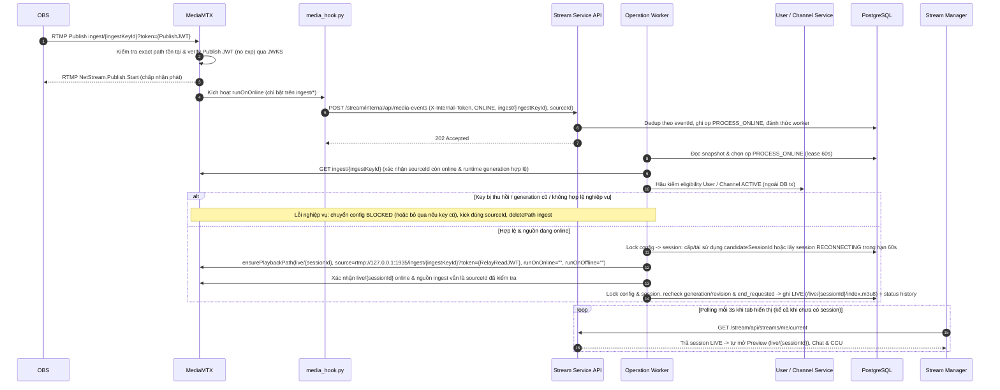

# Streaming — Kiến trúc và Workflow

> [!NOTE]
> Các sơ đồ **Mermaid** trong tài liệu này là nguồn chuẩn theo thiết kế **Stream Key cố định + tự động bắt đầu/kết thúc từ OBS** (`V5`). Các ảnh `.png` tham chiếu giữ nguyên cấu trúc thư mục hiện có; phần Mermaid bên dưới phản ánh đầy đủ kiến trúc hai đường dẫn (`ingest/{ingestKeyId}` và `live/{sessionId}`), callback nội bộ có xác thực và worker phục hồi PostgreSQL.

## 1. Giới thiệu và Hướng dẫn sử dụng

Hệ thống cho phép streamer phát trực tiếp từ **OBS** tới **MediaMTX** qua RTMP/RTMPS bằng một **Stream Key cố định theo kênh** và người xem xem trực tiếp trên **React + hls.js** qua HLS. **Stream Service** quản lý cấu hình kênh (`channel_stream_configs`), vòng đời credential (`channel_stream_credentials`), hàng đợi điều phối media (`stream_media_operations`), vòng đời phiên phát (`stream_sessions`), kiểm tra quyền nghiệp vụ và cấp/ký JWT bằng khóa RSA; **MediaMTX 1.21.2** tự xác thực JWT qua JWKS và chuyển tiếp media nội bộ từ path ingest sang path playback bằng RTMP pull (không transcoding).

```text
Luồng video:   [OBS] -- RTMP/RTMPS (ingest/{ingestKeyId}) --> [MediaMTX RTMP pull -> live/{sessionId}] -- HLS --> [React + hls.js]
Luồng API:     [React UI] --> [API Gateway] --> [Stream Service] --> [PostgreSQL / Redis]
Media <-> BE:  [MediaMTX ingest hook] -- POST /stream/internal/api/media-events (X-Internal-Token) --> [Stream Service]
               [Stream Service Worker / Reconciler] -- Control API (ensure/delete path, kick conn) --> [MediaMTX]
```

### Hướng dẫn livestream từng bước

1. **Mở Stream Manager**: Đăng nhập tài khoản đã là streamer và vào trang **Stream Manager**. Ở lần đầu tiên, `GET /stream/api/streams/me/setup` tự động khởi tạo `channel_stream_configs` ở trạng thái **`DRAFT`** (chưa cấp Stream Key và chưa mở ingest path trước khi thiết lập thông tin hợp lệ).
2. **Thiết lập thông tin lần đầu & Nhận key**: Nhập **Title**, chọn **Category**, rồi bấm **Save** (`PUT /stream/api/streams/me/setup`). Hệ thống kiểm tra điều kiện phát, sinh `ingestKeyId` thế hệ 1, ký Publish JWT (không `exp`) và Relay Read JWT nội bộ (mã hóa AES-256-GCM trong DB), sau đó chạy tác vụ `PROVISION_INGEST` (`PROVISIONING` → `ACTIVE`). Khi hoàn tất, giao diện hiển thị **Server URL** (`rtmp://localhost:1935/ingest`) và **Stream Key** (`{ingestKeyId}?token={PublishJWT}`).
3. **Cấu hình OBS (chỉ làm 1 lần)**: Copy **Server URL** (`.../ingest`) và **Stream Key** dán vào **OBS → Settings → Stream → Custom**. Key được giữ nguyên qua các lần Save thông tin sau và qua nhiều phiên `ENDED`.
4. **Bắt đầu phát từ OBS**: Bấm **Start Streaming** trong OBS. MediaMTX xác thực Publish JWT qua JWKS tại `ingest/{ingestKeyId}`, chạy `media_hook.py` gửi sự kiện `ONLINE` về `POST /stream/internal/api/media-events`. Stream Service lưu event, hậu kiểm User/Channel, cấp `sessionId` cố định cho operation, mở playback path `live/{sessionId}` kéo RTMP nội bộ từ ingest và chỉ công khai phiên ở trạng thái **`LIVE`** sau khi xác nhận playback đã sẵn sàng. Stream Manager đang poll `GET /stream/api/streams/me/current` (mỗi 3 giây khi tab hiển thị) sẽ tự bật Preview, Chat và CCU.
5. **Cập nhật khi đang phát**: Chỉnh sửa **Title** hoặc **Category** và bấm **Save** ngay trong lúc đang live (hoặc `RECONNECTING`); thông tin mới được lưu vào cấu hình kênh và đồng bộ vào phiên hiện tại mà không làm đổi Stream Key.
6. **Ngắt kết nối & Kết thúc livestream**: Bấm **Stop Streaming** trên OBS (hoặc mất mạng). Phiên chuyển sang **`RECONNECTING`** trong **60 giây** và đóng playback path `live/{sessionId}` (ingest path vẫn giữ **`ACTIVE`**). Nếu OBS nối lại trong 60 giây bằng cùng key, phiên cũ tiếp tục **`LIVE`**; quá 60 giây, hệ thống chuyển phiên thành **`ENDED`** và dọn dẹp CCU/thumbnail.
7. **Reset Stream Key khi bị lộ**: Nếu nghi ngờ lộ Stream Key, bấm **Reset Stream Key** và xác nhận trên Stream Manager (`POST /stream/api/streams/me/stream-key/reset` kèm `Idempotency-Key`). Hệ thống thu hồi key cũ (`REVOKED`), đóng buổi phát đang hoạt động về **`ENDED`**, ngắt kết nối OBS cũ và xóa ingest path cũ rồi mở `ingest/{newKey}`. Sau khi xong, dán key mới vào OBS.

---

## 2. Workflow Start Livestream

### 2.1. Chuẩn bị tại Stream Manager (Lazy `DRAFT`, Save để Provision & Reset Key)


<details>
<summary>Mã nguồn Mermaid</summary>

```mermaid
sequenceDiagram
    autonumber
    participant UI as Stream Manager
    participant GW as API Gateway
    participant SS as Stream Service
    participant UC as User / Channel Service
    participant DB as PostgreSQL
    participant W as Operation Worker
    participant MTX as MediaMTX

    UI->>GW: GET /stream/api/streams/me/setup
    GW->>SS: Forward request (userId)
    SS->>DB: Tìm channel_stream_configs theo ownerUserId
    alt Chưa có cấu hình kênh (lần đầu)
        SS->>UC: Kiểm tra điều kiện streamer & lấy channelId
        UC-->>SS: Hợp lệ (channelId, streamerId)
        SS->>DB: Insert conflict-safe channel_stream_configs (status=DRAFT, streamKey=null)
    end
    SS-->>UI: Trả setup hiện tại (DRAFT/PROVISIONING/ACTIVE/ROTATING/BLOCKED + Cache-Control: no-store)

    UI->>GW: PUT /stream/api/streams/me/setup (title, categoryId)
    GW->>SS: Forward request
    SS->>UC: Validate category, streamer & channel ACTIVE
    SS->>DB: Lock config row; nếu lần đầu/cần cấp -> tạo credential gen N (AES-256-GCM) + PROVISIONING + op PROVISION_INGEST
    SS-->>UI: Trả setup (status=PROVISIONING, operationId)

    W->>DB: Claim op PROVISION_INGEST (lease 60s)
    W->>MTX: Control API ensureIngestPath(ingest/{ingestKeyId}, overridePublisher=false, runOnRead="", runOnUnread="")
    MTX-->>W: 200 OK
    W->>DB: Lock config & xác nhận generation/revision -> chuyển credential/config sang ACTIVE, op SUCCEEDED
    UI->>SS: Poll GET /me/operations/{operationId} & GET /me/setup
    SS-->>UI: Trả status=ACTIVE, serverUrl (.../ingest), streamKey ({ingestKeyId}?token={PublishJWT})

    opt Streamer bấm Reset Stream Key (có xác nhận)
        UI->>SS: POST /stream/api/streams/me/stream-key/reset (Idempotency-Key)
        SS->>DB: Lock config/session -> revoke gen N, tạo gen N+1 PENDING, ROTATING, op RESET_KEY (end_requested=true)
        SS-->>UI: 202 Accepted (operationId)
        W->>MTX: Đóng playback cũ (nếu có), kick source OBS cũ, deletePath(ingest/{oldKey})
        W->>DB: Đóng session cũ thành ENDED (nếu có)
        W->>MTX: ensureIngestPath(ingest/{newKey})
        W->>DB: Kích hoạt gen N+1 ACTIVE, config ACTIVE, op SUCCEEDED
    end
```

</details>

### 2.2. Bấm Start Streaming trên OBS (Tự tạo session & lên LIVE)


<details>
<summary>Mã nguồn Mermaid</summary>



</details>

---

## 3. Workflow Xem Stream


<details>
<summary>Mã nguồn Mermaid</summary>

```mermaid
sequenceDiagram
    autonumber
    participant V as Viewer (React)
    participant GW as API Gateway
    participant SS as Stream Service
    participant UC as Channel Service
    participant DB as PostgreSQL
    participant P as Player (hls.js)
    participant MTX as MediaMTX

    V->>GW: GET /stream/api/streams/{sessionId}
    GW->>SS: Forward request
    SS->>DB: Đọc metadata & status của session
    SS-->>V: Trả metadata (status, title, CCU) — chưa cấp token

    alt Status == LIVE và cần mở player
        V->>GW: POST /stream/api/streams/{sessionId}/playback-access
        GW->>SS: Forward request (viewerUserId)
        SS->>UC: Kiểm tra quyền xem kênh (không bị ban)
        SS->>DB: Lock/recheck session PUBLIC + LIVE
        SS->>SS: Ký Read JWT (quyền read duy nhất path live/{sessionId}, TTL 5m; không đọc được ingest/*)
        SS-->>V: Trả playbackUrl (/live/{sessionId}/index.m3u8) + Read JWT (Cache-Control: no-store)

        P->>MTX: GET /live/{sessionId}/index.m3u8 + Authorization: Bearer {ReadJWT}
        MTX->>MTX: Verify Read JWT qua JWKS & phục vụ HLS từ nguồn pull nội bộ; kích hoạt runOnRead/runOnUnread (viewer_hook)
        MTX-->>P: Trả playlist .m3u8

        par Luồng phát video HLS
            loop Liên tục khi đang xem
                P->>MTX: GET playlist & segment fMP4
                MTX-->>P: Dữ liệu media
            end
        and Luồng đồng bộ trạng thái & tự phục hồi lỗi tạm thời
            loop Mỗi 3s khi tab hiển thị (hoặc ngay khi player lỗi HLS tạm thời)
                V->>SS: GET /stream/api/streams/{sessionId}
                SS-->>V: Status, serverTime, CCU mới (nếu vừa LIVE lại thì xin playback-access mới)
            end
        end
    else Status là RECONNECTING / ENDED
        Note over V: Đóng player hiện tại, hiển thị trạng thái chờ nối lại hoặc đã kết thúc; không xin Read JWT
    end
```

</details>

---

## 4. Workflow Reconnecting, End Stream và Phục hồi (Reconciliation)


<details>
<summary>Mã nguồn Mermaid</summary>

```mermaid
sequenceDiagram
    autonumber
    participant OBS as OBS
    participant MTX as MediaMTX
    participant Hook as media_hook.py
    participant SS as Stream Service API
    participant W as Operation Worker / Reconciler
    participant Sched as ReconnectScheduler
    participant DB as PostgreSQL
    participant V as Viewer / Stream Manager

    OBS--xMTX: Ngắt kết nối RTMP trên ingest/{ingestKeyId} (Stop Streaming hoặc rớt mạng)
    MTX->>Hook: Kích hoạt runOnOffline
    Hook->>SS: POST /stream/internal/api/media-events (X-Internal-Token, OFFLINE, ingest/{ingestKeyId}, sourceId)
    SS->>DB: Dedup theo eventId, ghi op PROCESS_OFFLINE
    SS-->>Hook: 202 Accepted

    W->>DB: Claim op PROCESS_OFFLINE
    W->>DB: Lock config & session: đối chiếu đúng sourceId (không để OFFLINE cũ ngắt nguồn mới)
    W->>MTX: deletePlaybackPath(live/{sessionId}) (ngăn relay cũ tự pull nguồn mới ngoài kiểm soát backend)
    W->>DB: Chuyển LIVE -> RECONNECTING (reconnectDeadlineAt = occurredAt + 60s), giữ ingest path ACTIVE
    Note over V: Polling GET /{sessionId} nhận RECONNECTING -> đóng player HLS & hiện chờ kết nối lại

    alt OBS nối lại trong vòng 60s
        OBS->>MTX: RTMP Publish lại ingest/{ingestKeyId}?token={PublishJWT}
        MTX->>Hook: Kích hoạt runOnOnline
        Hook->>SS: POST /stream/internal/api/media-events (ONLINE, ingest/{ingestKeyId}, newSourceId)
        W->>DB: Xác nhận trong deadline & end_requested=false -> giữ sessionId/startedAt/chat
        W->>MTX: Tạo lại playback path live/{sessionId} pull từ ingest/{ingestKeyId}
        W->>DB: Chuyển RECONNECTING -> LIVE
        Note over V: Polling nhận LIVE -> gọi playback-access xin Read JWT & mở lại HLS
    else Quá 60s không nối lại (kết thúc stream)
        Sched->>DB: Quét session quá reconnectDeadlineAt (mỗi 1s), tạo/xử lý op END_SESSION (end_requested=true)
        W->>MTX: Xác nhận đóng playback live/{sessionId} & kick nguồn cũ (nếu còn thuộc session cũ)
        W->>DB: Chuyển RECONNECTING -> ENDED & ghi history; dọn CCU & thumbnail job đang chờ
        Note over V: Polling GET /{sessionId} nhận ENDED -> dừng phát & đóng chat
    end
```

</details>

- **Phục hồi tự động (`StreamMediaReconciler`, chạy lúc khởi động và mỗi 5 giây)**:
  - Hoàn tất các `stream_media_operations` còn tồn/hết lease sau crash hoặc lỗi mạng tạm thời (`backoff 1, 2, 5, 10, tối đa 30s`).
  - Khi phát hiện MediaMTX restart (qua `server_started_at` trong `stream_media_runtime_state`), không đoán nguồn cũ còn trong grace period: đóng sạch path/session cũ nếu không xác định được khoảng ngắt an toàn, dọn ingest đã `REVOKED` và playback `ENDED`/mồ côi trước khi khôi phục các ingest path `ACTIVE`.
  - Đối chiếu nguồn thực tế trên MediaMTX để bù `ONLINE`/`OFFLINE` bị lỡ (đi qua cùng lifecycle handler và fencing `credential_generation` / `media_revision`).

---

## 5. Cơ chế bảo mật

1. **Xác thực chữ ký bất đối xứng RS256 & JWKS**:
   - **Stream Service** giữ private key RS256 (`STREAM_MEDIA_PRIVATE_KEY_BASE64`, tối thiểu 2048-bit) để ký mọi Media JWT và công bố public key tại `GET /stream/api/media/jwks`. Khóa RSA và khóa AES phải giữ ổn định qua các lần deploy (thay khóa là thao tác vận hành riêng).
   - **MediaMTX** tự tải và cache public key từ JWKS; không lưu private key hay secret mã hóa trong container media.
2. **Mã hóa Stream Key & Relay Credential tại DB (`AES-256-GCM`)**:
   - `Publish JWT` (của OBS) và `Relay Read JWT` (nội bộ để `live/{sessionId}` kéo RTMP từ `ingest/{ingestKeyId}`) **không có `exp`** và dùng lại cho tới khi reset key hoặc bị block.
   - Cả hai token được mã hóa bằng **AES-256-GCM** (`STREAM_MEDIA_CREDENTIAL_ENCRYPTION_KEY`) trong bảng `channel_stream_credentials` để `GET /me/setup` trả lại đúng chuỗi key cho owner mà không lưu plaintext JWT trong DB.
3. **Tách biệt đường dẫn Ingest & Playback + Giới hạn quyền từng loại JWT**:
   - **Publish JWT**: chỉ có quyền `action: publish` trên đúng `ingest/{ingestKeyId}` (`Server URL` có suffix `/ingest`, Stream Key là `{ingestKeyId}?token={PublishJWT}`).
   - **Relay Read JWT**: chỉ có quyền `action: read` trên `ingest/{ingestKeyId}` (`sub = relay-internal`), chỉ dùng nội bộ giữa MediaMTX playback source và ingest path; **không bao giờ** trả về frontend hoặc ghi vào log.
   - **Viewer / Worker Read JWT**: chỉ có quyền `action: read` trên đúng playback path `live/{sessionId}`, `TTL 5 phút`, không thể dùng để đọc `ingest/*` hoặc session khác.
   - **Control API JWT**: chỉ có quyền `action: api`, `TTL 5 phút`, chỉ cấp cho Stream Service và `viewer_hook.py` (mount file read-only).
4. **Whitelist path trên MediaMTX (`paths: {}`) & Chống chiếm luồng**:
   - MediaMTX cấu hình `paths: {}` (không có catch-all) và `overridePublisher: false`. Không tồn tại exact path hoặc đang có OBS phát hợp lệ thì kết nối RTMP thứ hai bị từ chối ngay.
   - Hook `runOnOnline`/`runOnOffline` chỉ bật trên `ingest/*`; `runOnRead`/`runOnUnread` chỉ bật trên `live/*`, tránh vòng lặp tạo session và đếm nhầm CCU từ kết nối relay kỹ thuật.
5. **Thu hồi key (`Reset`), khóa kênh (`BLOCKED`) & Hậu kiểm nghiệp vụ**:
   - Credential `REVOKED` không bao giờ được kích hoạt lại. Reset key đánh dấu thu hồi thế hệ cũ, chốt phiên hiện tại `ENDED`, xóa path `ingest/{oldKey}`, kick đúng connection cũ trước khi kích hoạt `ingest/{newKey}`.
   - Khi `PROCESS_ONLINE` xử lý nguồn mới, backend hậu kiểm User/Channel `ACTIVE` (nếu lỗi nghiệp vụ thì chuyển config `BLOCKED`, kick nguồn và xóa ingest path; lỗi 503/timeout tạm thời thì retry chứ không tự thu hồi key).
6. **Bảo vệ Webhook nội bộ & Dữ liệu nhạy cảm**:
   - `POST /stream/internal/api/media-events` chỉ nhận qua nội bộ với header `X-Internal-Token` (`STREAM_MEDIA_CALLBACK_INTERNAL_TOKEN`, so sánh constant-time SHA-256) và **không expose qua API Gateway**.
   - Các API `/me/setup`, `/me/stream-key/reset`, `/me/operations/{operationId}`, `/me/current` và `/playback-access` đều trả header `Cache-Control: no-store`.
   - Frontend chỉ giữ credential trong bộ nhớ phiên làm việc (không lưu `localStorage`/`sessionStorage`), và log/DTO `toString()`/bảng `stream_media_operations.payload` tuyệt đối không chứa JWT thô hoặc query `token=...`.
