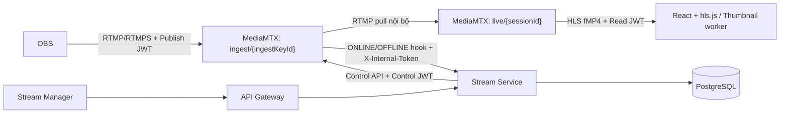

# Streaming — Kiến trúc và Workflow

> Thiết kế hiện tại (V6): xử lý đồng bộ, Stream Key chỉ trả một lần khi cấp.
> Mermaid bên dưới là nguồn chuẩn. Các ảnh PNG được giữ làm tài liệu tham chiếu cũ.

## 1. Kiến trúc



- MediaMTX 1.21.2 xác thực RS256 qua JWKS; không transcode.
- OBS dùng một key qua nhiều buổi phát, cho tới khi streamer yêu cầu key mới.
- `ingestKeyId` định danh đường ingest hiện hành của kênh. `sessionId` định danh từng buổi phát.
- Chỉ có ba bảng nghiệp vụ: `channel_stream_configs`, `stream_sessions`, `stream_status_history`.
- Không lưu Publish/Relay JWT trong DB; không có bảng credential, operation, runtime state, lease hay worker điều phối media.
- Service thực hiện Control API trực tiếp. Mọi thao tác ghi lifecycle khóa config trước session; transaction giữ khóa trong lúc gọi MediaMTX để tránh reset/ONLINE/OFFLINE cùng kênh chạy chồng nhau.

## 2. Setup và cấp key một lần

```mermaid
sequenceDiagram
    participant UI as Stream Manager
    participant SS as Stream Service
    participant DB as PostgreSQL
    participant MTX as MediaMTX
    UI->>SS: GET /stream/api/streams/me/setup
    SS->>DB: Tạo config DRAFT nếu chưa có
    SS-->>UI: title/category/status/hasStreamKey (không có credential)
    UI->>SS: PUT /stream/api/streams/me/setup (title, categoryId)
    SS->>SS: Kiểm tra eligibility
    SS->>DB: Lưu cấu hình; đồng bộ session đang hoạt động nếu có
    SS-->>UI: Settings (không cấp key)
    UI->>SS: POST /stream/api/streams/me/stream-key
    SS->>DB: Lock config và session hiện tại
    opt Đã có key/session cũ
        SS->>MTX: Đóng playback, kick publisher, xóa ingest path cũ
        SS->>DB: Kết thúc session cũ
    end
    SS->>MTX: ensureIngestPath(ingest/newIngestKeyId)
    SS->>DB: Lưu newIngestKeyId, trạng thái ACTIVE
    SS->>SS: Ký Publish JWT
    SS-->>UI: 200 + Server URL + Stream Key (Cache-Control no-store)
    Note over UI: Giữ credential trong state tạm. Copy key hoặc rời trang thì ẩn/xóa khỏi state.
```

- `POST /me/stream-key` luôn cấp key mới, cho cả lần đầu và lần thay thế. Không có operation ID, polling operation hay Idempotency-Key.
- Format: `{ingestKeyId}?token={PublishJWT}`; Server URL mặc định `rtmp://localhost:1935/ingest`.
- GET setup và Save không trả token. Reload trang không lấy lại key cũ. Mất key hoặc mất response thì yêu cầu key mới, vô hiệu hóa ingest cũ.
- UI xác nhận trước khi thay key hiện hành vì thao tác sẽ kết thúc buổi phát đang chạy.

## 3. OBS Start và xem stream

```mermaid
sequenceDiagram
    participant OBS as OBS
    participant MTX as MediaMTX
    participant SS as Stream Service
    participant DB as PostgreSQL
    participant V as Viewer / Stream Manager
    OBS->>MTX: Publish ingest/ingestKeyId + Publish JWT
    MTX->>MTX: Kiểm tra exact path và quyền JWT
    MTX->>SS: POST /stream/internal/api/media-events (ONLINE)
    SS->>SS: Kiểm tra eligibility và source thực tế
    SS->>DB: Lock config rồi session; chọn tạo mới hoặc resume
    SS->>MTX: Tạo live/sessionId, ký Relay Read JWT khi tạo path
    SS->>MTX: Xác nhận playback sẵn sàng và ingest vẫn đúng source
    SS->>DB: Ghi session LIVE + history
    SS-->>MTX: 200 APPLIED hoặc IGNORED
    V->>SS: GET /stream/api/streams/me/current hoặc GET /streams/sessionId
    V->>SS: POST /stream/api/streams/sessionId/playback-access
    SS-->>V: Playback URL + Read JWT TTL 5 phút
    V->>MTX: Đọc live/sessionId/index.m3u8
```

- Trước OBS Start chưa có Stream Session. Backend tra channel config bằng ingest ID hiện hành.
- Callback cũ sau thay key, callback trùng và source không còn hiện hành được bỏ qua.
- Source mới khi session cũ vẫn LIVE nhưng không biết thời điểm disconnect sẽ bắt đầu session mới.
- UI poll current/metadata mỗi 3 giây khi tab hiển thị; player tự thử mở lại có giới hạn khi HLS lỗi tạm thời.
- CCU vẫn theo session ID; relay/thumbnail không được tính là viewer. Thumbnail tiếp tục đọc `live/{sessionId}` với Read JWT, chỉ áp dụng kết quả vào đúng job/session LIVE.

## 4. OBS Stop, reconnect và kết thúc

1. Hook OFFLINE của đúng source: service đóng playback, chuyển LIVE sang RECONNECTING.
2. Deadline là thời điểm OFFLINE đáng tin cậy + 60 giây. Callback trùng không gia hạn.
3. Nguồn trở lại trước deadline: tạo lại playback cùng session ID, chuyển LIVE và giữ startedAt/chat.
4. Đúng hoặc quá deadline: session cũ ENDED trước khi tạo session mới, dù scheduler chưa chạy.
5. `ReconnectExpirationScheduler` quét mỗi giây và gọi closure service trực tiếp. Kết thúc chỉ đóng playback; giữ ingest cho lần phát sau. Dọn CCU và thumbnail đang chờ.

## 5. Bảo mật

- Publish JWT không exp, chỉ publish đúng `ingest/{ingestKeyId}`. Relay JWT không exp, chỉ read ingest, subject `relay-internal`; được ký khi tạo playback path.
- Viewer/thumbnail Read JWT chỉ đọc `live/{sessionId}`, TTL mặc định 5 phút. Control JWT có quyền api, TTL mặc định 5 phút.
- MediaMTX `paths: {}`, không catch-all, `overridePublisher: false`. Thu hồi key bằng xóa ingest cũ và kick kết nối; JWT cũ không được dùng với path mới.
- JWKS: `GET /stream/api/media/jwks`. Callback nội bộ dùng `X-Internal-Token`, không đi qua Gateway.
- Các endpoint setup/key/current/playback trả `Cache-Control: no-store`. Secret không vào log, query cache hoặc browser storage; DTO trả key có toString redacted.
- Hậu kiểm eligibility khi bắt đầu/nối lại. Lỗi nghiệp vụ chặn nguồn và config BLOCKED; lỗi transport trả lỗi, không tự coi là ban.

## 6. Phạm vi tối giản và vận hành

- Không có hàng đợi retry, phục hồi thao tác sau backend crash, phục hồi ingest sau MediaMTX restart hoặc đối soát hook bị lỡ.
- Lỗi Control API trả lỗi trực tiếp (thường HTTP 503). Người dùng có thể yêu cầu key mới sau khi media server hoạt động lại.
- PostgreSQL rollback không hoàn tác được tác động đã xảy ra trên MediaMTX. Lỗi/crash giữa thao tác có thể cần kiểm tra/dọn path thủ công; đây là phạm vi được chấp nhận cho phiên bản đơn giản.
- Transaction giữ row lock qua Control API; timeout HTTP hữu hạn. Đổi lại implementation không cần nhiều phase, lease và fencing.
- Flyway V1–V5 giữ nguyên lịch sử. V6 bỏ ba bảng hỗ trợ và cột generation/revision, giữ config/current ingest ID và lịch sử session. V6 chặn nếu config V5 còn PROVISIONING/ROTATING; cần hoàn tất thao tác cũ trước cutover.
- Khi nâng cấp: chuẩn bị RSA keypair, callback secret, cấu hình URL; chạy Flyway qua quá trình khởi động được người vận hành chủ động thực hiện. Không cần AES credential encryption key.
