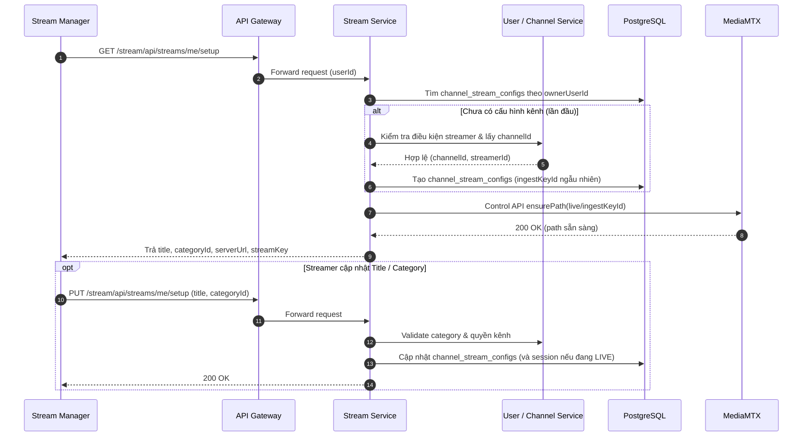
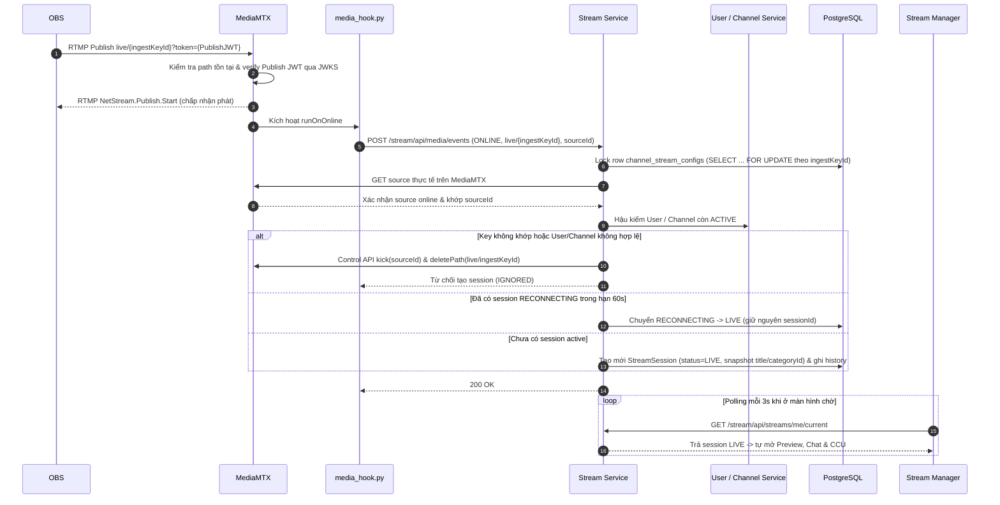
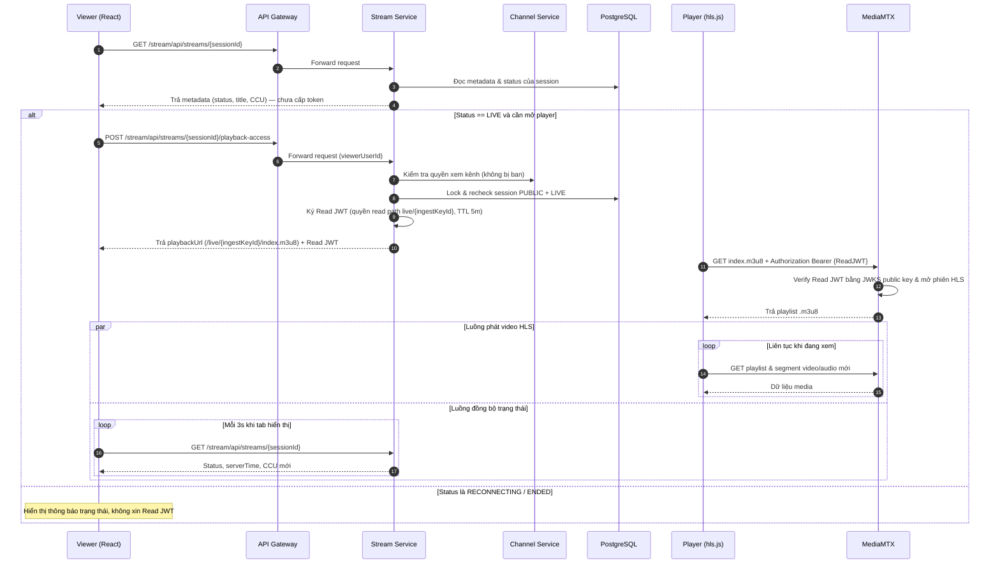
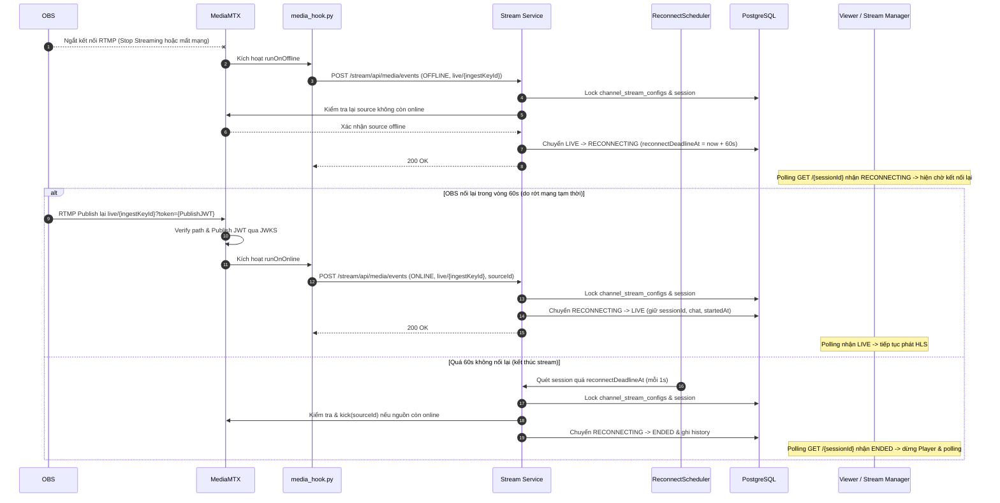

# Streaming — Kiến trúc và Workflow

## 1. Giới thiệu và Hướng dẫn sử dụng

Hệ thống cho phép streamer phát trực tiếp từ **OBS** tới **MediaMTX** qua RTMP/RTMPS và người xem xem trực tiếp trên **React + hls.js** qua HLS. **Stream Service** quản lý cấu hình kênh, vòng đời phiên phát (`StreamSession`), kiểm tra quyền nghiệp vụ và cấp/ký JWT bằng khóa RSA; **MediaMTX** tự xác thực Publish JWT và Read JWT qua public key từ JWKS.

```text
Luồng video:   [OBS] -- RTMP/RTMPS --> [MediaMTX] -- HLS --> [React + hls.js]
Luồng API:     [React UI] --> [API Gateway] --> [Stream Service] --> [PostgreSQL]
Media <-> BE:  [MediaMTX] -- JWKS / Webhook ONLINE, OFFLINE --> [Stream Service]
               [Stream Service] -- Control API (ensurePath / kick / deletePath) --> [MediaMTX]
```

### Hướng dẫn livestream từng bước

1. **Mở Stream Manager**: Đăng nhập tài khoản đã là streamer và vào trang **Stream Manager**. Ở lần đầu tiên, hệ thống tự khởi tạo cấu hình kênh (`channel_stream_configs`) và cấp **Stream Key** cố định cho kênh.
2. **Cấu hình OBS (chỉ làm 1 lần)**: Copy **Server URL** (`rtmp://localhost:1935/live`) và **Stream Key** (`{ingestKeyId}?token={PublishJWT}`) dán vào **OBS → Settings → Stream → Custom**. Các buổi live sau không cần nhập lại.
3. **Thiết lập thông tin buổi phát**: Nhập **Title** và chọn **Category**, sau đó bấm lưu (**Save**) trên Stream Manager.
4. **Bắt đầu phát từ OBS**: Bấm **Start Streaming** trong OBS. MediaMTX xác thực kết nối và báo về backend; **Stream Service** tự động tạo phiên livestream mới ở trạng thái **LIVE** và Stream Manager tự bật Preview, Chat, CCU.
5. **Cập nhật khi đang phát**: Có thể chỉnh sửa **Title** hoặc **Category** ngay trong lúc đang live; thông tin mới áp dụng cho cả phiên hiện tại lẫn cấu hình mặc định cho các lần live sau.
6. **Kết thúc livestream**: Bấm **Stop Streaming** trên OBS. Phiên chuyển sang trạng thái chờ kết nối lại (`RECONNECTING`) trong **60 giây**; hết 60 giây không phát lại, hệ thống tự động đóng phiên thành **ENDED**.
7. **Reset Stream Key khi bị lộ**: Nếu nghi ngờ lộ Stream Key, bấm **Reset Stream Key** trên Stream Manager để khóa đường dẫn cũ trên MediaMTX, sinh key mới và dán lại key mới vào OBS.

---

## 2. Workflow Start Livestream

### 2.1. Chuẩn bị tại Stream Manager (Lazy Auto-Provision & Lưu cấu hình)


<details>
<summary>Mã nguồn Mermaid</summary>



</details>

### 2.2. Bấm Start Streaming trên OBS (Tự tạo session & lên LIVE)


<details>
<summary>Mã nguồn Mermaid</summary>



</details>

---

## 3. Workflow Xem Stream


<details>
<summary>Mã nguồn Mermaid</summary>



</details>

---

## 4. Workflow Reconnecting và End Stream


<details>
<summary>Mã nguồn Mermaid</summary>



</details>

---

## 5. Cơ chế bảo mật

1. **Xác thực chữ ký bất đối xứng RS256 & JWKS**:
   - **Stream Service** giữ private key RS256 (nạp từ biến môi trường/secret) để ký toàn bộ Media JWT và công bố public key tại endpoint `GET /stream/api/media/jwks`.
   - **MediaMTX** tự tải và cache public key từ JWKS để verify mọi token; không lưu private key trên container media.
2. **Bảo vệ Stream Key của OBS (`ingestKeyId` + Publish JWT + Whitelist `paths: {}`)**:
   - Stream Key có dạng `{ingestKeyId}?token={PublishJWT}`. Trong đó `ingestKeyId` là UUID bí mật ngẫu nhiên của riêng kênh (tách biệt với `channelId` hay `sessionId`).
   - Publish JWT chỉ cấp đúng 1 quyền `action: publish` cho đúng path `live/{ingestKeyId}` và luôn có `exp` hợp lệ theo đặc tả của MediaMTX.
   - MediaMTX cấu hình `paths: {}` (không dùng `all_others` hay catch-all): chỉ exact path `live/{ingestKeyId}` do backend đăng ký qua Control API mới được phép kết nối RTMP.
3. **Thu hồi Stream Key khi bị lộ (Reset Key) & Ban tài khoản/kênh**:
   - Khi streamer bấm **Reset Stream Key** hoặc Admin ban kênh/user, **Stream Service** gọi `media.kick(...)` ngắt kết nối hiện tại, gọi `media.deletePath(oldIngestKeyId)` để **chặn key cũ ngay tại bước RTMP handshake của MediaMTX**, sau đó mới cấp `newIngestKeyId` và `ensurePath` mới.
   - Ở `onOnline`, backend hậu kiểm lại trạng thái `ACTIVE` của user/channel một lần nữa làm lớp bảo vệ thứ hai.
4. **Xác thực người xem bằng Read JWT**:
   - Read JWT tách biệt hoàn toàn với Publish JWT: chỉ có quyền `action: read` trên path đang phát, gắn `sub = viewerUserId` và có thời hạn ngắn (`5 phút`).
   - Player gửi Read JWT qua header `Authorization: Bearer ...` khi mở phiên HLS.
5. **Kiểm tra quyền xem & trạng thái tại Backend**:
   - Mọi request lấy quyền xem (`POST /playback-access`) đều đi qua **API Gateway**, xác thực tài khoản đăng nhập, kiểm tra session đang `PUBLIC` + `LIVE` và hỏi **Channel Service** xem user có bị chặn (ban) khỏi kênh hay không trước khi ký Read JWT.
6. **Bảo vệ Control API & Webhook nội bộ**:
   - MediaMTX Control API (`:9997`) yêu cầu Control JWT quyền `api` (TTL 5 phút), chỉ backend và hook nội bộ được giữ, không lộ qua Gateway hay trả về frontend.
   - `media_hook.py` gửi sự kiện `ONLINE`/`OFFLINE` trực tiếp qua mạng nội bộ Docker và tuyệt đối không copy `token`/query của publisher vào log hay payload callback.
7. **Chống chiếm luồng & giới hạn Origin**:
   - Đặt `overridePublisher: false` trên MediaMTX để kết nối RTMP mới không thể đá văng hoặc chiếm quyền phát của OBS đang live.
   - Giới hạn `hlsAllowOrigins` trên MediaMTX để trình duyệt ngoài origin cho phép không thể tải playlist/segment HLS.
