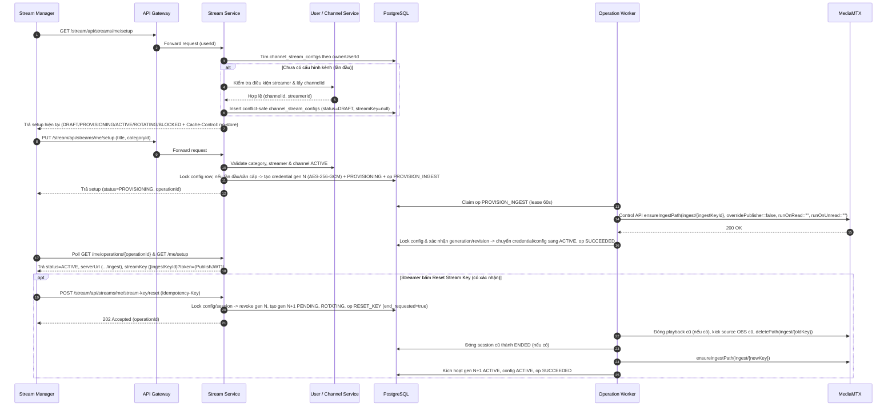
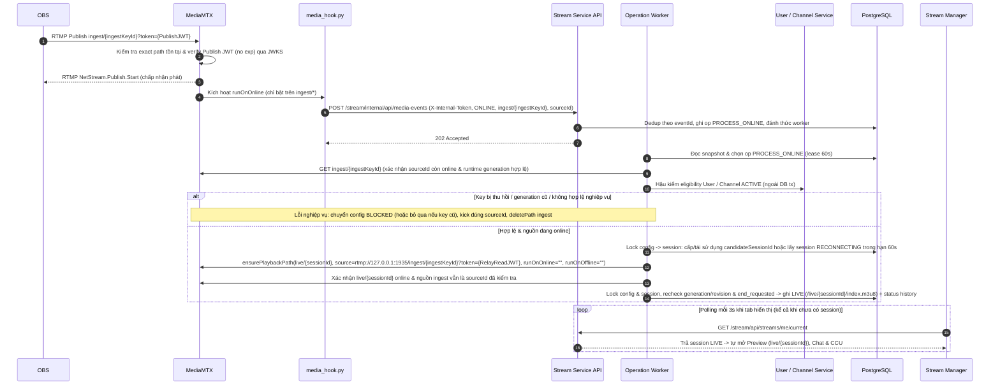
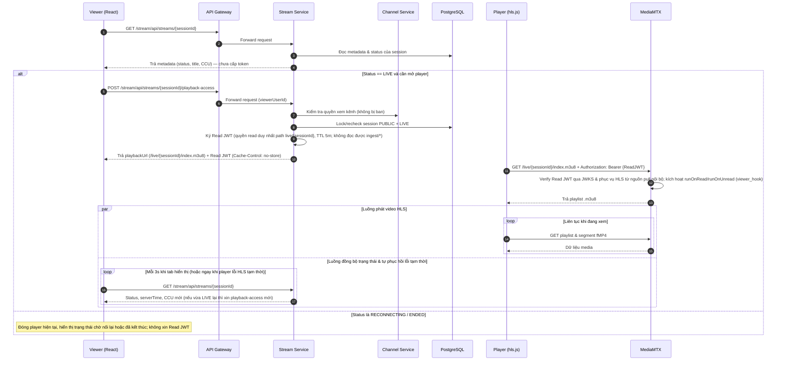
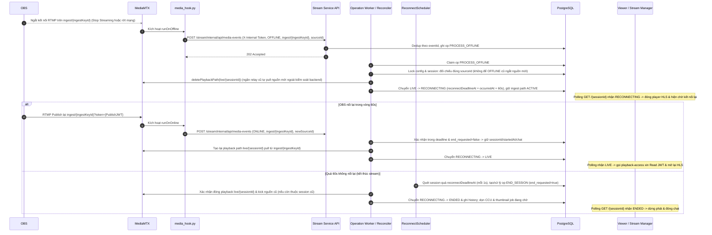
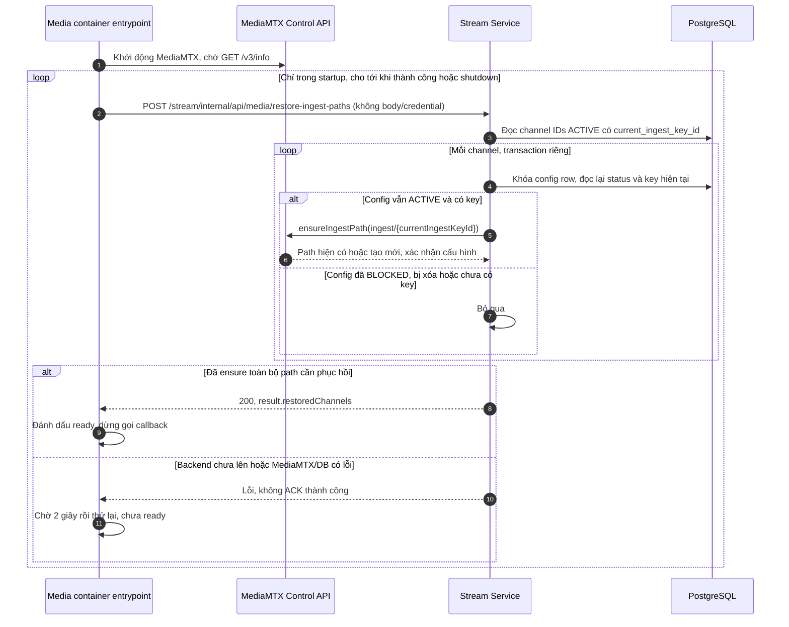

# Streaming — Architecture and Workflow

## 1. Giới thiệu và Hướng dẫn sử dụng

Hệ thống cho phép streamer phát trực tiếp từ **OBS** tới **MediaMTX** qua RTMP/RTMPS bằng một **Stream Key cố định theo kênh** và người xem xem trực tiếp trên **React + hls.js** qua HLS. **Stream Service** quản lý cấu hình kênh (`channel_stream_configs`), vòng đời credential (`channel_stream_credentials`), hàng đợi điều phối media (`stream_media_operations`), vòng đời phiên phát (`stream_sessions`), kiểm tra quyền nghiệp vụ và cấp/ký JWT bằng khóa RSA; **MediaMTX 1.21.2** tự xác thực JWT qua JWKS và chuyển tiếp media nội bộ từ path ingest sang path playback bằng RTMP pull (không transcoding).

```text
Luồng video:   [OBS] -- RTMP/RTMPS (ingest/{ingestKeyId}) --> [MediaMTX RTMP pull -> live/{sessionId}] -- HLS --> [React + hls.js]
Luồng API:     [React UI] --> [API Gateway] --> [Stream Service] --> [PostgreSQL / Redis]
Media <-> BE:  [MediaMTX ingest hook] -- POST /stream/internal/api/media-events (X-Internal-Token) --> [Stream Service]
               [Stream Service Worker / Reconciler] -- Control API (ensure/delete path, kick conn) --> [MediaMTX]
```

### Hướng dẫn livestream từng bước

| Tên bước | Mô tả cách thực hiện |
| --- | --- |
| **1. Mở Stream Manager** | Đăng nhập bằng tài khoản streamer. Mở menu tài khoản, chọn **Streamer Dashboard**, rồi vào **Stream Manager**. |
| **2. Đặt tiêu đề và danh mục** | Trong **Stream Information**, bấm **Set title & category** hoặc biểu tượng bút chì. Nhập **Stream title**, chọn **Category**, rồi bấm **Save**. |
| **3. Tạo khóa phát lần đầu** | Mở **Stream URL & Key**, bấm **Reset** cạnh **Stream Key** để tạo khóa. Bấm biểu tượng con mắt ở từng ô để hiện **Stream URL** và **Stream Key**, rồi sao chép cả hai trước khi rời trang. |
| **4. Cài đặt OBS** | Trong OBS, mở **Settings → Stream** và chọn **Custom**. Dán **Stream URL** vào ô **Server** và dán **Stream Key** vào ô **Stream Key**, rồi lưu cài đặt. OBS có thể dùng lại khóa này cho các buổi phát sau. |
| **5. Bắt đầu livestream** | Chuẩn bị hình ảnh và âm thanh trong OBS, rồi bấm **Start Streaming**. Quay lại **Stream Manager** để kiểm tra trạng thái **LIVE**, xem **Stream Preview**, theo dõi **Stream Chat** và số người đang xem. |
| **6. Sửa thông tin khi đang phát** | Bấm biểu tượng bút chì trong **Stream Information**, sửa tiêu đề hoặc danh mục, rồi bấm **Save**. Bạn có thể để OBS tiếp tục phát trong lúc chỉnh sửa. |
| **7. Kết nối lại hoặc kết thúc buổi phát** | Bấm **Stop Streaming** trong OBS để dừng phát. Khi OBS ngắt kết nối, **Stream Manager** hiển thị **RECONNECTING**. Nếu muốn tiếp tục buổi phát, hãy kết nối lại từ OBS trong vòng **60 giây**. Hết thời gian này, buổi phát tự kết thúc. |
| **8. Đổi khóa khi nghi ngờ bị lộ** | Vào **Stream URL & Key**, bấm **Reset**, rồi xác nhận bằng **Reset stream key**. Thao tác này kết thúc ngay buổi phát đang diễn ra. Sao chép **Stream URL** và **Stream Key** mới vào OBS trước khi phát lại. |

---

## 2. Workflow Start Livestream

### 2.1. Chuẩn bị tại Stream Manager (Lazy `DRAFT`, Save để Provision & Reset Key)



### 2.2. Bấm Start Streaming trên OBS (Tự tạo session & lên LIVE)



---

## 3. Workflow Xem Stream



---

## 4. Workflow Reconnecting, End Stream và Phục hồi (Reconciliation)



- **Phục hồi ingest hiện tại (V6)**: entrypoint của Media Server gọi endpoint nội bộ sau khi MediaMTX Control API sẵn sàng, như mục 6. Không chạy `StreamMediaReconciler`, hàng đợi operation hoặc scheduler phục hồi media trong Stream Service.

---

## 5. Cơ chế bảo mật

1. **Xác thực chữ ký bất đối xứng RS256 & JWKS**:
   - **Stream Service** giữ private key RS256 (`STREAM_MEDIA_PRIVATE_KEY_BASE64`, tối thiểu 2048-bit) để ký mọi Media JWT và công bố public key tại `GET /stream/api/media/jwks`. Khóa RSA và khóa AES phải giữ ổn định qua các lần deploy (thay khóa là thao tác vận hành riêng).
   - **MediaMTX** tự tải và cache public key từ JWKS; không lưu private key hay secret mã hóa trong container media.
2. **Mã hóa Stream Key & Relay Credential tại DB (`AES-256-GCM`)**:
   - `Publish JWT` (của OBS) và `Relay Read JWT` (nội bộ để `live/{sessionId}` kéo RTMP từ `ingest/{ingestKeyId}`) **không có `exp`** và dùng lại cho tới khi reset key hoặc bị block.
   - Cả hai token được mã hóa bằng **AES-256-GCM** (`STREAM_MEDIA_CREDENTIAL_ENCRYPTION_KEY`) trong bảng `channel_stream_credentials` để `GET /me/setup` trả lại đúng chuỗi key cho owner mà không lưu plaintext JWT trong DB.
3. **Tách biệt đường dẫn Ingest & Playback + Giới hạn quyền từng loại JWT**:
   - **Publish JWT**: chỉ có quyền `action: publish` trên đúng `ingest/{ingestKeyId}` (`Server URL` có suffix `/ingest`, Stream Key là `{ingestKeyId}?token={PublishJWT}`).
   - **Relay Read JWT**: chỉ có quyền `action: read` trên `ingest/{ingestKeyId}` (`sub = relay-internal`), chỉ dùng nội bộ giữa MediaMTX playback source và ingest path; **không bao giờ** trả về frontend hoặc ghi vào log.
   - **Viewer / Worker Read JWT**: chỉ có quyền `action: read` trên đúng playback path `live/{sessionId}`, `TTL 5 phút`, không thể dùng để đọc `ingest/*` hoặc session khác.
   - **Control API JWT**: chỉ có quyền `action: api`, `TTL 5 phút`, chỉ cấp cho Stream Service và `viewer_hook.py` (mount file read-only).
4. **Whitelist path trên MediaMTX (`paths: {}`) & Chống chiếm luồng**:
   - MediaMTX cấu hình `paths: {}` (không có catch-all) và `overridePublisher: false`. Không tồn tại exact path hoặc đang có OBS phát hợp lệ thì kết nối RTMP thứ hai bị từ chối ngay.
   - Hook `runOnOnline`/`runOnOffline` chỉ bật trên `ingest/*`; `runOnRead`/`runOnUnread` chỉ bật trên `live/*`, tránh vòng lặp tạo session và đếm nhầm CCU từ kết nối relay kỹ thuật.
5. **Thu hồi key (`Reset`), khóa kênh (`BLOCKED`) & Hậu kiểm nghiệp vụ**:
   - Credential `REVOKED` không bao giờ được kích hoạt lại. Reset key đánh dấu thu hồi thế hệ cũ, chốt phiên hiện tại `ENDED`, xóa path `ingest/{oldKey}`, kick đúng connection cũ trước khi kích hoạt `ingest/{newKey}`.
   - Khi `PROCESS_ONLINE` xử lý nguồn mới, backend hậu kiểm User/Channel `ACTIVE` (nếu lỗi nghiệp vụ thì chuyển config `BLOCKED`, kick nguồn và xóa ingest path; lỗi 503/timeout tạm thời thì retry chứ không tự thu hồi key).
6. **Bảo vệ Webhook nội bộ & Dữ liệu nhạy cảm**:
   - `POST /stream/internal/api/media-events` chỉ nhận qua nội bộ với header `X-Internal-Token` (`STREAM_MEDIA_CALLBACK_INTERNAL_TOKEN`, so sánh constant-time SHA-256) và **không expose qua API Gateway**.
   - Các API `/me/setup`, `/me/stream-key/reset`, `/me/operations/{operationId}`, `/me/current` và `/playback-access` đều trả header `Cache-Control: no-store`.
   - Frontend chỉ giữ credential trong bộ nhớ phiên làm việc (không lưu `localStorage`/`sessionStorage`), và log/DTO `toString()`/bảng `stream_media_operations.payload` tuyệt đối không chứa JWT thô hoặc query `token=...`.

## 6. Khôi phục ingest sau MediaMTX restart (V6)



Stream key và khóa ký RSA được giữ nguyên. Callback gọi lặp an toàn, dùng cùng khóa config với thao tác cấp/thay key để không mở lại ingest key đã bị thay thế. `DRAFT`/`BLOCKED` không được phục hồi; callback không tạo session, không mở playback path và không phục hồi phiên đã kết thúc. Đây là bước khởi động Media Server, không phải schedule job ở backend. Xem [contract](../contracts/streaming/README.md).
