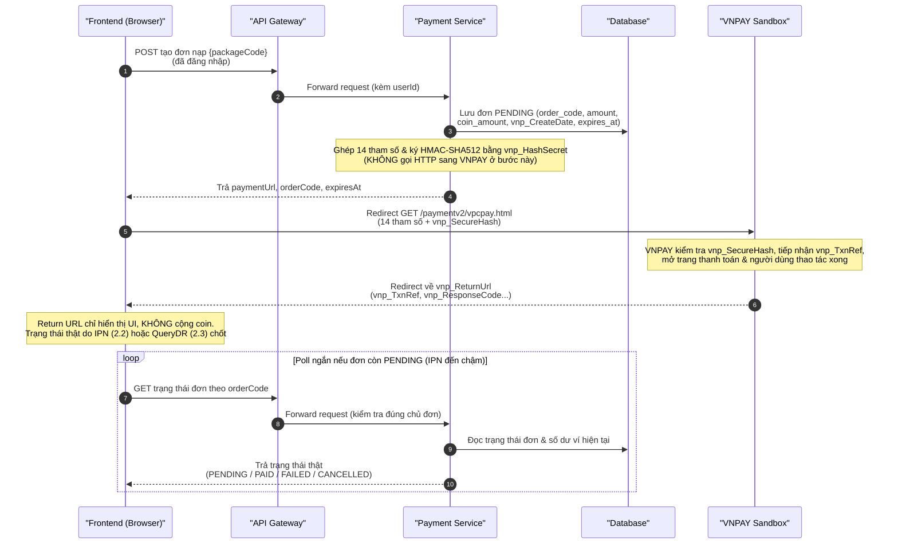
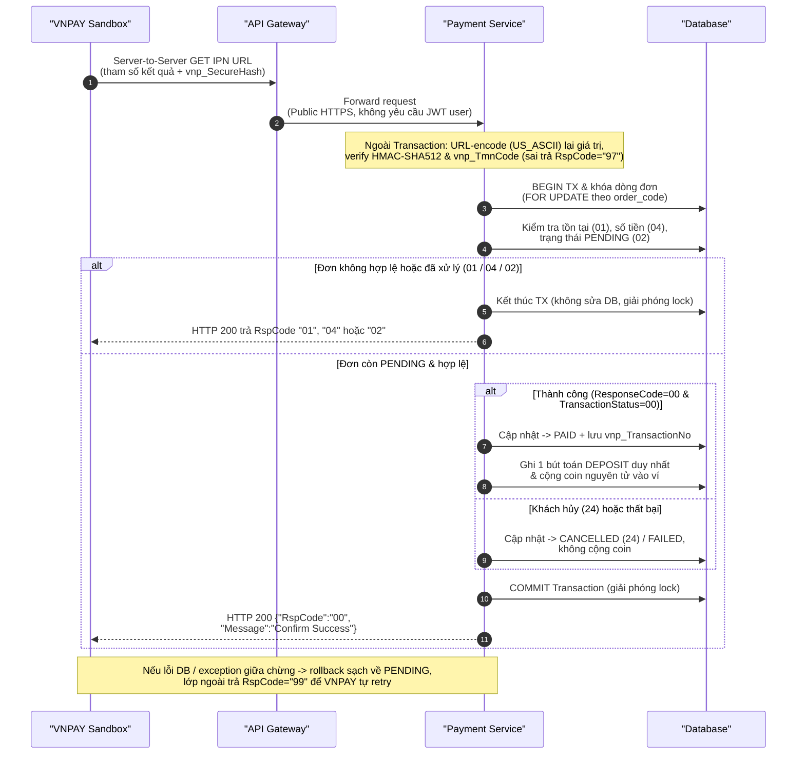
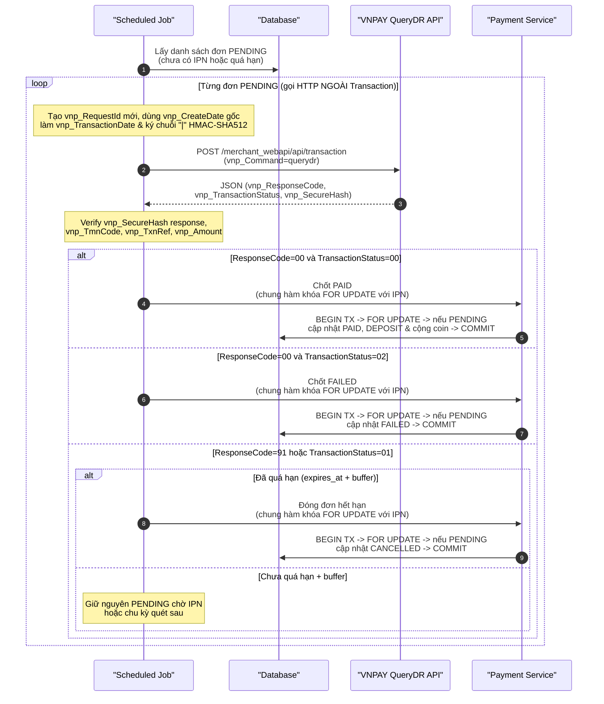
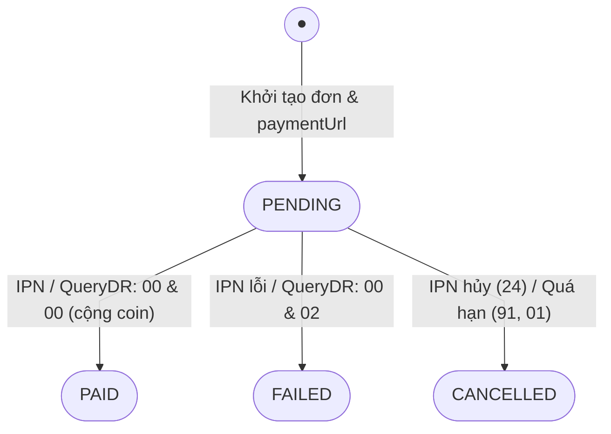

# VNPAY Coin Deposit — Kiến trúc và Workflow

## 1. Mô tả và phạm vi

Tài liệu đặc tả kiến trúc, giao thức của từng endpoint, máy trạng thái, luồng xử lý End-to-End và các kịch bản biên (edge cases) cho nghiệp vụ **nạp coin vào ví người dùng** trong **RealLive** qua cổng thanh toán **VNPAY PAY 2.1.0 (Sandbox)** theo mô hình **gói nạp cố định (`packageCode`)**.

Kiến trúc xoay quanh **4 điểm tích hợp chính với VNPAY**:

| # | Điểm tích hợp | Phương thức & URL | Chiều gọi | Vai trò trong kiến trúc |
|---|---|---|---|---|
| 1 | **Checkout Redirect** | `GET https://sandbox.vnpayment.vn/paymentv2/vpcpay.html` | Trình duyệt client → VNPAY *(Backend tự ghép chuỗi & ký, không gọi HTTP sang VNPAY)* | Mở giao diện chọn ngân hàng, nhập thẻ và xác thực thanh toán trên cổng VNPAY |
| 2 | **IPN Webhook** | `GET https://{domain}/payment/api/webhooks/vnpay/ipn` | Server VNPAY → Backend | **Nguồn tin cậy chính** để xác nhận kết quả thanh toán, chốt trạng thái đơn và cộng coin nguyên tử |
| 3 | **Return URL** | `GET {frontendOrigin}/payment/vnpay-return` | VNPAY redirect trình duyệt → Frontend | Điều hướng người dùng quay lại ứng dụng và hiển thị kết quả dựa trên trạng thái thật từ Backend (**không cộng coin tại đây**) |
| 4 | **QueryDR API** | `POST https://sandbox.vnpayment.vn/merchant_webapi/api/transaction` | Backend (Scheduled Job) → Server VNPAY | Đối soát dự phòng cho các đơn `PENDING` bị chậm/mất IPN hoặc quá hạn thanh toán |

### Nguyên tắc kiến trúc và phạm vi

- **Không tin dữ liệu từ client**: Frontend chỉ gửi mã gói (`packageCode`); Backend tự xác định người dùng từ phiên đăng nhập, tự tra số tiền VND và số coin tương ứng của gói.
- **Một khóa bí mật đối xứng cho toàn bộ luồng**: Tất cả thao tác ký và xác thực chữ ký (`vpcpay.html`, `IPN`, `Return URL`, `QueryDR`) đều dùng chung một `vnp_HashSecret` gắn với `vnp_TmnCode` (giữ hoàn toàn tại Backend).
- **Tách biệt hiển thị UI và xử lý dòng tiền**: `Return URL` chỉ hiển thị giao diện; việc cộng coin chỉ thực hiện qua `IPN Webhook` hoặc `QueryDR API` dưới cơ chế **Pessimistic Locking** và giao dịch nguyên tử (ACID).
- **Ngoài phạm vi đặc tả này**: Không xử lý quy trình rà soát thủ công giao dịch nghi ngờ gian lận (`07`) hoặc giao dịch đảo (`04`), không bao gồm API hoàn tiền (`refund`) và không bao gồm nghiệp vụ chi trả doanh thu cho streamer.

### Tài liệu liên quan

- [System Architecture](System%20Architecture.md)
- [VNPAY PAY 2.1.0 — Tạo URL & IPN](https://sandbox.vnpayment.vn/apis/docs/thanh-toan-pay/pay.html#tao-url-thanh-toan)
- [VNPAY — Truy vấn kết quả (QueryDR)](https://sandbox.vnpayment.vn/apis/docs/truy-van-hoan-tien/querydr%26refund.html)

---

## 2. Workflow End-to-End

### 2.1. Workflow tạo URL thanh toán

### 2.2. Workflow nhận IPN

### 2.3. Workflow đối soát dự phòng (Scheduled Job + QueryDR)

---

## 3. State Machine Diagram (Vòng đời đơn thanh toán)

### Quy tắc chuyển trạng thái

- **`PENDING` → `PAID`**: Khi IPN hoặc `QueryDR` trả đồng thời `vnp_ResponseCode = "00"` và `vnp_TransactionStatus = "00"` (thực hiện cộng coin nguyên tử).
- **`PENDING` → `FAILED`**: Khi IPN trả mã lỗi thanh toán khác `"00"` và `"24"` (`11`, `12`, `13`, `51`, `99`...), hoặc `QueryDR` trả `vnp_ResponseCode = "00"` và `vnp_TransactionStatus = "02"`.
- **`PENDING` → `CANCELLED`**: Khi IPN trả `vnp_ResponseCode = "24"` (khách chủ động hủy), hoặc đã quá mốc `expires_at + buffer` kèm kết quả `QueryDR` là `vnp_ResponseCode = "91"` / `vnp_TransactionStatus = "01"`.
- **Nguyên tắc một chiều & bất biến**: Một đơn nạp luôn khởi tạo ở **`PENDING`** và chỉ được chuyển một chiều sang một trong ba trạng thái kết thúc (`PAID`, `FAILED`, `CANCELLED`). Mọi callback IPN lặp lại hoặc lượt chạy `QueryDR` đến sau khi đơn đã rời khỏi `PENDING` đều phải bỏ qua việc cập nhật và tuyệt đối không cộng coin lần hai.

---

## 4. Chi tiết 4 Endpoint của VNPAY

### 4.1. Endpoint 1 — Checkout Redirect (VNPAY PAY 2.1.0)

#### Endpoint
`GET https://sandbox.vnpayment.vn/paymentv2/vpcpay.html`

#### Mô tả mục đích và chức năng chính
- Trang web giao diện thanh toán của VNPAY để người dùng chọn ngân hàng, nhập thông tin thẻ và xác thực thanh toán (**không phải JSON API**).
- Backend RealLive **không gửi HTTP request** sang endpoint này; Backend chỉ tạo đơn `PENDING`, lắp ghép 14 tham số bắt buộc và ký `HMAC-SHA512` bằng `vnp_HashSecret` thành chuỗi `paymentUrl` hoàn chỉnh rồi trả cho Frontend chuyển hướng trình duyệt (`GET`). VNPAY chỉ bắt đầu ghi nhận `vnp_TxnRef` và `vnp_CreateDate` khi trình duyệt người dùng thực sự mở URL này.
- **Quy tắc tạo chữ ký `vnp_SecureHash`**: Loại bỏ trường rỗng/`null` và bỏ `vnp_SecureHash`, `vnp_SecureHashType`; sắp xếp key A → Z; ghép `hashData` dạng `key=URLEncoder(value, US_ASCII)` nối bằng `&` (khoảng trắng thành `+`); băm `HMAC-SHA512` bằng `vnp_HashSecret` thành chuỗi hex 128 ký tự chữ thường.
- **Lưu ý múi giờ**: Dùng `Asia/Ho_Chi_Minh` (GMT+7); không dùng `Etc/GMT+7` vì chuẩn POSIX hiểu ngược thành UTC−7 (lệch 14 tiếng).

#### Các tham số Request DTO (Query Parameters gửi sang VNPAY)

| Field Name | Bắt buộc | Mô tả |
|---|---|---|
| `vnp_Version` | Có | Phiên bản API VNPAY, cố định `"2.1.0"` |
| `vnp_Command` | Có | Mã lệnh giao dịch, cố định `"pay"` |
| `vnp_TmnCode` | Có | Mã website/merchant do VNPAY cấp |
| `vnp_Amount` | Có | Số tiền thanh toán bằng **VND × 100** (số nguyên 64-bit, không thập phân; ví dụ `1000000` cho 10.000 VND) |
| `vnp_CurrCode` | Có | Đơn vị tiền tệ, cố định `"VND"` |
| `vnp_TxnRef` | Có | Mã tham chiếu đơn hàng phía RealLive (`order_code`), duy nhất cho mỗi lần khởi tạo thanh toán |
| `vnp_OrderInfo` | Có | Mô tả đơn hàng bằng tiếng Việt không dấu, tránh ký tự đặc biệt và không chứa thông tin cá nhân nhạy cảm |
| `vnp_OrderType` | Có | Mã danh mục hàng hóa/dịch vụ (ví dụ `"other"`) |
| `vnp_Locale` | Có | Ngôn ngữ giao diện cổng VNPAY (`"vn"` hoặc `"en"`) |
| `vnp_ReturnUrl` | Có | URL trang Frontend để VNPAY redirect trình duyệt người dùng quay lại sau khi thao tác xong |
| `vnp_IpAddr` | Có | Địa chỉ IPv4 của client thực hiện giao dịch (chuẩn hóa từ `X-Forwarded-For` hoặc remote address; IPv6 loopback quy đổi về `127.0.0.1`) |
| `vnp_CreateDate` | Có | Thời điểm tạo giao dịch theo `yyyyMMddHHmmss` (GMT+7 `Asia/Ho_Chi_Minh`); **phải lưu lại** để truyền vào `QueryDR` |
| `vnp_ExpireDate` | Có | Thời điểm hết hạn thanh toán theo `yyyyMMddHHmmss` (GMT+7 `Asia/Ho_Chi_Minh`); bắt buộc theo đặc tả 2.1.0 dù URL ví dụ của VNPAY bỏ sót |
| `vnp_BankCode` | Không | Mã phương thức/ngân hàng; bỏ qua ở phiên bản đầu để người dùng tự chọn trên trang VNPAY |
| `vnp_SecureHash` | Có | Chữ ký bảo mật `HMAC-SHA512` (128 ký tự hex = 64 byte) ký từ các tham số trên |

#### Các tham số Response DTO
- Không có Response DTO JSON trực tiếp; endpoint này trả về trang HTML giao diện thanh toán cho trình duyệt. Kết quả sau thanh toán được trả về thông qua **Endpoint 3 (Return URL)** cho trình duyệt và **Endpoint 2 (IPN Webhook)** cho Backend.

---

### 4.2. Endpoint 2 — IPN Webhook (Instant Payment Notification)

#### Endpoint
`GET https://{domain}/payment/api/webhooks/vnpay/ipn` *(Server VNPAY → Backend RealLive)*

#### Mô tả mục đích và chức năng chính
- Endpoint **Public HTTPS** (không yêu cầu JWT user, tắt HTTP cache) được đăng ký trên Merchant Portal để server VNPAY gọi trực tiếp vào Backend ngay khi giao dịch có kết quả.
- Là **nguồn tin cậy chính** để xác thực giao dịch và cập nhật dòng tiền:
  - **Ngoài Transaction**: tách `vnp_SecureHash` (và `vnp_SecureHashType` nếu có), sắp xếp key A → Z, **URL-encode (`US_ASCII`) lại giá trị query đã bị framework decode** rồi băm `HMAC-SHA512` để kiểm tra chữ ký theo thời gian hằng và đối chiếu `vnp_TmnCode` (sai trả `97`).
  - **Trong 1 Transaction ACID duy nhất**: khóa dòng đơn bằng **Pessimistic Lock (`SELECT ... FOR UPDATE`)** theo `vnp_TxnRef` (`order_code`), kiểm tra tồn tại (`01`), khớp `vnp_Amount == amount * 100` (`04`) và kiểm tra idempotency `status == PENDING` (`02`). Chỉ cộng coin nguyên tử vào ví và ghi 1 bút toán `DEPOSIT` duy nhất khi **cả `vnp_ResponseCode == "00"` VÀ `vnp_TransactionStatus == "00"`**; nếu `24` thì chốt `CANCELLED`, các mã lỗi khác chốt `FAILED`.
  - **Lỗi hệ thống & Retry**: nếu có lỗi DB/exception giữa transaction, transaction tự rollback sạch về `PENDING` và lớp ngoài transaction trả `RspCode = "99"`. VNPAY tự động retry (tối đa khoảng 10 lần, mỗi lần cách khoảng 5 phút) khi timeout, HTTP 5xx hoặc nhận `99`, và dừng retry ngay khi nhận `00` hoặc `02`.

#### Các tham số Request DTO (Query Parameters VNPAY gửi về Backend)

| Field Name | Bắt buộc | Mô tả |
|---|---|---|
| `vnp_TmnCode` | Có | Mã website/merchant; phải khớp với cấu hình của RealLive |
| `vnp_TxnRef` | Có | Mã đơn hàng phía RealLive (`order_code`) dùng để tra cứu và khóa đơn |
| `vnp_Amount` | Có | Số tiền thanh toán dạng VND × 100; phải khớp `order.amount * 100` |
| `vnp_OrderInfo` | Có | Nội dung mô tả đơn hàng đã gửi lúc tạo thanh toán |
| `vnp_ResponseCode` | Có | Mã kết quả / nguyên nhân chi tiết (`00`: thành công, `24`: khách hủy, `11`: hết hạn, `13`: sai OTP, `51`: không đủ số dư, `99`: lỗi khác) |
| `vnp_TransactionStatus` | Có | Trạng thái dòng tiền trên cổng VNPAY (`00`: thành công, `01`: chưa hoàn tất, `02`: bị lỗi/thất bại) |
| `vnp_TransactionNo` | Có | Mã giao dịch do VNPAY sinh ra để đối soát (nếu hủy sớm có thể trả `"0"`, cần chuẩn hóa `"0"`/rỗng thành `NULL` khi lưu) |
| `vnp_PayDate` | Không | Thời điểm thanh toán ghi nhận tại VNPAY (`yyyyMMddHHmmss`, GMT+7) |
| `vnp_BankCode` | Không | Mã ngân hàng hoặc ví/cổng khách hàng chọn thanh toán (ví dụ `NCB`, `VNPAYQR`) |
| `vnp_BankTranNo` | Không | Mã giao dịch ghi nhận phía ngân hàng |
| `vnp_CardType` | Không | Loại thẻ hoặc kênh thanh toán (`ATM`, `QRCODE`, `INTCARD`) |
| `vnp_SecureHash` | Có | Chữ ký `HMAC-SHA512` do VNPAY tạo trên các tham số phản hồi |

#### Các tham số Response DTO (JSON thô Backend trả về cho VNPAY — HTTP `200 OK`)

> Trả JSON thô đúng 2 field viết hoa đầu ở cấp ngoài cùng, không bọc wrapper `ApiResponse` của hệ thống.

| Field Name | Bắt buộc | Mô tả |
|---|---|---|
| `RspCode` | Có | Mã xác nhận gửi lại VNPAY: `"00"` (ghi nhận xong — dừng retry, áp dụng cho cả `PAID`, `CANCELLED`, `FAILED`), `"02"` (đơn đã xử lý trước đó — dừng retry), `"01"` (không tìm thấy đơn), `"04"` (sai số tiền), `"97"` (sai chữ ký hoặc `vnp_TmnCode`), `"99"` (lỗi hệ thống/DB rollback — kích hoạt VNPAY retry) |
| `Message` | Có | Thông điệp mô tả tương ứng với `RspCode` (`"Confirm Success"`, `"Order already confirmed"`, `"Order not Found"`, `"Invalid Amount"`, `"Invalid Checksum"`, `"Unknown error"`) |

---

### 4.3. Endpoint 3 — Return URL

#### Endpoint
`GET {frontendOrigin}/payment/vnpay-return` *(VNPAY redirect trình duyệt người dùng → Frontend)*

#### Mô tả mục đích và chức năng chính
- Đích chuyển hướng trình duyệt đưa người dùng quay về ứng dụng RealLive sau khi thanh toán xong, gặp lỗi hoặc bấm Hủy trên trang VNPAY.
- **Chỉ phục vụ hiển thị UI**, tuyệt đối không dùng để chốt đơn hay cộng coin và không tin trực tiếp giá trị `vnp_ResponseCode` trên URL trình duyệt.
- Frontend đọc `vnp_TxnRef` từ query string rồi gọi API nội bộ về Backend (kèm phiên đăng nhập của user) để lấy trạng thái thật từ DB (`PAID`, `FAILED`, `CANCELLED`). Nếu vẫn là `PENDING` (do IPN về chậm hơn redirect vài giây), giao diện hiển thị trạng thái chờ và polling ngắn hạn tới Backend.

#### Các tham số Request DTO (Query Parameters VNPAY gắn khi redirect về Frontend)

| Field Name | Bắt buộc | Mô tả |
|---|---|---|
| `vnp_TmnCode` | Có | Mã website/merchant của RealLive |
| `vnp_TxnRef` | Có | Mã đơn hàng (`order_code`) Frontend dùng để hỏi trạng thái thật từ Backend |
| `vnp_Amount` | Có | Số tiền thanh toán dạng VND × 100 |
| `vnp_OrderInfo` | Có | Nội dung mô tả đơn hàng |
| `vnp_ResponseCode` | Có | Mã kết quả giao dịch phía VNPAY (chỉ tham khảo hiển thị sơ bộ, không tin cậy để xử lý tiền) |
| `vnp_TransactionStatus` | Có | Trạng thái giao dịch trên VNPAY (`00`, `01`, `02`) |
| `vnp_TransactionNo` | Có | Mã giao dịch trên hệ thống VNPAY (`"0"` nếu chưa phát sinh giao dịch) |
| `vnp_PayDate` | Không | Thời điểm thanh toán (`yyyyMMddHHmmss`, GMT+7) |
| `vnp_BankCode` | Không | Mã ngân hàng thanh toán |
| `vnp_BankTranNo` | Không | Mã giao dịch phía ngân hàng |
| `vnp_CardType` | Không | Loại thẻ hoặc kênh thanh toán (`ATM`, `QRCODE`, `INTCARD`) |
| `vnp_SecureHash` | Có | Chữ ký `HMAC-SHA512` của VNPAY gắn trên URL redirect |

#### Các tham số Response DTO
- Không có Response DTO JSON trả về cho VNPAY; trang Frontend hiển thị kết quả thanh toán dựa trên dữ liệu trạng thái đơn thật đọc từ Backend.

---

### 4.4. Endpoint 4 — QueryDR API (Truy vấn kết quả giao dịch)

#### Endpoint
`POST https://sandbox.vnpayment.vn/merchant_webapi/api/transaction` *(Backend Scheduled Job → Server VNPAY)*

#### Mô tả mục đích và chức năng chính
- API `POST` JSON server-to-server do **Scheduled Reconciliation Job** của Backend chủ động gọi sang VNPAY để tra cứu trạng thái thực tế của các đơn còn `PENDING` (do mất/chậm IPN, server từng sập quá hạn retry hoặc user đóng tab bỏ ngang không bấm Hủy).
- **Quy tắc ký và xử lý đối soát**:
  - **Ký request**: Nối giá trị bằng ký tự `|` theo thứ tự cố định `vnp_RequestId|vnp_Version|vnp_Command|vnp_TmnCode|vnp_TxnRef|vnp_TransactionDate|vnp_CreateDate|vnp_IpAddr|vnp_OrderInfo` rồi băm `HMAC-SHA512` bằng `vnp_HashSecret`.
  - **Verify response**: Kiểm tra `vnp_SecureHash` trả về bằng công thức nối chuỗi `|` theo thứ tự `vnp_ResponseId|vnp_Command|vnp_ResponseCode|vnp_Message|vnp_TmnCode|vnp_TxnRef|vnp_Amount|vnp_BankCode|vnp_PayDate|vnp_TransactionNo|vnp_TransactionType|vnp_TransactionStatus|vnp_OrderInfo` (kèm các trường khuyến mại nếu có), đồng thời đối chiếu `vnp_TmnCode`, `vnp_TxnRef` và `vnp_Amount`.
  - **Nguyên tắc đối soát**: Gọi HTTP `QueryDR` **ở ngoài DB transaction**, sau đó dùng chung luồng chốt đơn có **Pessimistic Lock (`FOR UPDATE`)** với IPN. Lưu ý `vnp_ResponseCode == "00"` chỉ báo gọi API tra cứu thành công; kết quả thanh toán thực tế quyết định bởi **`vnp_TransactionStatus`**:
    - `ResponseCode = "00"` và `TransactionStatus = "00"` → chốt `PAID` + cộng coin.
    - `ResponseCode = "00"` và `TransactionStatus = "02"` → chốt `FAILED`.
    - `ResponseCode = "91"` (không tìm thấy) hoặc `TransactionStatus = "01"` (chưa hoàn tất) → giữ `PENDING` nếu chưa quá `expires_at + buffer`, chốt `CANCELLED` nếu đã quá `expires_at + buffer`.
    - Timeout / lỗi mạng → giữ `PENDING`, thử lại ở chu kỳ sau.

#### Các tham số Request DTO (JSON Body Backend gửi sang VNPAY)

| Field Name | Bắt buộc | Mô tả |
|---|---|---|
| `vnp_RequestId` | Có | Mã định danh duy nhất sinh mới cho mỗi lần gọi API `querydr` |
| `vnp_Version` | Có | Phiên bản API VNPAY, cố định `"2.1.0"` |
| `vnp_Command` | Có | Mã lệnh API, cố định `"querydr"` |
| `vnp_TmnCode` | Có | Mã website/merchant do VNPAY cấp |
| `vnp_TxnRef` | Có | Mã đơn hàng (`order_code`) cần truy vấn kết quả |
| `vnp_OrderInfo` | Có | Mô tả ngắn cho yêu cầu tra cứu (tiếng Việt không dấu) |
| `vnp_TransactionDate` | Có | **Chính xác chuỗi `vnp_CreateDate` ban đầu** đã dùng khi tạo checkout URL của đơn (`yyyyMMddHHmmss`, GMT+7) |
| `vnp_CreateDate` | Có | Thời điểm hiện tại Backend gửi request `querydr` (`yyyyMMddHHmmss`, GMT+7) |
| `vnp_IpAddr` | Có | Địa chỉ IP của server Backend thực hiện gọi API |
| `vnp_SecureHash` | Có | Chữ ký `HMAC-SHA512` ký trên chuỗi request nối bằng dấu gạch đứng theo thứ tự quy định của `querydr` |

#### Các tham số Response DTO (JSON Body VNPAY trả về cho Backend)

| Field Name | Bắt buộc | Mô tả |
|---|---|---|
| `vnp_ResponseId` | Có | Mã định danh duy nhất do VNPAY sinh ra cho phản hồi tra cứu |
| `vnp_Command` | Có | Mã lệnh API phản hồi (`"querydr"`) |
| `vnp_ResponseCode` | Có | Kết quả gọi API tra cứu (`"00"`: tìm thấy đơn/tra cứu thành công, `"91"`: không tìm thấy giao dịch, `"97"`: sai chữ ký, `"99"`: lỗi khác) |
| `vnp_Message` | Có | Thông điệp mô tả tương ứng với `vnp_ResponseCode` |
| `vnp_TmnCode` | Có | Mã website/merchant tương ứng với yêu cầu tra cứu |
| `vnp_TxnRef` | Có | Mã đơn hàng (`order_code`) được tra cứu |
| `vnp_Amount` | Có *(khi tìm thấy đơn)* | Số tiền thanh toán của giao dịch dạng VND × 100 |
| `vnp_OrderInfo` | Có *(khi tìm thấy đơn)* | Nội dung mô tả đơn hàng |
| `vnp_BankCode` | Không | Mã ngân hàng thanh toán (nếu có) |
| `vnp_PayDate` | Không | Thời điểm thanh toán ghi nhận tại VNPAY (`yyyyMMddHHmmss`, GMT+7) |
| `vnp_TransactionNo` | Không | Mã giao dịch trên hệ thống VNPAY (chuẩn hóa `"0"`/rỗng thành `NULL` khi lưu) |
| `vnp_TransactionType` | Không | Mã loại giao dịch phía VNPAY (thanh toán, hoàn tiền...) |
| `vnp_TransactionStatus` | Có *(khi tìm thấy đơn)* | Trạng thái thanh toán thực tế tại VNPAY (`"00"`: thành công, `"01"`: chưa hoàn tất, `"02"`: thất bại) |
| `vnp_PromotionCode` | Không | Mã khuyến mại áp dụng cho giao dịch (nếu có) |
| `vnp_PromotionAmount` | Không | Giá trị khuyến mại (nếu có) |
| `vnp_SecureHash` | Có | Chữ ký `HMAC-SHA512` của VNPAY ký trên chuỗi response nối bằng dấu gạch đứng theo thứ tự quy định của `querydr` để Backend verify |

---

## 5. Tổng hợp kịch bản và Edge Cases

| # | Kịch bản / Edge Case | Nguyên nhân | Cơ chế xử lý | Trạng thái & kết quả cuối |
|---|---|---|---|---|
| 1 | **Thanh toán thành công chuẩn** | User thanh toán xong, IPN về kịp và backend xử lý bình thường | Verify hash → Pessimistic Lock đơn → `PAID` + ghi 1 bút toán `DEPOSIT` + cộng ví nguyên tử → trả `RspCode=00` | `PAID`, cộng đúng 1 lần |
| 2 | **Mất response từ Backend về VNPAY** | Backend đã commit `PAID` và cộng coin nhưng rớt mạng/502 lúc gửi phản hồi → VNPAY retry IPN | Lần retry khóa đơn, thấy đơn không còn `PENDING` → bỏ qua cộng tiền, trả `RspCode=02` | `PAID`, cộng đúng 1 lần, VNPAY dừng retry |
| 3 | **Hai IPN trùng đến đồng thời hoặc Replay Attack** | VNPAY retry khi request trước đang xử lý chậm, hoặc user copy bộ tham số thật trên `vnp_ReturnUrl` bắn nhiều request `GET` song song vào IPN | Request 1 giữ `FOR UPDATE` trên dòng đơn; các request còn lại chờ đến khi request 1 commit rồi thấy đơn đã `PAID` → trả `RspCode=02`. Kết hợp ràng buộc duy nhất ở DB cho bút toán `DEPOSIT` của đơn | `PAID`, tuyệt đối không cộng đôi |
| 4 | **Backend sập / shutdown / mất mạng lúc nhận IPN** | Server bảo trì hoặc sự cố hạ tầng đúng thời điểm user trả tiền xong | Trong hạn retry, VNPAY gọi lại khi server phục hồi. Nếu sập quá hạn retry của VNPAY, đơn còn `PENDING` → khi hệ thống chạy lại, Scheduled Job gọi `QueryDR` thấy `00`/`00` → chốt `PAID` và cộng coin bù | `PAID`, không mất tiền người dùng |
| 5 | **Backend lỗi DB / exception ngay lúc cộng số dư** | Lỗi kết nối DB, deadlock hoặc exception ứng dụng giữa giao dịch | Cập nhật đơn, ghi bút toán `DEPOSIT` và cộng ví nằm trong **1 transaction ACID** → tự động rollback sạch về `PENDING`. Lớp ngoài transaction bắt lỗi và trả `RspCode=99` để VNPAY retry (cùng `QueryDR` dự phòng) | Không bao giờ lệch giữa trạng thái đơn và số dư ví |
| 6 | **User chủ động bấm Hủy trên VNPAY** | User chọn hủy giao dịch (`vnp_ResponseCode = 24`) | IPN khóa đơn, chuyển `PENDING` → `CANCELLED`, không cộng coin, trả `RspCode=00` | `CANCELLED`, ví không đổi |
| 7 | **Thanh toán thất bại từ ngân hàng / thẻ** | Hết hạn (`11`), thẻ khóa (`12`), sai OTP (`13`), không đủ số dư (`51`), lỗi khác (`99`) | IPN khóa đơn, chuyển `PENDING` → `FAILED`, lưu mã phản hồi chi tiết, không cộng coin, trả `RspCode=00` | `FAILED`, ví không đổi |
| 8 | **User chưa mở link hoặc đóng tab bỏ ngang** | User tạo đơn xong không redirect, hoặc mở trang VNPAY rồi tắt tab mà không bấm Hủy | Đơn giữ `PENDING`. Sau `expires_at + buffer`, Scheduled Job gọi `QueryDR` nhận `91` hoặc `01` → chốt `CANCELLED` | `CANCELLED`, không tồn đọng đơn treo |
| 9 | **Thanh toán thành công sát giờ hết hạn (`expires_at`)** | User xác nhận OTP sát `expires_at`, IPN về trễ hơn `expires_at` vài giây | Scheduled Job chỉ được phép chốt `CANCELLED` sau `expires_at + buffer` và dùng chung khóa `FOR UPDATE` với IPN | Không đóng nhầm `CANCELLED` đơn đã trả tiền |
| 10 | **User đóng trình duyệt trước khi về `vnp_ReturnUrl`** | Rớt mạng hoặc đóng tab ngay sau khi ngân hàng trừ tiền | Việc cộng coin không phụ thuộc `vnp_ReturnUrl`; luồng IPN server-to-server (và `QueryDR`) vẫn tự chốt `PAID` và cộng ví | `PAID`, mở lại ứng dụng thấy đủ coin |
| 11 | **IPN đến chậm hơn `vnp_ReturnUrl` vài giây** | Trình duyệt redirect về nhanh hơn server VNPAY gọi webhook IPN | Trang `vnp_ReturnUrl` hỏi trạng thái thật từ Backend; thấy `PENDING` thì hiển thị chờ xác nhận và polling ngắn hạn | Giao diện chính xác theo DB |
| 12 | **Đồng thời nạp coin và tiêu coin (hoặc nạp 2 đơn cùng lúc)** | User tặng quà hoặc nhận kết quả 2 đơn nạp chạm cùng một ví tại một thời điểm | Cộng ví bằng câu lệnh nguyên tử `balance = balance + coin_amount` (DB khóa dòng ví tuần tự theo giá trị mới nhất) và giữ thứ tự khóa cố định từ đơn thanh toán → ví | Không Lost Update, tránh deadlock |
| 13 | **IPN giả mạo / sai chữ ký / sai số tiền / sai mã đơn** | Request giả gửi vào endpoint IPN công khai | Verify `vnp_SecureHash` + `vnp_TmnCode` trước khi mở DB (`97`); kiểm tra tồn tại (`01`) và số tiền (`04`) nhưng **không thay đổi dữ liệu đơn** | An toàn toàn vẹn dữ liệu |
| 14 | **Phát thông báo / sự kiện sang dịch vụ khác sau khi nạp** | Lỗi mạng hoặc lỗi consumer bên ngoài sau khi cộng coin thành công | Chỉ phát sự kiện sau khi DB transaction đã `COMMIT` thành công (Outbox / After-Commit) | Lỗi thông báo không làm rollback tiền nạp |

> [!NOTE]
> Các trường hợp ngoại lệ liên quan đến **giao dịch nghi ngờ gian lận (`07`)** và **giao dịch đảo (`04`)** được loại trừ có chủ đích khỏi phạm vi đặc tả này theo quyết định thiết kế hiện tại.

---

## 6. Thông tin thẻ thử nghiệm VNPAY Sandbox

Các thông tin dưới đây được trích từ [trang demo VNPAY](https://sandbox.vnpayment.vn/apis/vnpay-demo/). Tên chủ thẻ cho tất cả các trường hợp là `NGUYEN VAN A`.

### 6.1. Thẻ NCB

| Số thẻ | Ngày phát hành | OTP | Kết quả thử nghiệm |
|---|---|---|---|
| `9704198526191432198` | `07/15` | `123456` | Thành công |
| `9704195798459170488` | `07/15` | — | Thẻ không đủ số dư |
| `9704192181368742` | `07/15` | — | Thẻ chưa kích hoạt |
| `9704193370791314` | `07/15` | — | Thẻ bị khóa |
| `9704194841945513` | `07/15` | — | Thẻ hết hạn |

### 6.2. Thẻ quốc tế

Các thẻ quốc tế dùng chung CVC/CVV `123`, email `test@gmail.com`, địa chỉ `22 Lang Ha` và thành phố `Ha Noi`.

| Loại thẻ | Số thẻ | Ngày hết hạn | Kết quả thử nghiệm |
|---|---|---|---|
| VISA (No 3DS) | `4456530000001005` | `12/26` | Thành công |
| VISA (3DS) | `4456530000001096` | `12/26` | Thành công |
| MasterCard (No 3DS) | `5200000000001005` | `12/26` | Thành công |
| MasterCard (3DS) | `5200000000001096` | `12/26` | Thành công |
| JCB (No 3DS) | `3337000000000008` | `12/26` | Thành công |
| JCB (3DS) | `3337000000200004` | `12/24` | Thành công |

### 6.3. Thẻ ATM nội địa

| Loại thẻ | Số thẻ | Ngày phát hành / hết hạn | OTP | Kết quả thử nghiệm |
|---|---|---|---|---|
| Nhóm ngân hàng qua NAPAS | `9704000000000018` | Phát hành `03/07` | `otp` | Thành công |
| Nhóm ngân hàng qua NAPAS | `9704020000000016` | Phát hành `03/07` | `otp` | Thành công |
| EXIMBANK | `9704310005819191` | Hết hạn `10/26` | — | Thành công |

Theo trang demo, môi trường thử nghiệm chỉ sử dụng được thông tin thẻ trong danh sách này; kết nối thử nghiệm của các ngân hàng khác đã tạm đóng. Một số ngày hết hạn ở trên đã qua; thông tin được giữ theo tài liệu nguồn.
