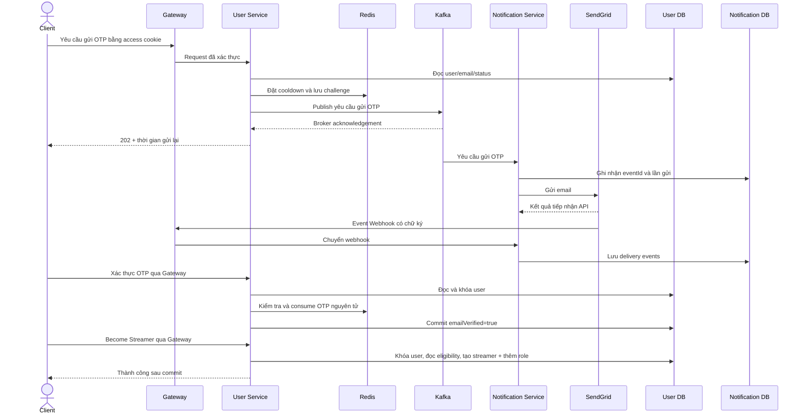

# Kế hoạch triển khai Become Streamer và xác thực email bằng OTP

Ngày tổng hợp: 2026-10-08. Trạng thái: kế hoạch; chưa triển khai chức năng hoặc chạy kiểm thử trong lượt lập kế hoạch này.

Kế hoạch dựa trên source hiện tại, tài liệu thiết kế và các quyết định nghiệp vụ đã thống nhất trong cuộc trò chuyện. Các tên class, topic, bảng lịch sử và mã lỗi mới bên dưới là đề xuất triển khai.

**Các quyết định đã chốt**

| Nội dung | Quyết định |
|---|---|
| Backend | Java 21, Spring Boot, Spring Security, JPA/Hibernate, PostgreSQL, Flyway |
| Email provider | SendGrid |
| Gửi email | User Service publish Kafka; Notification Service consume và gửi email |
| OTP | User Service sinh mã 6 số, quản lý thời hạn và kiểm tra mã |
| Cooldown | Theo user ID, Redis, 60 giây; request bị chặn không gia hạn cooldown |
| Kết quả giao email | Webhook về Notification Service, lưu database để tra cứu/debug |
| Phụ thuộc kết quả gửi | User Service không chờ webhook và không nhận sự kiện giao email |
| Danh tính | Lấy user ID từ authenticated security context/JWT subject |
| Nguồn eligibility | Query database ngay trong transaction; không lấy role/status/emailVerified từ JWT |
| Điều kiện đăng ký | User ACTIVE, email đã verified, không có role STREAMER, không có streamer record BANNED |
| SUSPENDED | Theo invariant đã chốt: vẫn giữ role STREAMER, nên bị chặn bởi kiểm tra role |
| Thành công | Thêm STREAMER bên cạnh USER và các role khác; tạo streamer ACTIVE |
| Tính nhất quán | Cấp role và tạo streamer trong cùng transaction; không có dữ liệu trùng |

Quyết định cập nhật: OTP sống 60 giây, cùng thời gian cooldown. Redis chỉ lưu một key String chứa `otpHash`. Mã đúng được consume ngay; mã sai không thay đổi value hoặc TTL. Giới hạn số lần nhập sai, quota dài hạn và giới hạn IP được để lại cho giai đoạn sau.

**Hiện trạng source đã kiểm tra**

- `user-service/pom.xml` và `notification-service/pom.xml`: Java 21, Spring Boot 4.1.1; đã có starter Kafka, Redis, JPA, Flyway và PostgreSQL.
- `UserEntity`: có `status`, `emailVerified`, nhiều role; `RoleEntity` có nhiều permission.
- `UserStatus`: ACTIVE/BANNED; `UserValidator.validateActive` có thể tái sử dụng.
- `ProfileController`: đã lấy UUID từ `@AuthenticationPrincipal Jwt`; các endpoint mới nên dùng cùng quy tắc.
- `SecurityConfig`: User Service đọc access cookie; các API mới mặc định cần xác thực.
- `CustomJwtDecoder` ở User Service chỉ parse JWT theo trust model hiện có; Gateway xác minh token. Backend phải chỉ nhận truy cập từ nguồn tin cậy, như README đã quy định.
- `AuthServiceImpl`: JWT scope chứa role/permission; refresh đọc user từ DB để phát token mới. Luồng register hiện gán `Collections.singleton(...)`; cần tránh sử dụng collection bất biến trong đường thêm role.
- `RedisConfig`: đã có `StringRedisTemplate`; chưa có OTP/cooldown.
- Migration User Service hiện có V1–V3; `user_roles` đã có khóa chính `(user_id, role_id)`. Chưa có bảng `streamers` hoặc seed STREAMER trong migration hiện tại.
- `docs/database/Data Model.md`: đã thiết kế `streamers` với UNIQUE(user_id), ACTIVE/PENDING/SUSPENDED/BANNED và thông tin đình chỉ.
- Notification Service mới có entry point và config port 8085; chưa có nghiệp vụ gửi mail, consumer, webhook hoặc migration lịch sử.
- `docker-compose.yml`: có Redis 7.4 và PostgreSQL 17 riêng cho User/Notification; chưa có Kafka.
- Gateway đã route `/notification/**` nguyên đường dẫn, nhưng Notification chưa cấu hình context path `/notification`. Gateway hiện yêu cầu access cookie cho các route này và bật CSRF ngoài cấu hình dev khi được cấu hình.
- Test User Service đã có JUnit, Mockito, Spring Boot, MockMvc, H2, test rollback/concurrency và một số test Redis thật tùy chọn.
- Chưa có feature OTP/streamer tương ứng trong source web/mobile được tìm kiếm.



1. **Ghi đặc tả API và quy tắc trạng thái.**

   Chốt contract trước khi viết controller. Không nhận `userId` hoặc email đích từ client; lấy danh tính từ principal và email từ DB. Xác thực email và đăng ký streamer là hai thao tác riêng. Email đã verified không cần OTP lại để đăng ký streamer.

   | Method/path trong controller | Request | Kết quả đề xuất |
   |---|---|---|
   | POST `/api/users/me/email-verification/otp` | Không có body nghiệp vụ | 202 khi Kafka xác nhận tiếp nhận; response chỉ có `expiresAt` của OTP |
   | POST `/api/users/me/email-verification/verify` | `{"otp":"012345"}` | 200 sau khi commit `emailVerified=true` |
   | POST `/api/users/me/become-streamer` | Không có body nghiệp vụ | 201, trả `streamerId`, `userId`, `status=ACTIVE` và các role cần thiết |
   | POST `/api/webhooks/sendgrid/events` ở Notification | Mảng sự kiện SendGrid, chữ ký trong headers | 2xx sau khi lưu bền vững; không dùng user JWT |

   Đường dẫn qua Gateway là `/user/...` cho User và `/notification/...` cho webhook. Giữ response envelope `ApiResponse`. API gửi OTP trả 202 chỉ có nghĩa yêu cầu được tiếp nhận, không có nghĩa email đã được giao.

   Bổ sung lỗi: email chưa verified (403), account không ACTIVE (403, tái sử dụng lỗi hiện có), streamer BANNED (403), đã là streamer (409), OTP không hợp lệ/hết hạn (400), vượt số lần thử hoặc cooldown (429), hạ tầng Redis/Kafka không sẵn sàng (503), role cấu hình thiếu (lỗi server). Các mã số mới phải không trùng `ErrorCode` hiện tại. Cooldown trả lỗi 429 theo ApiResponse hiện có; frontend tự đếm ngược 60 giây, không cần thời gian chờ trong response.

   Chính sách đề xuất cho dữ liệu bất nhất: đã có streamer ACTIVE/PENDING nhưng thiếu role thì trả conflict để xử lý riêng, không tạo record thứ hai hoặc tự khôi phục quyền. Flow này không tạo PENDING. Không tự chuyển SUSPENDED/BANNED về ACTIVE.

   Hoàn tất khi có contract, ví dụ request/response và bảng trạng thái được ghi vào tài liệu.

2. **Tổ chức các nghiệp vụ theo ranh giới rõ ràng.**

   Trong User Service, tách `EmailVerificationService` và `StreamerRegistrationService` khỏi `AuthServiceImpl`. Controller chỉ lấy principal, validate DTO, gọi service và dựng response. Xác thực email thuộc package `user`: request DTO trong `user.dto.request`, response DTO trong `user.dto.response`, test đặt cùng package tương ứng. Streamer thuộc package `streamer`; dùng interface cho OTP store và email-request publisher, Redis/Kafka là adapter. Tái sử dụng auth entity/repository hiện có thay vì tạo thêm mô hình user/role.

   Trong Notification, tách Kafka listener, email delivery service, SendGrid client và repository lịch sử. Webhook là endpoint trong package `email.controller`; service xử lý webhook nằm trong `email.service`/`email.service.impl`, không tạo package webhook chứa controller/service riêng. Tích hợp SendGrid nằm trong `email.client.sendgrid`. Không truy cập database User Service, không validate OTP hoặc cấp role. Giữ code Java bốn spaces, import/naming/Javadoc theo skill code-style. Không refactor toàn bộ monorepo trong feature này.

   Hoàn tất khi trách nhiệm từng class/interface và phụ thuộc đã rõ; service nghiệp vụ có thể unit test không cần Kafka/SendGrid thật.

   Khung bước 2 đã được tạo: `user.service.EmailVerificationService`/`impl.EmailVerificationServiceImpl`, các interface `EmailVerificationOtpStore` và `EmailVerificationEmailPublisher`, kết quả nội bộ trong `user.dto`, publisher nhận trực tiếp `user.dto.message.EmailVerificationRequestedMessage`, Redis implementation trong `user.adapter.redis`, Kafka adapter package `user.adapter.kafka`, cùng `streamer.service.StreamerRegistrationService`/`impl.StreamerRegistrationServiceImpl`. Interface OTP store đã được cập nhật ở bước 6 cho thiết kế một key chứa hash, với `hasCooldown`, `save`, `consume`, `deleteIfCurrent`. Request OTP đã được triển khai ở bước 7 với Spring bean và controller; verifyEmailOtp và streamer registration còn throw `UnsupportedOperationException`, chưa expose endpoint. Notification đã có package structure và README phân trách nhiệm; consumer/SendGrid/webhook/persistence được triển khai ở các bước tương ứng. Các port cho phép mock hạ tầng khi bổ sung unit test nghiệp vụ sau này.

3. **Bổ sung dữ liệu streamer và role trong User Service.**

   Tạo migration tiếp theo sau V3 cho `streamers` theo data model, gồm UUID id, FK user_id, UNIQUE(user_id), status và các cột thời gian/lý do đình chỉ. Tạo `StreamerEntity`, `StreamerStatus`, `StreamerRepository`. Có CHECK cho enum và các index theo thiết kế.

   Seed role STREAMER bằng migration, tái sử dụng roles/user_roles/role_permissions. Không tạo bảng streamer registration song song, không thêm cột status vào role. Chỉ gắn permissions đã có contract nghiệp vụ; không tự phát minh quyền cho Stream/Payment Service chưa triển khai.

   Thêm method khóa bản ghi user bằng `PESSIMISTIC_WRITE`, sau đó tải role và streamer trong cùng transaction. Tránh khóa outer join collection phức tạp khi triển khai trên PostgreSQL. Chuẩn hóa việc thêm role với collection có thể thay đổi; giữ tất cả role hiện có.

   Hoàn tất khi Flyway chạy được trên PostgreSQL mới và DB nâng cấp, entity validate khớp schema, role có sẵn và uniqueness được DB thực thi.

   Bước 3 đã triển khai: V6 tạo `streamers` (V4 giữ migration profiles lịch sử) với FK/UNIQUE/CHECK và index theo data model; V5 seed `STREAMER` nếu chưa có, giữ nguyên role/permissions/membership đã cấu hình. Đã bổ sung `StreamerEntity`, `StreamerRepository.findByUserId`, `UserRepository.findByIdForUpdate` và collection role có thể thay đổi khi tạo account. Scaffold đăng ký đã nhận thêm repository streamer; business logic/controller vẫn ở bước sau. `StreamerMigrationTest` và `StreamerRepositoryTest` gồm 14 test đã pass trên H2 và PostgreSQL 14 tạm: migration mới/nâng cấp từ V3, entity validate, enum/fields, FK/status/uniqueness, giữ role hiện có, truy vấn streamer BANNED khi không còn role, rollback role khi ghi trùng và khóa đồng thời cùng user. Database PostgreSQL dùng riêng cho test, không truy cập database ứng dụng.

   Kiểm tra toàn bộ User Service bằng `./mvnw -o clean verify`: BUILD SUCCESS, 214 test pass, 1 test Redis tùy chọn được skip do chưa cấu hình Redis test.

4. **Chuẩn bị Kafka và cấu hình môi trường.**

   Bổ sung Kafka cho môi trường local trong Compose, cấu hình listeners phù hợp cả ứng dụng chạy trên host và trong Docker, healthcheck và volume. Chọn/pin phiên bản tương thích với dependency do Spring Boot quản lý khi triển khai. Một broker local không đại diện cho cấu hình replication production.

   Bổ sung bootstrap servers, topic/group ID, timeout và retry có giới hạn cho hai service. User Service dùng producer idempotence và `acks=all`. Consumer không commit offset trước khi công việc được xử lý hoặc ghi nhận bền vững theo chính sách retry.

   Notification cấu hình datasource riêng, JPA validate, Flyway và context path `/notification`. Bổ sung biến mẫu: `KAFKA_BOOTSTRAP_SERVERS`, tên topic, group ID, `OTP_COOLDOWN_SECONDS=60`, `OTP_HMAC_KEY`, datasource Notification, `SENDGRID_API_KEY`, sender email/name và webhook verification public key. Thời hạn OTP và cooldown dùng chung cấu hình 60 giây; không cấu hình max attempts trong phiên bản này. Không dùng chung HMAC secret OTP với JWT secret. Không đưa secret thật vào Git.

   Hoàn tất khi hai service kết nối đúng Redis/PostgreSQL/Kafka local và có hướng dẫn khởi động; User Service dùng cấu hình YAML trực tiếp, Notification kiểm tra cấu hình hạ tầng/email.

   Bước 4 đã triển khai: Compose thêm Kafka KRaft `apache/kafka:4.2.1` khớp client do Spring Boot quản lý, listener host/Docker riêng, healthcheck và volume. User có producer idempotent/acks=all cùng cấu hình OTP trong YAML; OTP HMAC key độc lập JWT key. Theo yêu cầu đơn giản hóa, đã bỏ class kiểm tra cấu hình OTP/Kafka lúc khởi động ở User Service cùng properties class và test chỉ phục vụ validation này. Notification có datasource riêng, Flyway/JPA validate, context path `/notification`, cấu hình SendGrid được validate và Kafka consumer không auto-commit. Đã chuẩn bị request/dead-letter topics, retry giới hạn và chỉ recovery khi broker xác nhận dead-letter publication; listener nghiệp vụ sẽ bổ sung sau. Toàn bộ cấu hình development của hai service đặt trong `application-dev.yaml`, chạy bằng profile `dev`; test dùng `application-test.yaml` riêng. `.env.example` gốc chỉ chứa biến Docker Compose; biến ứng dụng đặt trong `.env` riêng của từng service. Hướng dẫn `docs/development/Email Verification Local Setup.md` liệt kê biến ứng dụng và cách chạy.

   Kiểm tra `./mvnw -o clean verify`: User có 214 test pass, 1 Redis test tùy chọn skip sau khi bỏ test validation cấu hình; Notification có 14 test pass, bao gồm embedded Kafka kiểm tra retry/dead-letter và không commit offset trước khi xử lý. Đã chạy hai service trên PostgreSQL/Redis/Kafka Docker riêng với credentials giả: health đều 200/UP, Notification tạo topic, listener Kafka nội bộ và host hoạt động, marker được giữ nguyên sau restart broker. Môi trường test đã được dọn. Không truy cập database ứng dụng hoặc gửi email thật.

5. **Định nghĩa contract message gửi OTP.**

   Đề xuất topic `notification.email-verification.requested.v1`, message key `userId`. DTO gồm `schemaVersion`, `eventId`, `challengeId`, `userId`, `recipientEmail`, `otp`, `issuedAt`, `expiresAt` và loại/template email. Topic name và DTO là contract mới cần ghi rõ; không gửi JPA entity.

   Dùng JSON contract độc lập package Java giữa hai service. Tránh phụ thuộc type header chứa tên class của bên producer hoặc deserialization wildcard. Dùng cùng `eventId` khi retry cùng một yêu cầu.

   OTP cần có trong message để Notification gửi email; không log payload. Hạn chế truy cập topic, retention đủ ngắn cho OTP, và áp dụng tương tự với retry/dead-letter topic. Kafka key giúp gom thứ tự theo user nhưng không đảm bảo email đến hộp thư đúng thứ tự nếu provider bị chậm.

   Hoàn tất khi có serialization/contract test từ DTO User sang DTO Notification và dữ liệu nhạy cảm không xuất hiện trong log lỗi.

   DTO bước 5 đã được thêm: `user.dto.message.EmailVerificationRequestedMessage` và `email.dto.message.EmailVerificationRequestedMessage`, mỗi service có enum `EmailType.EMAIL_VERIFICATION` riêng. Hai DTO có cùng JSON contract gồm 9 field; `templateId` do Notification cấu hình. Xem [contract Kafka](../contracts/Email%20Verification%20Kafka.md) và [JSON mẫu dùng chung](../contracts/email-verification-requested.v1.json). Contract test ở cả hai module kiểm tra serialize/deserialize bằng cùng fixture và OTP được loại khỏi `toString()`. Publisher, consumer và kiểm tra business logic được triển khai ở các bước tiếp theo.

6. **Triển khai OTP store và cooldown Redis.**

   Dùng một Redis String:

   ```text
   otp:email-verification:cooldown:{userId} -> otpHash, TTL 60s
   ```

   `hasCooldown` cho phép từ chối sớm trước khi sinh OTP. Khi lưu hash, dùng Lua thực hiện `SET ... NX EX 60` và lấy PTTL nếu bị chặn trong cùng thao tác nguyên tử. Kiểm tra tồn tại trước đó không thay thế SET NX. Request bị chặn không ghi đè hash hoặc gia hạn TTL.

   `EmailVerificationOtpHasher` dùng HMAC-SHA256 với `OTP_HMAC_KEY` riêng. Payload gồm purpose `email-verification`, user ID, email từ database và OTP sáu số, giữ số 0 đầu. Không lưu OTP thô, email, challenge ID, timestamp hoặc bộ đếm trong Redis. Thời hạn OTP và cooldown cùng 60 giây; `OTP_COOLDOWN_SECONDS` điều khiển một TTL duy nhất. Sinh mã bằng SecureRandom thuộc bước 7.

   `consume` dùng Lua đọc hash hiện tại, so sánh và DEL khi khớp. Trả VALID/INVALID/NOT_FOUND; không có key nghĩa là hết hạn, đã dùng hoặc chưa yêu cầu. Mã sai giữ nguyên value và TTL. Không giới hạn số lần thử trong phiên bản này. Mã đúng bị xóa ngay và không thể consume hai lần.

   `deleteIfCurrent` so sánh hash trước khi xóa, tránh cleanup xóa hash khác của request mới. Không dùng DEL vô điều kiện khi publish lỗi. Không tạo thêm key challenge hoặc attempts.

   Đã triển khai `user.adapter.redis.RedisEmailVerificationOtpStore` và `user.util.EmailVerificationOtpHasher`. Kiểm thử Redis thật bao gồm TTL 60 giây, từ chối gửi lại, mã sai giữ nguyên TTL/value, hết hạn, consume một lần, cleanup và concurrent save/consume. Khi chạy test độc lập, cung cấp cổng Redis riêng bằng `-Duser.test.redis-port=...`. Controller, Kafka publisher và cập nhật `emailVerified` trong DB thuộc bước 7–8.

   Kiểm tra bước 6: `./mvnw -o -Duser.test.redis-port=... -Dgateway.test.redis-port=... clean verify` tại User Service pass 236 test, không skip; gồm 10 test HMAC và 8 test OTP Redis trên container riêng. 10 test DTO Notification pass sau khi JSON mẫu và test Kafka được cập nhật về thời hạn 60 giây. Không gửi email thật hoặc truy cập Redis ứng dụng.

7. **Triển khai API yêu cầu gửi/gửi lại OTP tại User Service.**

   **7.1. Chốt contract HTTP và mã lỗi.**

   Endpoint trong User Service là `POST /api/users/me/email-verification/otp`; qua Gateway là `/user/api/users/me/email-verification/otp`. Gửi lần đầu và gửi lại dùng cùng endpoint, không cần request DTO hoặc request body nghiệp vụ. Thành công trả HTTP 202 với `ApiResponse<EmailVerificationOtpResponse>`; `result` chỉ có `expiresAt`. HTTP 202 xác nhận Kafka đã tiếp nhận message, không xác nhận SendGrid đã gửi hoặc email đã đến hộp thư.

   | Trường hợp | HTTP / hành vi |
   |---|---|
   | Không đăng nhập hoặc principal không có UUID hợp lệ | 401, tái sử dụng `UNAUTHENTICATED` |
   | User không tồn tại trong DB | 404, tái sử dụng `USER_NOT_FOUND` |
   | Account không ACTIVE | 403, tái sử dụng `USER_NOT_ACTIVE` |
   | Email đã verified | Đề xuất 409 với `EMAIL_ALREADY_VERIFIED`; không sinh OTP hoặc publish |
   | Cooldown còn hiệu lực | 429 với `OTP_COOLDOWN` theo ApiResponse hiện có |
   | Redis hoặc Kafka không sẵn sàng | 503 với `OTP_REQUEST_UNAVAILABLE`; không trả 202 |
   | Thiếu HMAC key hoặc thời hạn OTP không hợp lệ | Lỗi server; không publish hoặc trả thành công giả |

   Bổ sung ErrorCode mới với số không trùng mã hiện có. Cooldown dùng AppException(ErrorCode.OTP_COOLDOWN) và GlobalExceptionHandler hiện có; không thêm exception hoặc DTO trả thời gian chờ. Frontend tự đếm ngược 60 giây sau khi yêu cầu gửi OTP thành công. Không thay shape response profile/auth đang có.

   **7.2. Bổ sung controller và lấy danh tính.**

   Tạo `user.controller.EmailVerificationController`, theo conventions của ProfileController. Lấy `@AuthenticationPrincipal Jwt`, parse subject thành UUID rồi gọi `EmailVerificationService.requestEmailVerificationOtp(userId)`. JWT chỉ cung cấp danh tính; không đọc email, account status hoặc emailVerified từ claims. Không nhận target user ID hoặc recipient email từ client. Endpoint tiếp tục dùng security rule `anyRequest().authenticated()` hiện tại, không thêm vào danh sách public.

   **7.3. Query DB và kiểm tra eligibility.**

   Triển khai `requestEmailVerificationOtp` trong EmailVerificationServiceImpl và đăng ký Spring bean. Dùng UserRepository đọc user mới từ database cho mỗi request; kiểm tra ACTIVE, email chưa verified và lấy email hiện tại. Không thay đổi user, role hoặc streamer ở API gửi OTP. Không giữ khóa DB qua thời gian chờ Redis/Kafka; SET NX trong Redis quyết định request đồng thời nào được lưu OTP. Method verifyEmailOtp vẫn dành cho bước 8 và chưa expose endpoint trong bước này.

   **7.4. Kiểm tra cooldown, sinh OTP và lưu hash.**

   Dùng `otpStore.hasCooldown(userId)` hiện có trước khi sinh OTP. Nếu key còn tồn tại, trả 429 với OTP_COOLDOWN, không sinh OTP hoặc publish Kafka. Nếu key không tồn tại, tiếp tục xử lý. Không thêm getRemainingCooldown hoặc trả TTL cho frontend; Redis vẫn quyết định request có được phép gửi lại, kể cả khi frontend reload hoặc gọi API trực tiếp.

   Sinh OTP bằng SecureRandom, biểu diễn thành String đúng sáu ASCII digits và giữ số 0 đầu. Hash bằng EmailVerificationOtpHasher với user ID và email vừa query từ DB. Gọi `otpStore.save(userId, otpHash)` để SET NX với TTL mặc định 60 giây. Nếu save bị từ chối do request khác vừa lưu, trả 429 với OTP_COOLDOWN; không publish và không đưa retryAfter vào HTTP response. Không thêm key hoặc giới hạn số lần nhập sai.

   issuedAt lấy sát thời điểm lưu Redis; expiresAt dùng cùng `email-verification.otp.ttl-seconds` mà store sử dụng, không tính lại 60 giây từ lúc trả response. Dùng thời điểm trước thao tác lưu để expiry công bố không muộn hơn thời hạn thực tế trong Redis.

   **7.5. Build DTO và triển khai Kafka publisher.**

   Chỉ sau khi save thành công mới build `user.dto.message.EmailVerificationRequestedMessage` trực tiếp: schemaVersion=1, eventId và challengeId ngẫu nhiên, userId từ principal, emailType=EMAIL_VERIFICATION, recipientEmail từ DB, OTP gốc sáu số, issuedAt và expiresAt. Không tạo lại EmailVerificationEmail hoặc DTO trung gian. Redis chỉ lưu hash; message Kafka chứa OTP để Notification gửi email.

   Tạo `user.adapter.kafka.KafkaEmailVerificationEmailPublisher` implements EmailVerificationEmailPublisher. Serialize message bằng ObjectMapper hiện có; dùng KafkaTemplate<String, String>, key=userId.toString(), topic từ `email-verification.topic`. Tái sử dụng String serializers, acks=all và idempotence đã cấu hình trong application-dev.yaml. Chờ broker acknowledgement với thời gian hữu hạn phù hợp request/delivery/max-block timeout hiện có; chỉ trả khỏi publish khi có acknowledgement hoặc lỗi. Không thêm startup validator/config class riêng, template ID hoặc SendGrid client vào User Service.

   **7.6. Xử lý lỗi và cleanup.**

   Redis lỗi ở bước đọc/lưu: trả 503 và không publish. Phân loại lỗi publisher để service biết request chắc chắn chưa được gửi hay kết quả chưa xác định. Lỗi serialize/validation trước khi send chắc chắn chưa publish nên gọi deleteIfCurrent(userId, otpHash). Timeout, interruption hoặc lỗi không chứng minh được broker chưa nhận thì giữ key và trả lỗi; không trả 202 hoặc tạo OTP/event mới để retry ở tầng nghiệp vụ. Producer tự retry theo cấu hình cùng message.

   Cleanup chỉ xóa hash đang khớp; nếu cleanup cũng lỗi, vẫn giữ lỗi chính và không báo thành công. Không log OTP, hash, HMAC key hoặc raw message JSON. Không bao đồng loạt mọi lỗi Kafka thành lỗi chắc chắn chưa gửi.

   Redis và Kafka không có transaction chung: crash sau lưu Redis nhưng trước publish có thể để lại key chưa được gửi; user được gửi lại khi TTL hết. Giữ thiết kế hiện tại, không thêm outbox PostgreSQL ở bước này.

   **7.7. Kiểm thử.**

   Unit test service: user không tồn tại, status không ACTIVE, email đã verified, cooldown không sinh OTP/publish, OTP giữ số 0 đầu, save thua request đồng thời, message đầy đủ với email từ DB, expiresAt đúng TTL, Redis lỗi, publisher thành công, lỗi chắc chắn cleanup và lỗi không xác định giữ key. Kiểm tra các nhánh lỗi không sửa user/role/streamer.

   Controller/MockMvc test: 401 khi không có access cookie hoặc subject sai; 202 với response chỉ chứa expiresAt; 403/404/409/429/503 đúng contract; lỗi cooldown dùng ApiResponse hiện có, không cần field thời gian chờ. Dùng DB test kiểm tra status/emailVerified hiện tại được ưu tiên hơn thông tin cũ trong JWT.

   Publisher test với Kafka test infrastructure sẵn có: topic/key/value đúng contract, không có Java type headers, broker ack trước response thành công và failure không bị coi là thành công. Kết hợp service với Redis thật kiểm tra TTL, không gia hạn cooldown và hai request đồng thời chỉ có một message publish. Không gọi SendGrid thật. Bổ sung English Javadoc cho mọi method trong service interface bị sửa, cập nhật README và chạy các test phù hợp tại User Service.

   **7.8. Điều kiện hoàn tất.**

   User ACTIVE chưa verified gọi API được lưu hash 60 giây, publish đúng một message và nhận 202 sau broker ack. Request bị cooldown không sinh/publish OTP và trả 429; frontend tự đếm ngược 60 giây. Mọi lỗi eligibility không tạo key/message; lỗi hạ tầng không báo tiếp nhận thành công; cleanup không xóa hash khác của request mới. User data không bị sửa. Xác thực OTP/cập nhật emailVerified, Notification consumer và SendGrid thuộc các bước tiếp theo.

   **Trạng thái: đã hoàn thành bước 7.** EmailVerificationController dùng AuthenticationUserId lấy danh tính; EmailVerificationServiceImpl query DB, kiểm tra hasCooldown, sinh OTP SecureRandom, lưu hash và build trực tiếp EmailVerificationRequestedMessage. KafkaEmailVerificationEmailPublisher gửi JSON String theo user ID và chờ ack hữu hạn. Đã thêm mã lỗi 1020–1023; cooldown trả 429 theo ApiResponse hiện có, không thêm method đọc TTL hoặc DTO thời gian chờ. Producer error listener không log payload; KafkaTemplate dev logging giữ INFO.

   Kiểm tra `./mvnw -o -Duser.test.redis-port=... -Dgateway.test.redis-port=... clean verify`: 275 test pass, không skip, gồm 39 test mới của bước 7 (15 service, 13 controller/security/DB, 9 publisher và 2 HTTP/Redis/Kafka integration). Sau cập nhật controller dùng helper chung, 39 test bước 7 được chạy lại và đều pass. Redis chạy trên container riêng, Kafka dùng embedded test broker, database HTTP test dùng H2; không gọi SendGrid hoặc truy cập dữ liệu ứng dụng. README đã cập nhật API, response, lỗi và hướng dẫn test.

8. **Triển khai xác thực OTP tại User Service.**

   Request DTO chỉ có OTP, validate đúng sáu ký tự `[0-9]`. Lấy user ID từ security context, query và khóa user trong transaction, lấy email hiện tại từ database để tính lại HMAC. Service verify không kiểm tra ACTIVE; việc kiểm tra trạng thái tài khoản được dành cho security component chung ở bước sau. Không phụ thuộc trạng thái delivery trong Notification.

   Tính HMAC từ user ID/email/OTP rồi gọi `otpStore.consume`. Redis kiểm tra hash và consume nguyên tử, TTL đảm bảo mã hết hạn sau 60 giây. Mã sai không thay đổi key, không có max attempts trong phiên bản này. Mã đúng consume một lần rồi cập nhật `emailVerified=true` trong PostgreSQL. Chỉ trả thành công sau commit. Không cấp STREAMER ở API verify.

   Không thêm nhánh bỏ qua OTP khi email đã verified. Request dùng lại mã đã consume nhận lỗi OTP không còn hiệu lực. Redis và PostgreSQL không commit nguyên tử cùng nhau: nếu đã consume OTP nhưng DB rollback, không báo verified; user có thể xin mã mới vì key đã bị consume. Không hồi sinh OTP cũ. User eligibility/role không bị sửa khi xác thực thất bại.

   Hoàn tất khi mã đúng xác thực được email, mã sai/hết hạn/dùng lại/mã cho email khác không xác thực được và DB failure không dẫn tới thành công giả.

   **Trạng thái: đã hoàn thành bước 8.** Endpoint `/api/users/me/email-verification/verify` nhận `VerifyEmailOtpRequest`, dùng user ID từ principal và email hiện tại trong DB, gọi HMAC/consume rồi persist `emailVerified=true` trong transaction. Thành công trả 200 với `EmailVerificationResponse`; lỗi sai mã, mã không còn hiệu lực và Redis lần lượt dùng 1024, 1025, 1026. Không thêm kiểm tra ACTIVE hoặc nhánh đã verified trong service verify.

   Kiểm tra `./mvnw -o -Duser.test.redis-port=... -Dgateway.test.redis-port=... clean verify`: BUILD SUCCESS, 310 test pass, không skip. Bổ sung 35 test: 9 unit service, 18 controller/security/DB và 8 integration với Redis thật/H2, gồm request→verify→replay, TTL khi mã sai, hết hạn, user/email binding, hai request đồng thời và rollback khi commit DB thất bại. Kafka publisher được mock trong integration verify; các integration bước 7 vẫn chạy với embedded Kafka. Redis dùng container riêng; không gửi email thật hoặc truy cập dữ liệu ứng dụng.

9. **Tạo database lịch sử email trong Notification Service.**

   Đây là dữ liệu do Notification sở hữu, phù hợp quyết định lưu webhook để debug. Đề xuất hai bảng tối thiểu: `email_notifications` cho yêu cầu/lần gửi và `email_delivery_events` cho lịch sử webhook. Không thêm bảng OTP hoặc registration vào Notification.

   Bảng yêu cầu có UNIQUE(eventId), userId, recipient, loại email, templateId, issuedAt/expiresAt, trạng thái submit, attempt count, last HTTP status/error, provider message ID và timestamps. expiresAt nullable cho email không có thời hạn. Không lưu challengeId, body email, OTP hoặc OTP hash.

   Bảng webhook lưu sg_event_id có uniqueness khi có ID, notification_id liên kết bảng yêu cầu, sg_message_id khi có, loại event, provider timestamp, receivedAt và thông tin lỗi được lọc. Handler tìm yêu cầu qua eventId từ custom_args để lấy notification_id. Giữ các sự kiện lịch sử để webhook đến trễ không ghi đè sai trạng thái mới hơn. Webhook đến trước response của Mail Send vẫn liên kết được bằng eventId. Chính sách dọn lịch sử được triển khai khi có yêu cầu lưu trữ cụ thể.

   Hoàn tất khi migration Notification chạy được và tra cứu được từ eventId/userId đến yêu cầu gửi và các sự kiện delivery mà không cần OTP.

   **Trạng thái: đã hoàn thành phần persistence bước 9.** Data Model đã mô tả hai bảng dùng chung cho các loại email. Flyway V1 tạo `email_notifications` và `email_delivery_events` với unique event IDs, FK, index lịch sử user/delivery, trạng thái submit hợp lệ và attempt count không âm. Thêm `EmailNotificationEntity`, `EmailDeliveryEventEntity`, `EmailNotificationStatus` và hai interface repository; dùng `Instant`/TIMESTAMPTZ, quan hệ many-to-one lazy, hỗ trợ tìm event và phân trang lịch sử.

   Kiểm tra `./mvnw -o clean verify` tại Notification: 42 test pass, không skip. Cùng 18 test persistence cũng pass trên PostgreSQL 17 chạy ở container riêng; Flyway/JPA schema validation, timezone timestamps, duplicate Kafka/webhook IDs, dữ liệu nullable, lịch sử ngoài thứ tự và FK đều được kiểm tra. Không gọi SendGrid hoặc truy cập database ứng dụng. Kafka consumer, client gửi mail và webhook handler thuộc bước 10–11.

10. **Triển khai Kafka consumer và gửi mail qua SendGrid.**

    Consumer validate DTO/version, ghi nhận eventId trước khi gọi provider, bỏ qua yêu cầu đã xử lý xong, đánh dấu EXPIRED nếu quá expiresAt. Không sinh lại hoặc kiểm tra OTP với User Service. Không gửi message lỗi format đi retry vô hạn.

    SendGrid client sử dụng API key của Notification, sender đã xác minh và nội dung OTP sáu số/thời hạn rõ ràng. Có thể dùng WebClient hiện có; webhook verification dùng thư viện phù hợp được kiểm tra khi triển khai. Thêm eventId/challengeId vào SendGrid custom_args để webhook liên kết về yêu cầu, không đặt OTP trong custom_args.

    Phân biệt SendGrid nhận yêu cầu (HTTP 202) với delivered. Retry hữu hạn cho lỗi tạm thời và tôn trọng thời hạn OTP; lỗi cấu hình/địa chỉ/payload cần phân loại thay vì retry giống nhau. Sau retry thất bại, ghi lịch sử và chuyển DLT theo contract; DLT không log OTP.

    Dùng ràng buộc DB và claim/lease để consumer redelivery hoặc rebalance không gọi provider đồng thời cho cùng event. Không giữ transaction DB dài trong lúc gọi HTTP. Kafka producer idempotence không đảm bảo exactly-once cho tác dụng phụ SendGrid: nếu HTTP timeout/crash sau provider nhận mà trước DB ghi nhận, kết quả có thể không chắc chắn. Lưu UNKNOWN, liên kết webhook bằng eventId và có chính sách phục hồi hữu hạn; không hứa tuyệt đối không trùng email hoặc retry mù.

    Hoàn tất khi gửi được email qua adapter, duplicate Kafka event đã hoàn tất không gửi lại, retry không gửi OTP đã hết hạn và mọi failure có thể tra cứu trong Notification DB.

11. **Triển khai SendGrid Event Webhook và đường đi qua Gateway.**

    Thêm endpoint Notification nhận JSON array events. Xác minh chữ ký trên raw request bytes và timestamp bằng public key SendGrid trước khi parse/lưu. Không dùng JWT user để xác thực webhook. Request thiếu/sai chữ ký bị từ chối.

    Cho phép đúng POST webhook tại Gateway qua allowlist authentication và loại trừ đúng endpoint đó khỏi CSRF khi CSRF bật. Notification SecurityConfig cũng chỉ mở endpoint webhook phù hợp. Không mở toàn bộ `/notification/**`; ba API User vẫn cần access cookie và tuân thủ CSRF hiện tại.

    Đồng bộ context path `/notification` với route preserve-path hiện có, giữ raw body/headers nguyên vẹn. Bật Signed Event Webhook tại SendGrid và cấu hình URL HTTPS có thể truy cập từ provider. Dev có thể dùng tunnel được cấu hình thủ công.

    Giữ điều kiện mạng của trust model hiện tại: backend User chỉ được truy cập từ Gateway/nguồn tin cậy vì decoder downstream không xác minh chữ ký JWT. Công khai webhook qua Gateway không đồng nghĩa công khai cổng backend.

    Lưu processed/delivered/deferred/bounce/dropped, chống trùng bằng sg_event_id. Acknowledge 2xx sau lưu bền vững; DB lỗi trả non-2xx để provider có thể giao lại. Không kích hoạt gửi lại vô hạn chỉ vì deferred/bounce; không cập nhật emailVerified hoặc phát delivery event về User.

    Hoàn tất khi webhook hợp lệ đi qua Gateway không cần cookie/CSRF user, webhook giả bị chặn, duplicate/out-of-order events không làm sai lịch sử và không có request ngược về User Service.

12. **Triển khai Become Streamer nguyên tử.**

    Lấy UUID từ principal, bắt đầu transaction, khóa user row. Query user/status/emailVerified, roles và streamer từ database trong transaction hiện tại. Không dùng token role để quyết định hoặc `@PreAuthorize` dựa trên role cũ để thay thế eligibility trong DB.

    Validate đầy đủ trước khi mutate: account ACTIVE; emailVerified=true; không có role STREAMER; không có streamer BANNED kể cả khi role đã bị gỡ. SUSPENDED vẫn có STREAMER nên bị chặn ở role, đúng invariant đã chốt. Dữ liệu có record khác nhưng thiếu role không được tự động tạo record thứ hai hoặc reset trạng thái.

    Load role STREAMER đã seed; tạo streamer ACTIVE và verifiedAt theo quy ước kích hoạt; thêm role vào user, giữ USER và mọi role cũ. Persist/flush trong cùng transaction, chỉ trả thành công sau commit. Không thực hiện network call Kafka/SendGrid trong transaction đăng ký này.

    Dùng UNIQUE(streamers.user_id) và PK user_roles làm bảo vệ cuối. Hai request cùng user phải được serialize bởi user row lock; request sau đọc trạng thái mới và bị từ chối. Nếu DB lỗi giữa hai thay đổi thì rollback cả hai. Ghi lại quy tắc các luồng ban/suspend/gỡ role sau này phải khóa cùng user row theo cùng thứ tự.

    Hoàn tất khi đúng một streamer được tạo, tất cả role cũ được giữ và mọi trường hợp thất bại không đổi dữ liệu user/streamer.

13. **Đồng bộ quyền hiển thị và token sau đăng ký.**

    JWT hiện chứa role/permission snapshot trong scope; token cũ không tự đổi khi database thay đổi. Tái sử dụng `/api/auth/refresh` sau khi đăng ký thành công để nhận cookie mới có USER và STREAMER, thay vì phát một cơ chế token khác. Kiểm tra load role/permission nằm trong transaction refresh và refresh account banned vẫn bị chặn.

    Cung cấp trạng thái cần cho client qua response đăng ký hoặc endpoint me/status chuyên dụng; nếu mở rộng `/me`, cập nhật rõ contract và test hiện tại đang kiểm tra các field. Không tự thay shape profile một cách ngầm định. Response gửi OTP chỉ chứa `expiresAt`; frontend tự hiển thị cooldown đếm ngược 60 giây sau khi API gửi OTP thành công; response lỗi cooldown không cần thời gian chờ. Reload không vượt Redis cooldown. Hiển thị đã tiếp nhận yêu cầu email thay vì khẳng định delivered.

    Web/mobile UI đầy đủ là phần tích hợp theo phạm vi sản phẩm, không phải điều kiện để API backend hoàn thành. Không cho UI tự suy luận quyền mới chỉ từ JWT cũ.

    Hoàn tất khi có client contract cho resend countdown, verify, register và refresh; quyền mới được chứng minh có trong token sau refresh.

14. **Viết unit test và integration test theo hành vi.**

    | Nhóm | Các case bắt buộc |
    |---|---|
    | Authentication/ownership | Không cookie -> 401 với request qua đúng security flow; subject sai; không nhận target userId/email; mọi dữ liệu quyết định lấy từ DB |
    | Cooldown | Lần đầu được phép; trước 60s trả 429; bị chặn không gia hạn; sau hết hạn được gửi; nhiều request/instance chỉ một lượt được phép; Redis lỗi không gửi |
    | OTP | Leading zero; sai format/sai mã/hết hạn 60 giây; mã sai không gia hạn TTL; resend sau hết hạn; khác user/email; consume đồng thời; resend đua verify; DB rollback sau consume; đã verified không gửi thêm |
    | Producer | DTO đúng; broker ack trước 202; lỗi chắc chắn và timeout không chắc chắn; cleanup không xóa challenge mới; không log OTP |
    | Notification | Consume/gửi; duplicate event; retry/DLT; expired event; provider accept khác delivered; timeout UNKNOWN; DB lỗi và consumer redelivery |
    | Webhook | Chữ ký hợp lệ/sai/thiếu; raw body thay đổi; array nhiều event; duplicate và out-of-order; webhook đến trước Mail Send response; DB lỗi non-2xx |
    | Become Streamer | User đủ điều kiện -> ACTIVE + thêm role; giữ mọi role cũ; unverified/banned user; BANNED streamer không role; ACTIVE/SUSPENDED còn role; DB role khác token; record tồn tại thiếu role; role seed thiếu; rollback; request lặp/concurrent không trùng |
    | Gateway | Ba API User vẫn protected; webhook chỉ đúng method/path không cần user cookie/CSRF; chữ ký được chuyển nguyên vẹn; các endpoint notification khác không bị mở |
    | Refresh | Sau đăng ký, token mới có ROLE_USER và ROLE_STREAMER cùng permission đã cấu hình; account bị ban không refresh được |

    Dùng JUnit/Mockito cho logic, Spring Boot/MockMvc cho HTTP/persistence. Giữ test H2 hiện có để regression, thêm test PostgreSQL thật cô lập cho migration/row lock/unique/rollback, Redis thật cho Lua/TTL/concurrency, Kafka thật cô lập hoặc embedded Kafka cho producer/consumer/retry. Testcontainers là một lựa chọn phù hợp nếu Docker sẵn có; cấu hình CI/profile rõ ràng để không silently skip test bắt buộc.

    Stub SendGrid HTTP và tạo chữ ký webhook bằng key test trong automation. Smoke test email thật là bước thủ công riêng với tài khoản SendGrid; không bắt buộc credential thật trong unit/integration suite. Không dùng chung DB/Redis/topic production và không gửi mail thật trong test tự động.

    Hoàn tất khi có regression test cho toàn bộ acceptance criteria và các cửa sổ lỗi chính, không chỉ mock kiểm tra method đã được gọi.

15. **Chạy kiểm tra, hoàn thiện tài liệu và bàn giao.**

    Chạy `./mvnw clean verify` riêng trong User Service, Notification Service và API Gateway khi các thay đổi tương ứng hoàn tất; chạy profile integration PostgreSQL/Redis/Kafka được bổ sung. Kiểm tra Compose config, migration và ứng dụng khởi động với config mẫu. Không tuyên bố kiểm thử hạ tầng thật đã pass nếu chỉ chạy mock/H2.

    Smoke test toàn luồng: login -> xin OTP -> Kafka -> Notification/SendGrid -> nhập OTP -> emailVerified -> become-streamer -> USER+STREAMER và streamer ACTIVE -> refresh -> gửi đăng ký lại bị từ chối. Kiểm tra riêng account ban, streamer ban bị gỡ role, cooldown và webhook lịch sử.

    Cập nhật User README, tạo Notification README, Gateway README, `.env.example`, tài liệu data model và API/message/error contracts. Hướng dẫn tra cứu email bằng eventId/challengeId; log không chứa OTP/API key/raw payload nhạy cảm. Bổ sung metric lỗi publish, số request bị rate limit, consumer retry/DLT, webhook lỗi và đăng ký streamer nếu hạ tầng quan sát hiện có cho phép.

    Phạm vi backend lần này hoàn thành khi ba API User, pipeline Kafka/SendGrid, webhook/history và kiểm thử bắt buộc hoạt động. Tài liệu sản phẩm còn yêu cầu tự tạo channel khi trở thành streamer; ghi rõ đó là phần mở rộng kế tiếp của Channel Service, chưa biến thành HTTP call hoặc transaction phân tán trong API này. Nếu đưa tự tạo channel vào đợt triển khai, cần thiết kế riêng StreamerRegistered bền vững, consumer idempotent và UNIQUE(streamer_id); không coi việc cấp role đồng nghĩa channel đã tạo xong.

**Nguồn đối chiếu**

- [User Service README](../../user-service/README.md), [API Gateway README](../../api-gateway/README.md).
- [Data Model](../database/Data%20Model.md), [Actor Roles](../product/Actor_Roles.md), [System Architecture](../architecture/System%20Architecture.md).
- Producer acknowledgement/idempotence cần cấu hình theo [Apache Kafka producer configs](https://kafka.apache.org/41/configuration/producer-configs/); không bao phủ tác dụng phụ HTTP SendGrid.
- [SendGrid Mail Send API](https://www.twilio.com/docs/sendgrid/api-reference/mail-send/mail-send) mô tả HTTP 202 và custom_args dùng liên kết activity.
- [SendGrid Event Webhook overview](https://www.twilio.com/docs/sendgrid/for-developers/tracking-events/twilio-sendgrid-event-webhook-overview) mô tả duplicate events và sg_event_id.
- [SendGrid webhook security](https://www.twilio.com/docs/sendgrid/for-developers/tracking-events/getting-started-event-webhook-security-features) yêu cầu xác minh trên raw bytes và timestamp.
- [Redis SET](https://redis.io/docs/latest/commands/set/) và [TTL](https://redis.io/docs/latest/commands/ttl/) là cơ sở cho cooldown.
