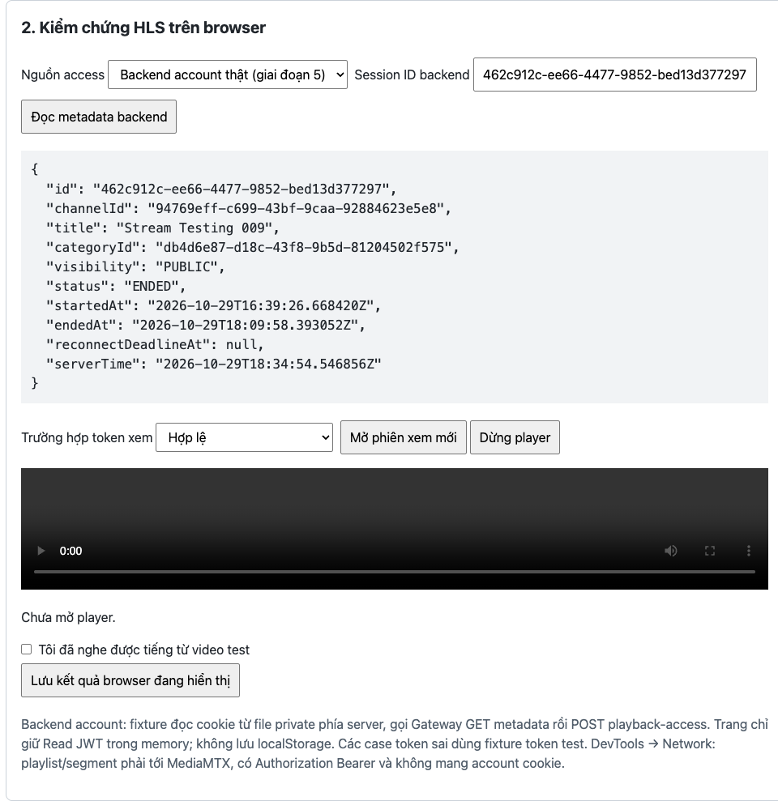

# Streaming MVP — Nghiệm thu Giai đoạn 5

- Ngày kiểm tra ban đầu: 2026-10-29; chốt nghiệm thu: 2026-10-30.
- Phạm vi: STR-501, STR-503, STR-504, STR-505 theo [Phase 5 Implementation Plan](../Implement%20Plan/Streaming%20MVP%20Phase%205%20Implementation%20Plan.md).
- Snapshot kiểm tra ban đầu: HEAD `b299d43` cùng các thay đổi Phase 5 chưa commit trong working tree tại thời điểm kiểm tra.
- Kết luận cuối: **STR-501/503/504/505 và M5 hoàn tất.** Backend/media thật và regression đã đạt; browser được kiểm tra bổ sung và người dùng xác nhận hoàn tất nghiệm thu thủ công ngày 2026-10-30 (mục 8).
- Lần review ban đầu không sửa implementation, không đổi chính sách locking, không điều khiển OBS, không kết thúc session người dùng và không sửa dữ liệu ứng dụng.

## 1. Kết quả kiểm thử tự động

| Kiểm tra | Kết quả | Phạm vi |
|---|---|---|
| `./mvnw clean verify` trong `stream-service` | **164/164 PASS**, 0 failure/error/skipped; BUILD SUCCESS | Domain, migration, security, owner API, lifecycle, metadata, playback access và concurrency PostgreSQL |
| `python3 -m unittest discover -s scripts/testing/streaming -p 'test_*.py' -v` | **23/23 PASS** | Fixture M0 và backend account mode |
| `node --check scripts/testing/streaming/player.js` | **PASS** | Cú pháp JavaScript |
| `git diff --check` | **PASS** | Không có lỗi whitespace trong diff được kiểm tra |

Môi trường: Java 21.0.11, Docker Engine 29.5.3, PostgreSQL 17 Testcontainers, MediaMTX 1.21.2, FFmpeg/ffprobe có sẵn.

Các test mặc định chưa phát hiện hai lỗi fixture/helper ở mục 3. Kết quả PASS của chúng không thay thế kiểm chứng media hoặc browser thật.

## 2. Kiểm chứng bằng account và stream thật

Người dùng cung cấp account và session. Chỉ access cookie được dùng cho Gateway local; không dùng refresh token, không ghi credential vào báo cáo. File cookie tạm đã được xóa sau kiểm tra.

- Session ban đầu `6a942e0f-db2c-4176-a7ba-721f09a5c9ea` đã ENDED: GET trả 200 và metadata ENDED, POST trả **409/code 1009**.
- Session mới `f12a132f-a052-4da8-ab4a-1553f06b7805` được Gateway xác nhận **PUBLIC/LIVE** và dùng cho happy case.

### Hai API qua Gateway

Đã thực hiện **10/10 HTTP case đạt kỳ vọng** qua `http://localhost:8888`, không dùng stub account:

| Trường hợp | GET metadata | POST playback-access |
|---|---|---|
| Thiếu account cookie | 401/code 1001 | 401/code 1001 |
| Session PUBLIC/LIVE, account hợp lệ | 200/code 1000 | 200/code 1000 |
| UUID sai | 400/code 1004 | 400/code 1004 |
| Session không tồn tại | 404/code 1006 | 404/code 1006 |
| Session PUBLIC/ENDED, account hợp lệ | 200/code 1000 | 409/code 1009 |

Metadata không chứa `readToken`, `streamKey`, `playbackUrl` hoặc publish credentials. Response thành công của cả hai API có `Cache-Control: no-store`.

Read JWT lấy từ POST thật được verify bằng public key tương ứng: chữ ký hợp lệ, subject khớp account, TTL **300 giây**, quyền duy nhất `read` tại exact path của session LIVE. Không đưa JWT vào URL hoặc report.

### HLS và media thật

| Kiểm tra | Kết quả |
|---|---|
| Read JWT backend cấp → master playlist | 200 |
| Video/audio rendition playlist, init và segment | 200 |
| Giải mã video | H.264, **1920×1080**, PASS; đã xem frame trích xuất |
| Giải mã audio | AAC, PASS; clip có tín hiệu audio, mean volume -19.1 dB, max volume -6.6 dB |
| Playlist tiếp tục xuất hiện segment mới | PASS |
| Thiếu Read JWT khi mở HLS mới | 401 |
| Sai action, sai path, sai chữ ký, token thử nghiệm đã hết hạn | 401 cho cả bốn case |
| CORS preflight từ `http://localhost:5173` | 204; allow-origin đúng origin, allow-headers `Authorization, Range` |

Helper tải media trực tiếp từ MediaMTX và decode bằng FFmpeg. Đây là bằng chứng HTTP/codec/hình trích xuất, không được ghi thành xác nhận đã phát và nghe tiếng trên browser.

### Expiry

- Đợi đúng TTL 5 phút của **Read JWT backend thật cấp**, giữ session ở LIVE: mở HLS mới bằng JWT đó trả **401**.
- Thử riêng với Read JWT test TTL 4 giây, cùng dev key, liên tục tải playlist của phiên đã mở: sau expiry, playlist hiện tại vẫn **200**, còn mở HLS mới trả **401**. Không thay TTL backend hoặc cấu hình MediaMTX.
- Lượt thử token backend 5 phút có một phiên HLS bị để nhàn rỗi suốt thời gian chờ; request lại phiên đó trả 401. Không dùng lượt nhàn rỗi này để kết luận về một player đang tải liên tục. Kiểm chứng phiên hoạt động là phép thử TTL 4 giây nêu trên.

## 3. Các lỗi cần sửa

### P2 — Kết quả browser backend mode bị lưu vào session fixture cũ — Đã sửa

- Vị trí: [player.js](../../scripts/testing/streaming/player.js), phần tạo `measurement` và gọi `/fixture/observation`; [fixture.py](../../scripts/testing/streaming/fixture.py), phần `fixture_post` ghi `manual-results.jsonl`.
- `measurement` không có session ID hoặc loại access source. Handler observation luôn đọc `sessionId`/`path` từ `fixtures.json` của M0, kể cả khi player vừa lấy access cho một session backend khác.
- Đã tái hiện qua HTTP fixture thật với backend/media stub cô lập: backend cấp access cho session B, bấm lưu số đo browser tương đương lại tạo record mang session A của fixture; record vẫn được chấp nhận khi source của A không tồn tại.
- Ảnh hưởng: bằng chứng hình/tiếng của backend session không thể được đối chiếu đúng; có thể lẫn với nghiệm thu M0. Chưa đủ điều kiện dùng bản ghi này để chốt STR-505.
- Cách sửa: ràng buộc observation với session/access source đang được xem, dùng đúng path/source khi lưu, và giữ tương thích dữ liệu M0. Bổ sung regression với hai session ID khác nhau.

### P2 — Backend client tự theo redirect và chuyển tiếp account cookie sang origin khác — Đã sửa

- Vị trí: [backend_access.py](../../scripts/testing/streaming/backend_access.py), `BackendClient._request`, khoảng dòng 113–118.
- Cookie được đặt vào request header rồi gửi bằng `urlopen` mặc định. Nếu Gateway trả 302 sang origin khác, redirect handler tiếp tục gửi header Cookie sang đích đó.
- Đã tái hiện bằng hai HTTP server loopback khác port: server đóng vai Gateway redirect sang server thứ hai; server thứ hai nhận được cookie đánh dấu. **Chỉ dùng cookie giả, không gửi account cookie thật ra origin khác.**
- Ảnh hưởng: trái với contract helper chỉ gửi account cookie tới Gateway đã cấu hình; có nguy cơ lộ credential khi có redirect ngoài origin.
- Cách sửa: dùng opener từ chối redirect như mẫu helper provisioning hiện có; trả lỗi an toàn thay vì gửi credential tiếp. Bổ sung regression cross-origin redirect cho backend client.

Hai lỗi trên thuộc fixture/helper; chưa phát hiện lỗi chặn happy case trong hai API Java sau các kiểm tra đã thực hiện. Khóa bi quan hiện tại phù hợp contract đang được triển khai; đề xuất tối ưu bỏ khóa là thay đổi thiết kế riêng, không được tự áp dụng trong lần nghiệm thu này.

## 4. Giới hạn ban đầu và điều kiện chốt M5

Tại lần review ban đầu ngày 2026-10-29, công cụ browser/native không kết nối được browser host, chưa có xác nhận hình/tiếng trên player và không điều khiển/ngắt OBS. Kết quả bổ sung, nguồn xác nhận thủ công và quyết định chốt M5 nằm ở mục 8.

Để chốt STR-505/M5:

1. Hai lỗi fixture/helper ở mục 3 đã được sửa và chạy regression theo mục 6.
2. Chạy fixture backend mode ở origin đã allowlist, dùng account thật và session LIVE.
3. Xác nhận hình/tiếng trên Chrome/Edge; lưu observation gắn đúng session.
4. Kiểm tra browser Network: playlist/segment trực tiếp tới MediaMTX, Read JWT trong Authorization, không có account cookie hoặc JWT trong URL.
5. Đối chiếu metadata khi reconnect/End theo lifecycle đã có, ghi rõ phần do người dùng thực hiện và phần kiểm thử tự động.

Không đánh dấu M5 hoàn tất chỉ dựa trên bộ 164 Java test, 23 Python test hoặc clip giải mã từ helper.

## 5. Artifact kiểm chứng

Artifact local được giữ trong thư mục đã được Git ignore:

```text
.local/streaming/phase5-acceptance-2026-10-29/
  maven-summary.json
  python-tests.log
  live-api-audit.json
  hls-active-expiry.json
  fixture-findings.json
  reproduce_fixture_findings.py
  media-active/report.json
  media-active/sample-frame.jpg
  media-active/sample.mp4
```

Chạy lại hai repro bằng `python3 .local/streaming/phase5-acceptance-2026-10-29/reproduce_fixture_findings.py` từ root repository. Repro chỉ dùng server/stub loopback và dữ liệu tạm, không cần account thật hoặc OBS.

Artifact không có account cookie, refresh token, Read JWT hoặc private key. Các mã session giả trong repro không phải session người dùng.

## 6. Sửa hai lỗi fixture/helper (2026-10-29)

- Player gắn `accessSource` và `sessionId` từ access thực tế đã nhận vào measurement, nên đổi ô nhập/mode sau khi mở video không làm đổi session của bằng chứng.
- Fixture lưu đúng path/source của session backend, chỉ nhận browser observation backend cho session đã được fixture cấp access. Browser observation thiếu context bị từ chối khi backend mode bật. Fixture M0 cũ vẫn dùng được khi không bật backend mode; observation có context fixture cũng được kiểm tra session tương ứng.
- Backend client dùng opener từ chối mọi redirect. Redirect trả lỗi 502 an toàn, không theo Location, không chuyển tiếp cookie và không đưa Location vào thông báo lỗi.
- Regression Python: **29/29 PASS**, gồm GET/POST redirect 301/302/303/307/308, redirect cùng origin, backend/legacy session khác nhau, đúng media source, observation thiếu/sai context và tương thích M0.
- Regression player: **2/2 PASS** bằng Node VM, xác nhận session được gắn với access đã nhận, kể cả khi đổi ô nhập/mode trước khi lưu. Đây là unit test, không thay xác nhận browser thật.
- `node --check scripts/testing/streaming/player.js` và `git diff --check`: PASS.

Lệnh chạy lại từ root:

```sh
python3 -m unittest discover -s scripts/testing/streaming -p 'test_*.py' -v
node --test scripts/testing/streaming/test_player.mjs
node --check scripts/testing/streaming/player.js
```

Không sửa Java/backend locking hoặc điều khiển OBS trong đợt fix này. Không chạy lại Maven vì không thay Java/config backend. Chưa đánh dấu STR-505/M5 hoàn tất; các bước browser/Network/reconnect trong mục 4 vẫn cần được thực hiện.

## 7. Bổ sung sửa OBS observation và acceptance theo session (2026-10-29)

Người dùng chỉ ra bản sửa mục 6 mới hoàn thiện đường ghi browser: OBS observation và acceptance vẫn dùng session M0. Đã sửa tiếp toàn bộ đường ghi/đọc context:

- OBS observation backend có `sessionId`, `accessSource` và status backend đã đối chiếu; media/path/source được đọc cho đúng session backend, không dùng session A trong `fixtures.json`. Có thể ghi nhận OBS publish trước khi mở player mà không phải xin Read JWT.
- `/fixture/status` và `/fixture/acceptance` nhận context backend/session được chọn. Thiếu hoặc sai context bị từ chối, không fallback về M0. UI gửi cùng context và bỏ response đến muộn sau khi đổi lựa chọn.
- Acceptance backend chỉ đọc evidence đúng session và `accessSource=backend`; tách khỏi các task STR-004/005/006 của M0 và không phụ thuộc callback file M0, vì callback backend thuộc Stream Service. CLI có `--access-source backend --session-id UUID`.
- Acceptance M0 vẫn đọc session fixture cũ nhưng loại record backend, kể cả khi trùng session ID. Các record cũ không có đủ context không được tự chuyển sang session B.
- Tắt nút path/key M0 trong backend mode; kết thúc session backend vẫn dùng End API hiện có.
- Regression cuối: **40/40 Python test PASS**, **5/5 player unit test PASS**, `node --check player.js` và `git diff --check` PASS.
- Có test HTTP xuyên suốt ghi browser/OBS publish/reconnect/End của B rồi gọi acceptance B; B có đủ evidence, A không được hưởng bằng chứng của B. Các test khác giữ compatibility M0 và kiểm tra context thiếu/sai, đổi input/mode, media source và callback file tách biệt.

Đây vẫn là regression với stub và unit harness; không thay thế bước xem/nghe trên Chrome/Edge thật. STR-505/M5 tiếp tục chờ xác nhận browser. Lỗi redirect đã sửa ở mục 6 và các regression redirect vẫn PASS.

## 8. Browser và xác nhận nghiệm thu cuối (2026-10-30)

- Session `462c912c-ee66-4477-9852-bed13d377297` được kiểm tra qua Gateway với account thật: PUBLIC/LIVE. Fixture metadata và playback-access trả 200; HLS master trả 200; preflight trả 204 cho origin `http://localhost:5173`.
- Đã chạy Chrome headless với profile tạm riêng, truy cập đúng player fixture, lấy Read JWT qua backend và tải playlist/init/segment. Quan sát sau khoảng 10 giây: video giải mã 182 frame, thời gian phát khoảng 3,17 giây. Browser test này không ghi xác nhận nghe tiếng thay người dùng.
- Cùng Chrome cô lập, mở fixture bằng `http://127.0.0.1:5173` tái hiện đúng `networkError/manifestLoadError; HTTP —`: preflight bị `PreflightMissingAllowOriginHeader`. Hai hostname là hai origin khác nhau; sử dụng `http://localhost:5173` đúng allowlist. Fixture đã sửa URL in ra terminal để hướng dẫn đúng hostname, không nới CORS hoặc khởi động lại media giữa buổi phát.
- Người dùng gửi ảnh player phát thực tế: 111.483 frame, 2.118,0 giây, 1.519 playlist và 3.288 fragment; sau đó xác nhận “Mọi thứ của giai đoạn 5 này đã ok” sau hướng dẫn các case API/media âm tính, expiry và hết grace reconnect.
- Nguồn chốt phần thủ công là xác nhận trực tiếp của người dùng. Các HTTP case và số đo tự động được ghi riêng ở mục 1–2; các regression fixture ở mục 6–7. Không tạo thêm observation hoặc số đo cho các thao tác do người dùng thực hiện.
- **STR-505/M5 hoàn tất**; frontend watch/player production tiếp tục thuộc giai đoạn 6. Quy trình chạy lại nằm trong [Phase 5 Test Plan](Streaming%20MVP%20Phase%205%20Test%20Plan.md).
- Chạy lại trước PR ngày 2026-10-30: `stream-service clean verify` đạt **164/164**, không failure/error/skipped; **40/40 Python**, **5/5 player unit test**, JavaScript syntax và diff whitespace đều PASS.

Ảnh giao diện backend mode để review thay đổi fixture, chụp sau khi session đã ENDED; đây là minh họa UI, không thay bằng chứng playback phía trên:


