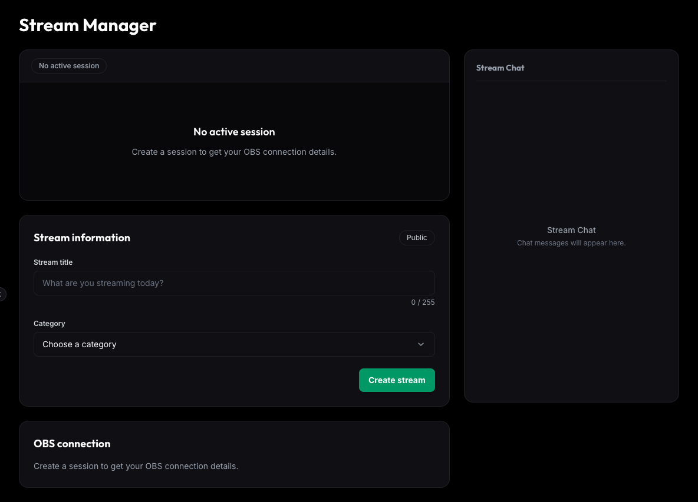

# Streaming MVP — Nghiệm thu giai đoạn 6A

- Ngày đánh giá: 2026-10-30.
- Phạm vi: Stream Manager và preview cho owner theo phạm vi đã chốt. Phần Stream Chat trên UI hiện chỉ là placeholder, chưa tích hợp chat service. Watch cho viewer, discovery/browse, chat, viewer count và donate chưa nằm trong đợt này.
- Kết luận hiện tại: **Đã sửa F6A-01 và F6A-02**, có regression test và kiểm chứng Chrome với API giả lập lỗi. Chưa chốt nghiệm thu đầy đủ 6A vì OBS/audio thủ công vẫn cần xác nhận. M6 tiếp tục để mở.
- Các mục 1–3 lưu bằng chứng review ban đầu; mục 6 ghi bản sửa và kết quả kiểm tra lại.

## 1. Lỗi đã tái hiện tại thời điểm review ban đầu

### F6A-01 — P2: Form quay về title cũ sau khi PATCH thành công nhưng GET metadata lỗi

**Vị trí:** [useStreamManager.ts](../../web-app/src/hooks/useStreamManager.ts), phương thức `update`; [StreamInfoForm.tsx](../../web-app/src/components/stream/StreamInfoForm.tsx), reset form theo `initial` và sau submit.

**Cách tái hiện:**

1. Session có title `Morning`.
2. Sửa thành `Saved title`, bấm Save changes.
3. PATCH trả thành công và backend đã lưu title mới.
4. GET metadata ngay sau PATCH lỗi mạng/503.

**Thực tế:** UI báo `Stream information updated`, nhưng input quay về `Morning`. Test kỳ vọng giữ `Saved title` bị lỗi, nhận được `Morning`.

**Nguyên nhân:** Hook bỏ response PATCH; `refreshMetadata` trả null khi GET thất bại nhưng operation vẫn trả true. Form được reset rồi effect lại nạp metadata cũ.

**Ảnh hưởng:** UI hiển thị thông tin cũ trong lúc mất kết nối, dù backend đã lưu thành công; trạng thái form và thông báo không nhất quán. Khi polling thành công trở lại mới có thể tự đồng bộ.

**Hướng sửa:** Đồng bộ các field title/category từ kết quả PATCH, giữ lifecycle mới nhất; GET refetch thất bại không được làm form quay về bản cũ. Thêm regression test cho trường hợp PATCH thành công/GET thất bại.

### F6A-02 — P3: Dialog Cancel/End không đóng khi polling xác nhận ENDED

**Vị trí:** [useStreamManager.ts](../../web-app/src/hooks/useStreamManager.ts), effect ENDED; [StreamerDashboardPage.tsx](../../web-app/src/pages/dashboard/StreamerDashboardPage.tsx), render theo state `dialog`.

**Cách tái hiện:**

1. Mở hộp thoại Cancel/End.
2. Chưa xác nhận; session kết thúc qua deadline hoặc một tab khác.
3. GET metadata trả ENDED.

**Thực tế:** Preview và trang bên dưới nhận ENDED, nhưng dialog vẫn mở với thao tác End. Test kỳ vọng dialog biến mất bị lỗi vì vẫn có phần tử dialog.

**Ảnh hưởng:** Hộp thoại hiển thị hành động không còn phù hợp và tiếp tục giữ focus trên một session đã kết thúc. Không gây hồi sinh session ở backend.

**Hướng sửa:** Đồng bộ dialog với trạng thái terminal; đóng dialog khi metadata xác nhận ENDED và kiểm thử cả trường hợp kết thúc từ tab khác/deadline.

## 2. Kết quả kiểm tra trước khi sửa

| Kiểm tra | Kết quả |
|---|---|
| `npm run build` | PASS; còn cảnh báo bundle lớn hơn 500 kB |
| `npm run lint` | PASS |
| `npm run test:streaming` hiện có | 13/13 PASS |
| Hai case nghiệm thu bổ sung | 2/2 tái hiện lỗi F6A-01 và F6A-02 |
| `npm test` | 34/38 PASS; 4 lỗi category-preferences đã có trước thay đổi |
| Browser desktop 1440 × 1000 | Nội dung và form tải đúng với account/backend thật |
| Browser viewport 390 × 844 | Không tràn ngang: document width 390; vùng nội dung cuộn được |
| OBS thật / nghe audio thủ công | Chưa thực hiện trong lần nghiệm thu này |

Hai case review ban đầu có log trong `.local/streaming/phase6-acceptance`. Sau bản sửa, các tình huống này đã được đưa vào bộ test chính thức `web-app/tests/streaming/dashboard.test.tsx`; chạy `npm run test:streaming` để kiểm tra lại.

## 3. Luồng đã chạy lại trên backend/media thật

Dùng Chrome headless, account thật, Gateway, Stream Service, Channel Service và MediaMTX thật; nguồn thử nghiệm FFmpeg H.264/AAC. Đây là kiểm chứng tích hợp media, không thay thế thao tác OBS và xác nhận nghe tiếng của người dùng.

Session test `eda64f15-2060-4fdd-8f09-44b547bc5894`:

1. Tạo từ form dashboard: READY, credential OBS hiển thị và key mặc định được che.
2. Phát nguồn thử nghiệm: LIVE; preview giải mã được video, ghi nhận 28 frame.
3. Network có master/playlist/segment thành công; request mở HLS có Bearer, loader dùng credentials omit và không quan sát thấy account cookie ở request media.
4. Sửa title bằng UI, backend lưu thành công.
5. Reload dashboard: preview mở lại; credential không tự khôi phục từ storage.
6. Ngắt nguồn: RECONNECTING; phát lại trước deadline: LIVE và preview phát lại.
7. End từ UI: ENDED; dọn nguồn thử nghiệm và gọi cleanup nhận HTTP 200.

Tài khoản test không còn active session sau khi dọn. Không ghi token/key/cookie vào báo cáo.

Kiểm chứng timeout reconnect và từ chối key cũ bằng FFmpeg đã có ở lần triển khai trước, được ghi trong [test plan 6A](Streaming%20MVP%20Phase%206A%20Test%20Plan.md). Lần đánh giá này chạy lại nhánh reconnect trước deadline và End chủ động.

## 4. Điều kiện để chốt

- [x] Sửa F6A-01/F6A-02 và đưa regression test vào bộ sản phẩm.
- [x] Giữ 13 test cũ đạt và bổ sung 11 case hồi quy; tổng cộng 24 test streaming đạt.
- Thực hiện checklist OBS thật, nghe tiếng, autoplay/quyền browser theo test plan. Chưa xem Chrome headless với autoplay override là bằng chứng đầy đủ cho các mục đó.
- Ghi rõ 4 test category-preferences là baseline riêng; không tuyên bố toàn bộ regression đã xanh.
- Không đóng M6 trước khi phần viewer của giai đoạn 6 được triển khai và nghiệm thu theo phạm vi tiếp theo.

## 5. Ảnh giao diện cho review

Ảnh dưới đây chụp UI hiện tại ở trạng thái No active session bằng dữ liệu minh họa trong browser; không phải bằng chứng playback hoặc xác thực backend. Stream Chat chỉ là placeholder. Ảnh không chứa cookie, JWT hoặc stream key.

## 6. Bản sửa F6A-01/F6A-02

### F6A-01 — Đã sửa

- Sau PATCH thành công, lấy title/category đã được backend xác nhận và cập nhật đúng các field đã gửi trong cả cache metadata và current session.
- Hủy GET metadata đang chạy của đúng session trước khi áp dụng kết quả, tránh response cũ ghi đè dữ liệu đã lưu.
- Giữ nguyên lifecycle, serverTime và dataUpdatedAt khi chỉ cập nhật thông tin; không reset duration/countdown. Snapshot mới hơn response PATCH được giữ lại.
- GET sau PATCH thất bại vẫn giữ thông tin đã lưu và hiển thị cảnh báo cập nhật trạng thái. PATCH thất bại giữ draft và không báo thành công.
- Response đến muộn sau ENDED, đổi session hoặc unmount bị bỏ qua; helper operation trả false để form không reset sai.

### F6A-02 — Đã sửa

- ENDED xóa credential và reset state dialog. Dialog chỉ render khi session còn hoạt động.
- Polling xác nhận kết thúc không gửi thêm End request. Tạo phiên tiếp theo không làm dialog cũ hiện lại.
- Lỗi mạng/503 khi chưa xác nhận kết thúc không tự đóng dialog. Kết quả End đến sau khi polling đã nhận ENDED không mở dialog lại.

### Kiểm chứng bản sửa

- Hai case chính đã chạy thất bại trên code trước sửa: form nhận `Morning` thay vì `Saved title`; dialog vẫn tồn tại sau ENDED.
- Sau sửa: `npm run test:streaming` đạt **24/24** (13 test cũ và 11 case mới), bao phủ PATCH/GET thất bại, poll cũ, snapshot mới hơn, clock lifecycle, response đến muộn và dialog terminal state.
- Chrome headless trên UI React thật với Axios adapter giả lập: PATCH thành công rồi metadata 503 giữ title mới, có cảnh báo GET; mở Cancel dialog rồi metadata ENDED đóng dialog, số End request phát sinh là 0. Đây là kiểm chứng UI với lỗi giả lập, không phải một lượt OBS/backend/media thật mới.
- Build/lint đạt. `npm test` vẫn 34/38, đúng 4 lỗi category-preferences đã có trước bản sửa.
- Chưa thay đổi kết luận về OBS/audio thủ công hoặc phạm vi viewer/M6.
